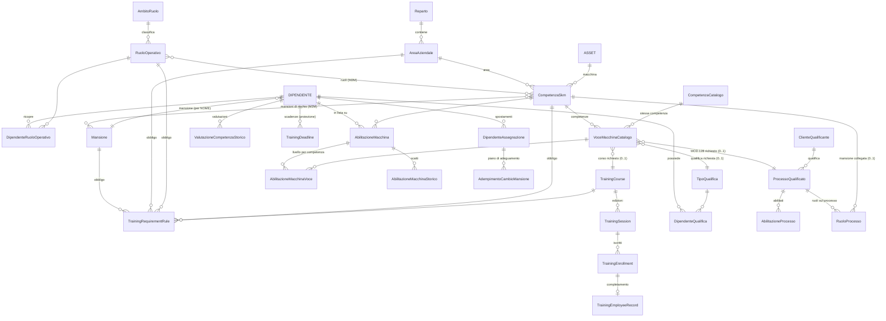
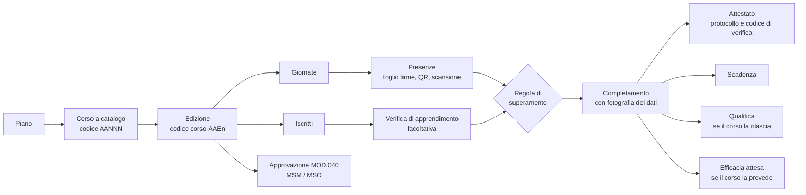

# 01 — AS-IS e tracciabilità dei requisiti

**Analisi di fattibilità: Ruoli → Mansioni → Competenze → Formazione (NOVICROM HUB, app `anagrafica`)**
Versione 0.2 · 21/11/2026 · Fase 1 (ricognizione), con lo studio del modulo Formazione (§11) e le risposte tecniche del
proprietario (§9.2). Stato: GATE 1 riaperto, in attesa di conferma.

> **Natura del documento.** Sola analisi: nessun codice, modello, migrazione o dato è stato modificato.
> Tutte le proposte che toccano contenuti, relazioni o sotto-domini HR sono **proposte**: la decisione finale è
> del proprietario del progetto.
>
> **Riferimento del codice.** Ramo `main`, commit `784cbf3ae` (21/11/2026). I percorsi sono relativi a
> `django_app/anagrafica/` salvo diversa indicazione; la forma è `file.py:riga`.
>
> **Riferimento dei dati.** Conteggi letti dal database di **produzione in sola lettura** (profilo
> `config.settings.prod_readonly`, utenza `db_datareader`) il 21/11/2026. Solo numeri, nessun nominativo.

---

## 0. Sintesi

1. La richiesta della Qualità (Specifica v2 + bozza MOD.053) introduce **due eventi formali** che oggi non esistono:
   la **Sessione Formativa (SF)**, unico atto che modifica le competenze, e la **Richiesta di Aggiornamento
   Mansione (RAM)**, unico atto che assegna una mansione.
2. Il **modello dati è in gran parte pronto**: ruoli, mansioni lavorative, competenze per mansione con livello minimo
   e criticità, livelli I/L/U/O per persona, storici, mansioni di rischio, MOD.128, formazione.
3. Il **motore dei requisiti di sicurezza** (formazione obbligatoria, visite, DPI) è già unico, spiegabile
   («origine» di ogni requisito) e ricalcolato ogni notte e a ogni salvataggio. Due «fatti noti» della missione
   sono quindi **superati** (§2.3).
4. Manca il **flusso**: oggi mansione e livello si assegnano e si cambiano **direttamente**, senza richiesta, senza
   evidenza P/A/C, senza approvazione RDD/MSO, senza numerazione.
5. Manca l'**algoritmo «mansioni potenziali»**: il confronto competenze richieste/possedute esiste solo per le
   mansioni già assegnate.
6. Il vero ostacolo non è il codice ma i **contenuti**: in produzione ci sono 242 mansioni lavorative e
   **nessuna competenza definita**, **nessuna regola di obbligo formativo**, 56 persone su 135 senza mansione in lista.
   Il motore oggi gira «a vuoto».
7. I livelli in produzione sono tutti **dichiarati a mano** (import del MOD.187): 203 abilitazioni su 443 sono al
   livello massimo «O». Va chiarito con la Qualità che cosa significhi.
8. I due documenti della Qualità **si contraddicono** su un punto centrale: la mansione entra in skill matrix a
   livello «I» *prima* della formazione (MOD.053) oppure *dopo* l'approvazione della RAM (Specifica v2)?
9. La scala dei livelli ha **tre vocabolari** diversi (codice, MOD.053, esempio numerico del MOD.053).
10. Esistono **tre posti diversi** per dire «questa mansione richiede questo corso» e **tre letture diverse** di
    «corso mancante». Sono le divergenze da chiudere nel TO-BE.
11. La **selezione candidati** ai corsi è l'unico motore che ancora espande le regole per conto suo.
12. Il **cambio mansione** oggi governa solo la sicurezza (visite, formazione, DPI, schede di sicurezza), non le
    competenze.
13. La fattibilità tecnica è **alta**: si tratta di aggiungere due oggetti di flusso e un calcolo sopra un modello
    esistente, non di riscrivere.
14. La fattibilità organizzativa dipende dal **popolamento del catalogo** (competenze per mansione, livelli minimi,
    criticità) da parte della Qualità e dei responsabili.
15. Le domande aperte sono 17 per la Qualità (§9.1); le 9 tecniche hanno avuto risposta (§9.2).
16. Il **modulo Formazione** è completo come funzioni ma in produzione è soprattutto un **archivio storico importato**:
    595 corsi su 774 hanno una sola edizione, nessuna verifica di apprendimento registrata, nessuna valutazione di
    efficacia, nessuna approvazione MOD.040 (§11).

---

## 1. Requisiti della Qualità (fonti primarie)

Fonti: `input/Specifica_Funzionale_Piattaforma_Formazione_Skill_Matrix_v2.md` (nel seguito **SPEC**) e
`input/MOD.053 BOZZA.md` (**M053**). Ogni requisito cita la sezione o la riga del documento.

| ID | Requisito | Fonte |
| --- | --- | --- |
| REQ-01 | Catalogo Competenze: elenco standard delle competenze valutabili, con ID stabile | SPEC §1 |
| REQ-02 | Catalogo Corsi con ID stabile (es. CRS-014); ogni corso indica quali competenze può alimentare; creato una sola volta | SPEC §1, §5 |
| REQ-03 | Sessione Formativa `SF-AAAA-NNNN`: persone, competenze, causale, responsabile/tutor, evidenze, valutazione, chiusura | SPEC §1, §3 |
| REQ-04 | Richiesta Aggiornamento Mansione `RAM-AAAA-NNNN`: persona, mansione, richiedente, motivazione, approvatore | SPEC §1, §6 |
| REQ-05 | Una SF può alimentare più competenze e più persone | SPEC §2 |
| REQ-06 | Una RAM si collega a 0..N SF, anche precedenti; il collegamento RAM ↔ SF resta tracciato | SPEC §2, §9 |
| REQ-07 | Una SF può esistere senza RAM (aggiornamento normativo, crescita professionale) | SPEC §2, §7 caso 4 |
| REQ-08 | Una RAM si chiude senza nuova SF se le competenze sono già possedute («regola decisiva») | SPEC §2, §9 |
| REQ-09 | P/A/C sono **modalità**, non livelli: P esperienza/pregressa, A affiancamento, C corso; registrazione minima per ciascuna | SPEC §4, M053 r.31 |
| REQ-10 | P/A/C sono eventi multipli e storicizzati sulla stessa competenza; nessuna sovrascrittura dello storico | SPEC §4, §9 |
| REQ-11 | Il livello corrente deriva dall'**ultima valutazione valida**, non dalla modalità | SPEC §4 |
| REQ-12 | La competenza si aggiorna **solo** tramite una SF chiusa e valutata | SPEC §9, §10 |
| REQ-13 | La mansione si aggiunge **solo** tramite una RAM approvata | SPEC §9, §10 |
| REQ-14 | Competenza soddisfatta ≠ mansione assegnata; nessuna assegnazione automatica | SPEC §5, §7, §9 |
| REQ-15 | Confronto automatico fra competenze richieste dalla mansione e competenze possedute; proposta delle mancanti dal catalogo | SPEC §6, §9 |
| REQ-16 | Segnalazione delle **mansioni potenziali** (requisiti soddisfatti o parzialmente soddisfatti) senza assegnarle | SPEC §7, §8, §9 |
| REQ-17 | Le qualifiche obbligatorie o a scadenza continuano a richiedere le evidenze specifiche | SPEC §9 |
| REQ-18 | Vista «Profilo persona»: ruolo, reparto, mansioni, competenze, livelli, qualifiche, evidenze P/A/C | SPEC §8 |
| REQ-19 | Cruscotto Responsabile: SF aperte, competenze da valutare, RAM da proporre, persone potenzialmente idonee | SPEC §8 |
| REQ-20 | Cruscotto RDD: chiusure e assegnazioni mansione da approvare | SPEC §8 |
| REQ-21 | MOD.053 dinamico: output sempre aggiornato e stampabile dello storico della persona (report, non evento) | SPEC §1, §8 |
| REQ-22 | Skill Matrix = solo stato corrente delle mansioni formalmente assegnate e relativi livelli | SPEC §8, §10 |
| REQ-23 | MOD.040 = registro operativo allegato agli eventi A (affiancamento) | SPEC §1, §4 |
| REQ-24 | All'assunzione: ruolo e reparto compilati in automatico, mansione scelta da catalogo; la persona entra in SKM e le mansioni si popolano a livello «I – Principiante» (no firma OP) | M053 r.23-27 |
| REQ-25 | Competenze richieste e modalità compilate in automatico dalla mansione; livello raggiunto compilato dal responsabile; «responsabile giudizio» compilato in automatico | M053 r.31-41 |
| REQ-26 | Se il livello minimo richiesto non è raggiunto, la formazione non si può chiudere con esito POS | M053 r.36, r.81 |
| REQ-27 | Firme: responsabile del giudizio; esito finale RDD (assunzione); approvatore RDD e esito finale MSO (aggiornamento mansione); richiedente | M053 r.40-62, r.90 |
| REQ-28 | Consegna timbro e matricola assegnata con l'esito finale dell'assunzione | M053 r.49-54 |
| REQ-29 | Richiesta di formazione aggiuntiva: da catalogo mansioni/competenze più testo libero, con firma del richiedente | M053 r.45-47 |
| REQ-30 | Verifica di efficacia = aggiornamento periodico della SKM (conferma dei livelli) da parte del responsabile, **tracciato a sistema** | M053 r.95-97 |
| REQ-31 | Riepilogo in due elenchi separati: mansioni (dalla più recente) e competenze, con lo storico di tutte le valutazioni (data, competenza, modalità, evidenza, livello) | M053 r.99-131 |
| REQ-32 | Due livelli distinti: «livello C» (competenza) e «livello M» (mansione) | M053 r.31, r.105 |
| REQ-33 | Numerazione progressiva annuale di SF e RAM | SPEC §1 |
| REQ-34 | Titolo di studio, se requisito obbligatorio, gestito fra le abilitazioni di mansione | M053 r.9 |

Punti che M053 lascia aperti con «(?)»: indirizzo, titolo di studio, precedente occupazione, inquadramento/livello
all'assunzione, richiesta di formazione aggiuntiva, forma del tracciamento («es. report??»). Sono riportati fra le
domande per la Qualità (§8).

---

## 2. Mappa del dominio attuale

### 2.1 Vocabolario: i nomi nel codice non coincidono con quelli della Qualità

| Concetto della Qualità | Nome nel codice | Dove |
| --- | --- | --- |
| Ruolo | `RuoloOperativo` (catalogo unico; ha assorbito `RuoloAziendale`) | `models.py:396`, `models.py:1149` |
| Ambito del ruolo (produttivo, 45001, 27001…) | `AmbitoRuolo` | `models.py:339` |
| Ruolo della persona | `DipendenteRuoloOperativo` (principale / secondario / ad interim, con date) | `models.py:513` |
| Reparto / Area | `Reparto`, `AreaAziendale` (il «reparto» del file Qualità è un'**area**) | `models.py:1014`, `models.py:1087` |
| **Mansione lavorativa** | **`CompetenzaSkm`** (colonna della skill matrix: macchina o processo) | `models_skillmatrix.py:142` |
| **Competenza** | **`VoceMacchinaCatalogo`** (voce di una mansione: livello minimo, bloccante, requisiti formali) | `models_skillmatrix.py:491` |
| Catalogo competenze | `CompetenzaCatalogo` (la stessa competenza su più mansioni) | `models_skillmatrix.py:464` |
| Mansione assegnata + livello M | `AbilitazioneMacchina` (`in_lista`, `livello`, `stato`) | `models_skillmatrix.py:324` |
| Livello C della persona | `AbilitazioneMacchinaVoce` | `models_skillmatrix.py:546` |
| Storico valutazioni | `ValutazioneCompetenzaStorico`, `AbilitazioneMacchinaStorico` | `models_skillmatrix.py:568`, `:594` |
| **Mansione di rischio** (DVR) | `Mansione` | `models.py:637` |
| Corso / edizione | `TrainingCourse` / `TrainingSession` | `models_formazione.py:292`, `:962` |
| Regola d'obbligo | `TrainingRequirementRule` | `models_formazione.py:640` |
| Attestato / completamento | `TrainingEmployeeRecord`, `TrainingCertificate` | `models_formazione.py:1422`, `:1876` |
| Scadenza formazione | `TrainingDeadline` (proiezione) | `models_formazione.py:1908` |
| Qualifica / patentino | `TipoQualifica`, `DipendenteQualifica` | `models.py:725`, `:806` |
| Processo qualificato MOD.128 | `ProcessoQualificato`, `AbilitazioneProcesso` | `models_mpq.py:123`, `:421` |

Attenzione: `CompetenzaSkm` **non** è una competenza ma una mansione, e `AbilitazioneMacchina` vale anche per i
processi senza macchina (`models_skillmatrix.py:325-330`). È debito di nomenclatura: ogni lettura del codice e ogni
colloquio con la Qualità rischia l'equivoco.

### 2.2 Diagramma entità-relazioni (AS-IS)

`DIPENDENTE` non è una tabella Django: è la riga della tabella legacy `anagrafica_dipendenti`, a cui tutti i
modelli si agganciano con l'intero `legacy_anagrafica_id` **senza chiave esterna** (`models_skillmatrix.py:8-9`,
`models_mpq.py:9-10`). Le anagrafiche doppie si riconducono all'id principale a livello di servizio
(`services/requisiti.py:22-23`).

### 2.3 Fatti noti della missione: verifica

| Fatto dichiarato nella missione | Esito | Evidenza |
| --- | --- | --- |
| Notazione I/L/U/O (MT CN 06 §8.3) | ✅ confermato | `models_skillmatrix.py:28-46` |
| Il CAR è l'unico che approva il merito | 🟡 confermato come **principio**, non come vincolo: l'accesso è dato dal permesso `anagrafica.skillmatrix.manage`, senza verifica che il reparto sia quello dell'utente | `models_skillmatrix.py:739`, `views/qualifiche.py:1753-1769`, `views_mansionario.py:47-54` |
| Abilitazione macchina ancorata a `assets.Asset` | ✅ confermato, ed **esteso** ai processi senza asset | `models_skillmatrix.py:340-349` |
| Dipendenti identificati con `legacy_anagrafica_id` | ✅ confermato | `models_skillmatrix.py:339` |
| MOD.128 in `models_mpq.py`, `ClienteQualificante` con 4 tipi e self-FK | ✅ confermato | `models_mpq.py:85-107` |
| `timbro` FK nullable per i processi ORGANIZZATIVO | ❌ **non trovato**: esiste la modalità `ORGANIZZATIVO` del personale, non un FK `timbro` nei modelli MOD.128 | `models_mpq.py:159-162`, `:228-232` |
| `TrainingDeadline` è una cache non affidabile, con refresh manuale e non schedulato | ❌ **superato**: è ricostruita dal motore unico ogni notte e a ogni salvataggio | `services/scadenze.py:49-109`, `:217-241`, `segnali_scadenze.py:1-25`, `django_app/automazioni/schedules.py:598-608` |
| L'espansione delle regole per mansione/area/ruolo è incompleta | ❌ **superato** nel motore unico; resta vero per la selezione candidati | `services/requisiti.py:199-275`, `services/training_eligibility.py:88-172` |
| L'espansione diverge dal motore di selezione candidati | ✅ confermato (§3.2) | — |
| `views.py` è monolitico | 🟡 **superato in parte**: è un pacchetto `views/`, ma `formazione.py` ha 5.877 righe e `dipendenti.py` 6.395 | `views/` |
| Stati non formalizzati in un'unica FSM | ✅ confermato: gli stati sono liste di scelte su più modelli, le transizioni sono nelle viste | `models_formazione.py:965-969`, `:1212-1218` |
| ACL v2: fusione RuoloAziendale/RuoloOperativo in corso | 🟡 la fusione dei cataloghi è **fatta**; resta il campo testuale `ruolo_aziendale` sulla scheda | `models.py:397-401`, `models.py:1388` |
| Mansioni di rischio distinte dalle mansioni lavorative | ✅ **già realizzato** | `models.py:685-697`, `models_skillmatrix.py:203-206` |

### 2.4 Stati esistenti (non unificati)

| Oggetto | Stati | Dove |
| --- | --- | --- |
| Abilitazione su mansione | attiva / sospesa; in lista sì/no | `models_skillmatrix.py:332-354` |
| Esito sulla mansione (calcolato) | abilitato / in addestramento / non abilitato | `services/mansionario_competenze.py:46-49` |
| Edizione di un corso | pianificata / in corso / completata / annullata (+ approvata MOD.040) | `models_formazione.py:965-969`, `:1011-1025` |
| Iscrizione | iscritto / in corso / completato / non idoneo / assente / ritirato | `models_formazione.py:1212-1218` |
| Scadenza formazione | valido / in scadenza 30 / in scadenza 90 / scaduto / mai frequentato / una tantum | `models_formazione.py:1917-1923` |
| Spostamento organizzativo | programmata / in corso / conclusa (calcolato) | `models.py:2208-2210` |
| Adempimento cambio mansione | da fare / fatto / non necessario / non più dovuto / annullato | `models.py:2410-2421` |
| Stato operativo (calcolato) | ok / avviso / deroga / non idoneo a operare | `services/stato_operativo.py:32-35` |
| Campagna di refresh | aperta / chiusa | `models_skillmatrix.py:741-746` |
| Continuità operativa (calcolato) | mantenuta / in scadenza / persa / n.a. | `models_skillmatrix.py:682-685` |

---

## 3. Motori di calcolo esistenti

### 3.1 Inventario: ogni punto che decide «chi deve fare cosa»

| # | Motore | Risponde a | Input | Output | Trigger |
| --- | --- | --- | --- | --- | --- |
| M1 | `services/requisiti.py` (motore unico sicurezza) | Quali corsi e visite sono dovuti, e in che stato sono oggi? | Mansione di rischio (per nome), area, ruoli in essere, mansioni lavorative in lista, MOD.128, regole in vigore, protocollo sanitario | Voci con origine, stato alla data, scadenza | A richiesta |
| M2 | `services/scadenze.py` | Riscrive i dati salvati dal motore M1 | Esito di M1 | `TrainingDeadline`, `VisitaMedica.data_scadenza` | Notte 00:20 e dopo ogni salvataggio |
| M3 | `services/mansionario.py` | Requisiti di una mansione di rischio e di una persona | `Mansione`, fattori di rischio, esposizioni, override individuali | DPI, visite, corsi con origine | Chiamato da M1 |
| M4 | `services/training_eligibility.py` | Chi iscrivere a un corso? Chi ha un gap formativo? | Regole d'obbligo, cache `TrainingDeadline`, prerequisiti | Candidati idonei / non idonei | Pagina iscritti, copertura |
| M5 | `services/mansionario_competenze.py` | Qual è il livello sulla mansione e l'esito? | Livelli per competenza, regola multi-competenza, requisiti formali | Livello M, esito, mancanze | Valutazione, pagine |
| M6 | `services/competenze_ricalcolo.py` | Riallinea i livelli M salvati | Esito di M5 | `AbilitazioneMacchina.livello` + storico «automatico» | Coda di M2 e segnali |
| M7 | `services/mpq_competenze.py` | Chi ha un ruolo su un processo MOD.128 è in lista sulla mansione collegata? | `RuoloProcesso.competenza`, qualificati | **Assegna** la mansione e alza/abbassa il livello | Coda di M2, pulsante |
| M8 | `services/skillmatrix_qualifica.py` | Si può passare da I a L senza il corso qualificante? | `CompetenzaSkm.corso_qualificante`, cache scadenze | Ammesso / non ammesso, override tracciato | Modifica livello |
| M9 | `services/skillmatrix_refresh.py` | Rivalutazione periodica del reparto | Abilitazioni del reparto, decisioni del CAR | Scatti storico, `prossima_revisione` | Campagna CAR |
| M10 | `services/skillmatrix_continuita.py` | Sospendere chi non esegue da troppo tempo? | `ContinuitaOperativa.ultima_esecuzione` | Sospensione / riattivazione | Solo comando manuale |
| M11 | `services/conformita.py` | La persona è in regola con la sua mansione? | M1, qualifiche, DPI | Semaforo ok / warn / ko / na | Scheda, spostamenti |
| M12 | `services/cambio_mansione.py` | Cosa cambia e cosa va fatto prima dello spostamento? | M1 su mansione attuale e di destinazione | Piano di adeguamento | Registrazione spostamento, notte |
| M13 | `services/stato_operativo.py` | Può operare? | Adempimento visita, giudizio di idoneità, deroghe | ok / avviso / deroga / non idoneo | A richiesta |
| M14 | `services/skillmatrix_resolver.py`, `skillmatrix_copertura.py` | Chi può stare su quella macchina? Copertura minima? | Abilitazioni, soglia operativa | Pool abilitati, uomo solo, gap di copertura | A richiesta |
| M15 | `services/struttura_persona.py` | Quali mansioni proporre a una persona? | Ruoli e area della persona | Elenco di mansioni **per ruolo e area** | Scheda persona |
| M16 | `services/elearning_assegnazioni.py` | Quali corsi online assegnare? | M1 | Iscrizioni e-learning | Schedulato |

Riferimenti: M1 `services/requisiti.py:199-336`; M2 `services/scadenze.py:49-164`; M3 `services/mansionario.py:1-21`;
M4 `services/training_eligibility.py:88-334`; M5 `services/mansionario_competenze.py:103-246`;
M6 `services/competenze_ricalcolo.py:51-101`; M7 `services/mpq_competenze.py:1-60`;
M8 `services/skillmatrix_qualifica.py:48-96`; M9 `services/skillmatrix_refresh.py:118-162`;
M10 `services/skillmatrix_continuita.py:29`; M11 `services/conformita.py:1-29`;
M12 `services/cambio_mansione.py:116-310`; M13 `services/stato_operativo.py:85-140`;
M14 `services/skillmatrix_resolver.py:80-200`; M15 `services/struttura_persona.py:22-36`.

### 3.2 Divergenze fra i motori

| # | Divergenza | Motore A | Motore B | Effetto |
| --- | --- | --- | --- | --- |
| D1 | Ruoli conclusi | M1 scarta i ruoli con `data_fine` passata (`services/requisiti.py:58`) | M4 prende tutte le assegnazioni di ruolo (`services/training_eligibility.py:116-120`) | La selezione candidati propone chi non ricopre più il ruolo |
| D2 | Finestra di validità della regola | M1 applica `data_inizio/fine_validita` (`services/requisiti.py:44-49`, `:229-235`) | M4 non la guarda (`services/training_eligibility.py:101-106`) | Regole scadute o future valgono nella selezione |
| D3 | Regole su piano | M1 espande il piano nei suoi corsi attivi (`services/requisiti.py:264-274`) | M4 filtra con `Q(piano_id=corso.piano_id)` (`:104`) e dai requisiti di mansione legge solo `corsi` (`:150-153`) | I piani richiesti dalla mansione di rischio non arrivano alla selezione |
| D4 | Stato alla data | M1 lo calcola dalle registrazioni (`services/requisiti.py:333`) | M4 e M5 lo leggono dalla proiezione (`services/training_eligibility.py:232-235`, `services/mansionario_competenze.py:169-173`) | Coerente solo finché la proiezione è allineata |
| D5 | Anagrafiche doppie | M1 riconduce all'id principale (`services/requisiti.py:60`, `:76`) | M4 e M5 usano l'id grezzo (`services/training_eligibility.py:111-139`, `services/mansionario_competenze.py:169`) | Una persona con due id può risultare scoperta |
| D6 | Gap formativo | M1: obbligo da mansione, fattori di rischio, MOD.128, regole | Il gap parte **solo** dai corsi con regola esplicita (`services/training_eligibility.py:349-363`) | Un obbligo che nasce dai fattori di rischio o dal MOD.128 non compare nel gap |
| D7 | Tre letture di «corso mancante» | M1: «mai frequentato», obbligatorio (`services/requisiti.py:195`, `:328`) | M11: «non applicabile», neutro (`services/conformita.py:74-78`); M5: «non abilitato» (`services/mansionario_competenze.py:224-231`) | La stessa mancanza è rossa in una pagina e grigia in un'altra |
| D8 | Tre posti per «la mansione richiede il corso» | `TrainingRequirementRule.competenza` → obbligo formativo (`models_formazione.py:668-670`) | `VoceMacchinaCatalogo.corso` → tetto a «I» (`models_skillmatrix.py:518-521`); `CompetenzaSkm.corso_qualificante` → blocco I→L (`models_skillmatrix.py:184-190`) | Lo stesso corso va dichiarato tre volte, con tre effetti diversi |
| D9 | Quattro «livelli richiesti» | `VoceMacchinaCatalogo.livello_minimo` (`:511`) | `AbilitazioneMacchina.livello_richiesto` per persona (`:358`), `SkillMatrixConfig.soglia_operativa` globale (`:73`), `SogliaCopertura.livello_minimo` (`:822`) | Non c'è un livello atteso **della mansione**: è globale, o per competenza, o per persona |
| D10 | Assegnazione automatica della mansione | Principio «le mansioni si assegnano una a una» (`services/struttura_persona.py:3-5`) | M7 mette in lista da solo chi ha il ruolo sul processo (`services/mpq_competenze.py:7-8`) | Contrasta con REQ-13 e REQ-14 |
| D11 | Livello che scende da solo | M9: il merito è del CAR (`services/skillmatrix_refresh.py:9-11`) | M6 abbassa il livello senza atto umano, con storico «automatico» (`services/competenze_ricalcolo.py:91-96`) | Contrasta con REQ-11 e REQ-12 se letti alla lettera (§7, C3) |
| D12 | Tre nozioni di reparto | Testo `area` sulla scheda (`models.py:1359`) | FK `area_aziendale` (`models.py:1360`); reparto delle mansioni svolte (`models_skillmatrix.py:298-306`) | Il «reparto» compilato in automatico del MOD.053 non è univoco |
| D13 | Mansione della persona | Testo legacy `mansione` = mansione di rischio (`services/mansionario.py:470-474`) | Mansioni lavorative = righe `AbilitazioneMacchina` in lista | Il campo «mansione» della scheda non è la mansione della Qualità |
| D14 | Cambio mansione | M12 confronta rischi, formazione, visite, DPI, schede di sicurezza (`services/cambio_mansione.py:1-19`) | Non considera competenze né livelli | Il «cambio mansione» di oggi è un atto di sicurezza, non di competenza |
| D15 | Continuità operativa | M10 sospende per mancato esercizio (`services/skillmatrix_continuita.py:1-12`) | La sorgente dell'ultima esecuzione **non è collegata** (`:8-11`) | La regola di decadimento esiste ma non lavora |

---

## 4. Matrice di tracciabilità dei requisiti

Legenda: ✅ coperto · 🟡 parziale · ❌ assente.

| ID | Stato | Evidenza nel codice | Gap |
| --- | --- | --- | --- |
| REQ-01 | 🟡 | `CompetenzaCatalogo` con `chiave` unica (`models_skillmatrix.py:464-485`); gestione in `services/competenze_catalogo.py` | Manca un codice leggibile stabile; in produzione il catalogo è **vuoto** |
| REQ-02 | 🟡 | `TrainingCourse` con codice `YYNNN` (`models_formazione.py:217-244`, `:292`) | Il legame corso → competenze esiste solo al contrario, come requisito di una voce (`models_skillmatrix.py:518`): un corso non dichiara quali competenze alimenta |
| REQ-03 | ❌ | `TrainingSession` è l'edizione di un corso, con codice `corso-AAEn` (`models_formazione.py:979`, `services/formazione_pianificazione.py:59`) | Non esiste un evento che raccolga persone + competenze + evidenze + valutazione |
| REQ-04 | ❌ | — | Nessun oggetto di richiesta; l'assegnazione è diretta (`views_mansionario.py:564-597`) |
| REQ-05 | ❌ | La valutazione avviene per una persona su una mansione (`views_mansionario.py:741`) | Manca l'evento «molti a molti» |
| REQ-06 | ❌ | — | Nessun collegamento RAM ↔ SF |
| REQ-07 | 🟡 | Le edizioni dei corsi esistono a prescindere dalla mansione | Ma non aggiornano le competenze |
| REQ-08 | ❌ | — | Dipende da REQ-04 e REQ-15 |
| REQ-09 | 🟡 | Tipi di evidenza nel MOD.128, fra cui «affiancamento» (`models_mpq.py:653-662`, `:781`); formazione pregressa in onboarding (`services/onboarding.py:496`) | Le valutazioni di competenza non hanno modalità né evidenza (`models_skillmatrix.py:568-580`) |
| REQ-10 | 🟡 | Storico in sola aggiunta delle valutazioni (`models_skillmatrix.py:568-585`) | Manca modalità, evidenza, riferimento all'evento |
| REQ-11 | 🟡 | Il livello per competenza è l'ultimo registrato (`services/mansionario_competenze.py:262`) | Il livello mostrato può essere **ridotto a «I»** se manca un requisito formale (`:224-226`) e il livello sulla mansione è ricalcolato (`:235-241`) |
| REQ-12 | ❌ | Modifica diretta (`views_mansionario.py:609-661`), import (`services/skillmatrix_importer.py`), refresh (`services/skillmatrix_refresh.py:118`), ricalcolo automatico (`services/competenze_ricalcolo.py:91`) | Quattro vie di scrittura, nessuna passa da una SF |
| REQ-13 | ❌ | `services/mansionario_struttura.py:128-160`, `services/mansioni_in_blocco.py`, `services/mpq_competenze.py:29` | Assegnazione diretta, in blocco e automatica |
| REQ-14 | 🟡 | Le proposte da ruolo e area non assegnano (`services/struttura_persona.py:22-36`) | M7 assegna in automatico (D10) |
| REQ-15 | 🟡 | Confronto per le mansioni **assegnate** (`services/mansionario_competenze.py:207-246`); livelli già noti proposti su altre mansioni (`services/competenze_catalogo.py:107`) | Manca il confronto per una mansione **non assegnata** |
| REQ-16 | ❌ | — | Le proposte attuali sono per ruolo e area, non per competenza posseduta |
| REQ-17 | ✅ | Requisiti formali per competenza (`models_skillmatrix.py:518-529`), motore requisiti (`services/requisiti.py`), MOD.128 (`models_mpq.py:646`) | — |
| REQ-18 | 🟡 | Scheda persona del Mansionario (`services/mansionario_competenze.py:280-306`, `views_mansionario.py:842`) | Mancano le evidenze P/A/C |
| REQ-19 | 🟡 | Refresh del reparto (`views/qualifiche.py:1740`), lacune (`views_mansionario.py:948`), «campagne da gestire» (`services/skillmatrix_refresh.py:394`) | Nessuna coda di SF e RAM |
| REQ-20 | ❌ | Esiste solo l'approvazione MOD.040 delle edizioni (`models_formazione.py:1011-1025`, permesso `anagrafica.formazione.approve` in `acl_bootstrap.py:312`) | Nessuna coda RDD per mansioni |
| REQ-21 | 🟡 | Libretto formativo in PDF (`services/attestato_pdf.py:346`, `views/dipendenti.py:2688`); pagina personale (`views_mia_scheda.py:54`) | Riporta i corsi, non mansioni e competenze con lo storico |
| REQ-22 | 🟡 | Skill matrix (`views/qualifiche.py:1520`), matrice competenze (`views_mansionario.py`, rotta `mansionario/matrice-competenze/`) | «Formalmente assegnate» non è garantito (D10, import) |
| REQ-23 | 🟡 | MOD.040 generato dall'edizione di un corso (`services/mod040_pdf.py:1-17`) | Non per un affiancamento su competenza |
| REQ-24 | 🟡 | Pratica di onboarding (`models.py:1594`, `services/onboarding.py`) | L'assegnazione chiede il livello a chi assegna (`services/mansionario_struttura.py:128-132`): non c'è la regola «entra a I»; «firma OP» non è modellata |
| REQ-25 | 🟡 | Competenze dalla mansione (`services/mansionario_competenze.py:53`); capo del reparto risolto (`services/skillmatrix_refresh.py:264`) | Manca la modalità prevista e il responsabile del giudizio come dato |
| REQ-26 | 🟡 | Esito «non abilitato» se una competenza bloccante è sotto il minimo (`services/mansionario_competenze.py:232-241`) | Non esiste una «chiusura con esito» da bloccare |
| REQ-27 | ❌ | — | Nessuna firma o approvazione a più livelli su mansioni e competenze |
| REQ-28 | 🟡 | Cambio matricola tracciato (`models.py:2088`); app `timbri` e `services/mpq_timbri.py` | Nessun legame fra esito dell'inserimento e consegna del timbro |
| REQ-29 | 🟡 | Assegnazione esplicita di un corso da HR (`models_formazione.py:911`) | Non è una richiesta con richiedente, né nasce da mansioni/competenze |
| REQ-30 | 🟡 | Campagna di refresh con scatti e `prossima_revisione` (`models_skillmatrix.py:738`, `services/skillmatrix_refresh.py:118-162`) | In produzione non è in uso (1 campagna, `prossima_revisione` vuota su tutte le abilitazioni); la verifica di efficacia dei corsi è un oggetto separato (`models_formazione.py:1809`) |
| REQ-31 | 🟡 | Storici disponibili (`models_skillmatrix.py:568`, `:594`), storico degli spostamenti (`models.py:2068`) | Manca la vista a due elenchi e le colonne modalità/evidenza |
| REQ-32 | ✅ | Livello per competenza e livello sulla mansione distinti (`models_skillmatrix.py:546-553`, `:350`) | — |
| REQ-33 | ❌ | Esiste lo schema dei contatori annuali (`models_formazione.py:196-244`) | Da replicare per SF e RAM |
| REQ-34 | 🟡 | `TipoQualifica` e requisito «qualifica» di una competenza (`models.py:725`, `models_skillmatrix.py:522`) | Nessun tipo «titolo di studio» |

Riepilogo: 2 coperti, 21 parziali, 11 assenti. Gli assenti sono quasi tutti **flusso** (SF, RAM, approvazioni,
numerazione, mansioni potenziali).

---

## 5. Riconciliazione con gli studi precedenti

Inventario completo, con date e percorsi, in `_lavoro/fonti.md`.

### 5.1 Studi trovati e loro stato

Il 07/10/2026 il commit `93340a676` ha rimosso 115 documenti superati: molti studi del dominio si leggono solo dallo
storico git (`git show 93340a676^:<percorso>`).

| Studio | Data | Proposta principale | Stato | Ancora valido? |
| --- | --- | --- | --- | --- |
| Progetto del modulo Formazione, decisioni D1-D10 (rimosso) | 22-23/05/2026 | Modelli della formazione dentro `anagrafica`; scadenze come cache ricalcolata **solo a comando** (D9) | Implementato; D9 **superata** il 07/10/2026 (`6186e2a24`) | Sì, tranne D9 |
| Proposta fattori di rischio | 23/05/2026 | Fattori di rischio → corsi, visite, DPI | Implementato (`models_rischi.py:30`, `:107`, `:138`); la validità dei corsi ricavata dai fattori **mai fatta** | Sì; in produzione 0 fattori caricati |
| Skill Matrix MOD.187 (rimosso) | 28/06/2026 | Scala I/L/U/O, continuità, refresh, ancoraggio ad `assets.Asset` | Implementato; voci per tipo macchina e regola «minimo» **superate** da D16-D17 | Sì |
| Analisi MOD.128 (rimosso) | 06/07/2026 | Processi qualificati, legame con i timbri | Implementato; ruoli come booleani superati da `RuoloProcesso` (`models_mpq.py:614`) | Sì |
| **Analisi di miglioramento della Formazione** (rimosso) | 13/07/2026 | Riguarda **solo l'e-learning** | Implementato (priorità 0 e 1) | Non pertinente a questa richiesta |
| «Versione unificata» della stessa analisi | — | — | **Non esiste**, né nell'albero né nello storico | — |
| Piano di miglioramento dei moduli (rimosso) | 15/07/2026 | Catalogo ruoli unico, gerarchia «riporta a» | Implementato (`models.py:396-459`) | Sì |
| Proposta ruoli SGI | 29/09/2026 | Più incarichi per persona; incarico con perimetro, nomina, sostituto e delega | Parziale: ruoli multipli e ambiti sì; perimetro, sostituto e delega **mai fatti** (`models.py:513-561`) | **Da riprendere**: la RAM chiede approvatori con sostituto |
| Spec Mansionario, decisioni D1-D18 | 15/10/2026 | Ruolo → mansione → competenze; mansione di rischio | Fasi 1-4 implementate; fasi 5-6 parziali (il testo legacy `mansione` conta ancora, `services/mansionario.py:249`) | Sì: è la base del TO-BE |
| Sistema unico dei permessi | 12-30/10/2026 | Ruoli dell'organigramma → ruoli del portale, solo permessi positivi | Implementato (`models.py:463`) | Sì: vincola come dare i permessi di SF e RAM |
| Verifica dei prompt 01-08 | 11/10/2026 | Controllo su mansioni di rischio e cambio mansione | Verifica, non proposta | — |

Nessuno studio precedente tratta **SF, RAM, MOD.053, mansioni potenziali o P/A/C come modalità**: la richiesta della
Qualità è nuova su tutti questi punti.

### 5.2 Decisioni già prese

Le decisioni che il codice dichiara esplicitamente, e come la nuova richiesta le conferma o le rimette in discussione.

| Decisione già presa | Dove è scritta | Rapporto con la nuova richiesta |
| --- | --- | --- |
| Il catalogo `Mansione` **è** quello delle mansioni di rischio (15/10/2026) | `models.py:685-697` | Confermata: la Qualità non lo tocca |
| La colonna macchina/processo **è** la mansione lavorativa (Mansionario fase 2) | `models_skillmatrix.py:194-198` | Confermata: «DM3», «DM6» negli esempi della Qualità sono proprio queste colonne |
| D16 — livello sulla mansione = media delle competenze con tetto sulla bloccante più bassa | `models_skillmatrix.py:63-71` | Da riconfermare: il MOD.053 parla di «livello minimo richiesto», non di media |
| D17 — ogni competenza appartiene a una mansione, con minimo e requisiti formali | `models_skillmatrix.py:494-497` | Confermata |
| D18 — il merito è del CAR; la Qualità avvia e sollecita | `views/qualifiche.py:1750-1751`, `models_skillmatrix.py:739` | **Rimessa in discussione**: il MOD.053 aggiunge RDD e MSO come approvatori dell'esito finale |
| Le mansioni si assegnano una a una; il portale propone soltanto (21/10/2026) | `services/struttura_persona.py:3-5` | Rafforzata: diventa «solo con RAM approvata» |
| Il «reparto» del file della Qualità è un'area (21/10/2026) | `models_skillmatrix.py:214-216`, `struttura_v8_dati.py:8` | Confermata; impatta il «reparto compilato in automatico» del MOD.053 |
| Chi ha la «Responsabilità del reparto» è il capo (27/10/2026) | `models.py:1035-1039` (campo `ruolo_responsabile`), `models_skillmatrix.py:236-241` | Confermata: è la fonte del «responsabile del giudizio» |
| Una mansione si assegna solo a chi ha il suo ruolo (28/10/2026, `d52d4a503`) | `services/mansioni_in_blocco.py` | Confermata: diventa un controllo della RAM |
| I ruoli dell'organigramma non sono permessi: danno solo permessi positivi, mai ruoli amministratore | `models.py:399-401`, `:460-469` | Confermata: i permessi di SF e RAM passano da qui |
| Vincoli di SQL Server: niente indici unici su campi nullable senza filtro positivo | `models_skillmatrix.py:10-11`, `:380-381` | Vincolo tecnico per i nuovi oggetti |
| Il livello si ricalcola da solo quando cambia ciò da cui dipende (28/10/2026) | `services/competenze_ricalcolo.py:1-24` | **Rimessa in discussione** da REQ-11/REQ-12 (§7, C3) |
| Un requisito mai registrato non è una non conformità per chi è già in forza | `services/conformita.py:74-78` | Da riconfermare con la Qualità (D7) |
| L'arretrato del refresh è visibile ma non bloccante | `services/skillmatrix_refresh.py:10-11` | Da riconfermare alla luce di REQ-30 |
| La continuità operativa è l'unica regola bloccante della skill matrix | `services/skillmatrix_continuita.py:3-6` | Da riprendere nel modello dei livelli (Fase 2) |

---

## 6. Matrice «C'è / Manca / Come introdurlo»

Ordinata per valore per la Qualità e, a parità, per rischio. Stima: S fino a 3 giorni, M 1-2 settimane, L oltre.
«Affidabilità» valuta il codice; la colonna «In uso» dice se in produzione ci sono dati.

| # | Capacità | C'è oggi | Affidabilità · In uso | Manca | Come introdurlo | Impatto su dati e utenti | Dipende da | Rischio | Stima |
| --- | --- | --- | --- | --- | --- | --- | --- | --- | --- |
| 1 | **Catalogo competenze per mansione** (livello minimo, criticità, requisiti formali) | Modello ed editor completi (`models_skillmatrix.py:491`, `views_struttura.py`, import/export Excel) | Alta · **vuoto** (0 competenze su 242 mansioni) | I contenuti; codice stabile della competenza; criticità a tre gradi (oggi solo «bloccante» sì/no) | **Estendere** il modello di poco; **popolare** con la Qualità (import Excel già disponibile) | Lavoro di contenuto per Qualità e responsabili; nessuna migrazione rischiosa | — | **Alto** (organizzativo): senza contenuti tutto il resto gira a vuoto | S codice, L contenuti |
| 2 | **Sessione Formativa** come unico atto che modifica le competenze | Storico valutazioni (`:568`); edizioni dei corsi; MOD.040 | Media · storico vuoto | L'oggetto SF: numerazione, persone × competenze, modalità P/A/C, evidenze, valutatore, chiusura | **Nuovo** oggetto di flusso sopra lo storico esistente; l'edizione di un corso diventa una SF di modalità C | Cambia il gesto del responsabile: non più «cambio il livello» ma «apro e chiudo una sessione» | 1, decisioni Q1-Q4 | Medio | L |
| 3 | **Richiesta Aggiornamento Mansione** con approvazione | Assegnazione diretta (`services/mansionario_struttura.py:128`) | Alta · in uso | L'oggetto RAM: numerazione, richiedente, confronto, collegamento alle SF, approvazione RDD/MSO | **Nuovo** oggetto di flusso; l'assegnazione diretta resta solo come esito della RAM | Toglie una libertà oggi usata; serve un periodo di doppio binario | 2, 4, decisioni Q5-Q7 | Medio-alto | L |
| 4 | **Confronto requisiti/posseduto e mansioni potenziali** | Confronto per mansioni assegnate (`services/mansionario_competenze.py:207`) | Alta · non esercitato | Il calcolo per mansioni non assegnate; lo stato «soddisfatti / parzialmente soddisfatti» | **Estendere**: generalizzare `valuta` a una coppia persona × mansione qualsiasi | Nuova vista per i responsabili | 1 | Basso | M |
| 5 | **Regole di livello**: significato, salita, discesa, conferma | Scala I/L/U/O, ricalcolo automatico, refresh, continuità | Media · livelli solo dichiarati | Definizioni operative; regole di decadimento; stati transitori; chi propone e chi approva | **Rifattorizzare** in un unico modello di livello (Fase 2 §2.2) | Può cambiare livelli oggi registrati | Decisioni Q1, Q8-Q10 | **Alto**: è il cuore dell'analisi | L |
| 6 | **Motore unico dei requisiti** (formazione, visite, DPI) | `services/requisiti.py`, spiegabile e ricalcolato | Alta · gira a vuoto (0 regole, 0 fattori di rischio) | Le competenze non sono un requisito del motore; indicatore di freschezza reale | **Estendere** il motore alle competenze; non riscrivere | Nessuno per gli utenti | 1 | Basso | M |
| 7 | **Selezione candidati e gap formativo** | `services/training_eligibility.py` | Media · divergente (D1-D6) | Uso del motore unico | **Rifattorizzare**: la selezione legge il motore invece di espandere le regole | Elenchi candidati più corretti | 6 | Basso | S-M |
| 8 | **MOD.053 dinamico** | Libretto formativo PDF, scheda persona | Media · in uso (solo corsi) | Riepilogo a due elenchi con modalità ed evidenza; sezioni assunzione e aggiornamento mansione | **Estendere** il generatore PDF esistente | Sostituisce un modulo cartaceo | 2, 3 | Basso | M |
| 9 | **Verifica periodica (efficacia) tracciata** | Campagna di refresh, `prossima_revisione` | Media · non in uso | Collegamento a una SF di conferma; scadenza e sollecito; report | **Estendere** il refresh perché produca SF di conferma | Impegno periodico dei responsabili | 2, 5 | Medio | M |
| 10 | **Cruscotti** Responsabile e RDD | Refresh, lacune, scadenzario abilitazioni | Media | Code SF e RAM, persone potenzialmente idonee | **Nuovo** sopra i dati di 2-4 | Punto d'ingresso quotidiano | 2, 3, 4 | Basso | M |
| 11 | **Cambio mansione** esteso alle competenze | Piano di adeguamento per la sicurezza (`services/cambio_mansione.py`) | Alta · 165 spostamenti, 0 adempimenti | Il confronto delle competenze nel piano; legame con la RAM | **Estendere**: la RAM approvata genera lo spostamento e il piano | HR e responsabili lavorano sullo stesso oggetto | 3 | Medio | M |
| 12 | **Inserimento (assunzione)** secondo MOD.053 | Pratica di onboarding | Alta · 1 pratica | Ingresso a livello «I», esito POS/NEG con firma RDD, consegna timbro | **Estendere** l'onboarding con una RAM di inserimento | Tocca il flusso di assunzione | 3, decisione Q5 | Medio | M |
| 13 | **Vincolo «valuta solo il responsabile del reparto»** | Permesso generale `anagrafica.skillmatrix.manage` | Bassa come vincolo | Ambito per reparto; separazione fra chi valuta e chi approva | **Estendere** con gli ambiti di ACL v2 | Restringe chi oggi può valutare | ACL v2 | Medio | S-M |
| 14 | **Requisito di corso dichiarato una sola volta** | Tre posti (D8) | Bassa | Fonte unica | **Rifattorizzare**: `corso_qualificante` confluisce nel requisito della competenza | Semplifica l'editor | 1 | Basso | S |
| 15 | **Livello atteso della mansione** | Quattro nozioni (D9); `livello_richiesto` mai valorizzato | Bassa | Livello atteso per mansione e per competenza, versionato | **Rifattorizzare** nel profilo della mansione | — | 5 | Medio | M |
| 16 | **Versioni del profilo della mansione** e anteprima d'impatto | Revisioni della struttura (`models_struttura.py:18`), simulazione delle regole (`services/mansionario_regole.py:121`) | Media | Versione del profilo dei requisiti di una mansione; periodo transitorio | **Estendere** revisioni e simulazione | Qualità pubblica versioni | 1, 15 | Medio | M |
| 17 | **Decadimento per mancato esercizio** | Continuità operativa (M10) | Media · non collegata | La sorgente dell'ultima esecuzione; estensione oltre i processi critici | **Estendere**; collegare a una fonte di produzione | Può sospendere abilitazioni | Decisione Q9, dati di produzione | **Alto** se automatico | M-L |
| 18 | **Collegamento MOD.128 → mansione** senza assegnazione automatica | M7 assegna da solo | Alta · non in uso (0 ruoli collegati) | Coerenza con REQ-13 | **Rifattorizzare**: M7 propone una RAM invece di assegnare | — | 3 | Basso | S |
| 19 | **Vista personale del dipendente** | «La mia scheda» | Alta · in uso | Mansioni, competenze, livelli, cosa manca | **Estendere** | Trasparenza verso le persone | 4 | Basso | S |
| 20 | **Nomenclatura del codice** | `CompetenzaSkm` = mansione | — | Nomi allineati | Rinominare a livello Python con alias (tabelle invariate), **solo se** si decide di investire | Nessuno per gli utenti | — | Medio (tocca molto codice) | M |

---

## 7. Contraddizioni fra le fonti

| # | Contraddizione | Fonte A | Fonte B | Conseguenza |
| --- | --- | --- | --- | --- |
| C1 | **Quando la mansione entra in skill matrix** | M053 r.27: all'inserimento la persona entra in SKM e la mansione parte da «I – Principiante» | SPEC §6 e §9: la mansione si aggiunge **solo** con RAM approvata, cioè a requisiti soddisfatti | Decide se «I» significa «assegnata e in formazione» o se chi è in formazione **non** compare in skill matrix |
| C2 | **Scala dei livelli** | M053: «I – Principiante» nel testo, livelli **1 e 2** nell'esempio (r.128-130) | Codice (MT CN 06 §8.3): I «In formazione», L «Intermedio», U «Autonomo», O «Formatore/Esperto» | Tre vocabolari per la stessa scala |
| C3 | **Il livello può scendere senza una SF?** | SPEC §9: la competenza si aggiorna solo tramite SF chiusa; il livello è l'ultima valutazione valida | Codice: senza requisito formale la competenza non supera «I» e il livello sulla mansione viene riscritto in automatico (`services/mansionario_competenze.py:224-241`, `services/competenze_ricalcolo.py:91`) | Va distinto il **livello valutato** (atto umano) dallo **stato di validità** (calcolato) |
| C4 | **Chi approva** | Codice e D18: il merito è solo del CAR | M053: responsabile del giudizio + RDD (assunzione) + MSO (aggiornamento mansione); SPEC §8: cruscotto RDD | Due livelli: merito (responsabile) e autorizzazione (RDD/MSO) |
| C5 | **Significato di P** | M053: «P – Pregressa» | SPEC §4: «P – Esperienza», anche interna («per osmosi», caso 1) | La P copre anche l'esperienza maturata in azienda |
| C6 | **Livello sulla mansione** | D16: media con tetto sulla bloccante | M053 r.36: conta il «livello minimo richiesto» | La regola di calcolo del «livello M» va riconfermata |
| C7 | **Assegnazione automatica dal MOD.128** | `services/mpq_competenze.py`: chi ha il ruolo sul processo entra in lista | SPEC §9: nessuna assegnazione automatica | M7 va trasformato in proposta |
| C8 | **MOD.128 e firma** | `models_mpq.py:19-21`: «il MOD.128 non è motore di autorizzazione alla firma (resta ai timbri fisici + Skill Matrix)» | SPEC §6: la RAM approvata comporta «eventuale autorizzazione firma»; M053: «no firma OP» a livello I | La skill matrix diventa la fonte dell'autorizzazione alla firma: va detto esplicitamente |
| C9 | **Stato di `TrainingDeadline`** | Missione: cache non affidabile e non schedulata | Codice e produzione: ricostruita ogni notte dal motore unico | L'analisi parte dallo stato reale, non da quello dichiarato |
| C10 | **Docstring superata** | `models_formazione.py:1912-1913` e `services/training_eligibility.py:24-25` descrivono ancora il ricalcolo manuale | `services/scadenze.py` | Documentazione interna da riallineare |

---

## 8. Qualità dei dati (produzione, 21/11/2026)

Metodo: script di sola lettura eseguiti con il profilo `prod_readonly`; contano righe, non leggono nominativi.

### 8.1 Persone e struttura

| Misura | Valore |
| --- | --- |
| Persone in forza | 135 |
| Senza mansione (testo) / senza area | 3 / 3 |
| Senza ruolo in essere | 0 |
| Con più di un ruolo in essere | 40 |
| **Senza alcuna mansione lavorativa in lista** | **56** (41%) |
| Mansioni lavorative per persona (chi ne ha) | min 1 · mediana 5 · max 16 |
| Abilitazioni in lista di persone non più in forza | 11 |
| Mansioni di rischio non risolte per nome | 0 |
| Ruoli attivi / con sigla / senza mansioni collegate | 61 / 38 / 16 |
| Reparti / aree attive | 10 / 44 |
| Associazioni ruolo → qualifica | 0 |

### 8.2 Mansioni e competenze

| Misura | Valore |
| --- | --- |
| Mansioni lavorative attive | 242 (44 macchina, 198 processo), di cui 19 di responsabilità |
| **Mansioni con almeno una competenza definita** | **0** |
| **Competenze nel catalogo unico** | **0** |
| Mansioni senza persone in lista | 182 (75%) |
| Mansioni senza mansione di rischio / senza ruolo / senza area | 20 / 3 / 14 |
| Mansioni con «abilitazione con validità» | 8 |
| Mansioni con corso qualificante | 0 |
| Mansioni di rischio attive | 13 (tutte con visite e DPI) |

### 8.3 Livelli

| Misura | Valore |
| --- | --- |
| Abilitazioni in lista | 443 (420 su macchina, 23 su processo), 82 persone, 60 mansioni |
| Per livello | I 46 · L 84 · U 110 · **O 203** |
| Livelli calcolati da competenze | 0 (tutti dichiarati) |
| Origine degli scatti di storico | 765 import · 32 manuali · 0 refresh · 0 automatici |
| Valutazioni di competenza a storico | 0 |
| `prossima_revisione` valorizzata | 0 su 443 |
| `data_assegnazione` valorizzata | 23 su 443 |
| Campagne di refresh | 1 (aperta) |
| Mansioni coperte da **una sola** persona a livello U/O | 17 |
| Soglie di copertura configurate | 0 |
| Continuità operativa | 1 processo critico, 0 righe |

### 8.4 Formazione e MOD.128

| Misura | Valore |
| --- | --- |
| Corsi attivi | 774 (763 una tantum, 11 con validità; 0 con «fonte dell'obbligo») |
| **Regole di obbligo formativo** | **0** |
| Fattori di rischio / esposizioni | 0 / 0 |
| Scadenze formazione | 4.071, **nessuna obbligatoria**; 31 scadute, 2 in scadenza |
| Scadenze orfane (persone non in forza) | 0 |
| Edizioni | 995 (872 completate), **0 approvate MOD.040**, 0 verifiche NC |
| Completamenti validi | 4.932 |
| Verifiche di efficacia | 0 |
| Processi MOD.128 | 14 attivi (13 nominali, 1 organizzativo), 7 abilitazioni |
| Ruoli di processo collegati a una mansione | 0 su 3 |
| Requisiti persona MOD.128 | 0 |
| Spostamenti organizzativi / adempimenti di cambio mansione | 165 / 0 |

### 8.5 Lettura

- **Il catalogo delle competenze non esiste ancora.** Il modello è pronto, i contenuti no: è il prerequisito di
  tutto il TO-BE e non è lavoro informatico.
- **Il motore dei requisiti gira a vuoto**: senza regole né fattori di rischio non produce obblighi formativi.
  Per questo la divergenza fra i motori oggi **non è misurabile sui dati** (nessun corso ha «tenuti»): è stata
  verificata sul codice.
- **I livelli sono dichiarazioni storiche** del MOD.187 cartaceo. Il 46% al livello «O – Formatore/Esperto» è
  anomalo per una scala a quattro gradi: o «O» è stato usato come «operativo», o l'import ha tradotto male.
  Da verificare con la Qualità prima di costruirci sopra.
- **56 persone senza mansione in lista**: sono in larga parte indiretti o persone non ancora caricate. Con la RAM
  diventeranno visibili come «senza mansione formale».
- **Il campo `ricalcolato_il` non misura la freschezza**: l'aggiornamento massivo non lo tocca e le righe invariate
  non vengono riscritte (`services/scadenze.py:94-103`). L'ultimo valore è del 07/10/2026 pur con il ricalcolo
  notturno attivo. Serve un indicatore dedicato.
- **Non verificato**: l'esito effettivo dell'ultima esecuzione notturna (il registro dei lavori conserva solo le
  ultime 250 esecuzioni, tutte della mattina del 21/11).

---

## 9. Domande aperte

### 9.1 Per la Qualità

- **Q1.** Che cosa significa operativamente ciascun livello I/L/U/O? Chi può operare da solo, chi può formare,
  chi può firmare o timbrare? Le etichette in uso («In formazione, Intermedio, Autonomo, Formatore/Esperto»)
  vanno bene, o vale «Principiante» del MOD.053? L'esempio numerico (1, 2) è un refuso?
- **Q2.** Perché in produzione 203 abilitazioni su 443 sono a livello «O»? È il significato inteso?
- **Q3.** La mansione entra in skill matrix a livello «I» all'assegnazione (MOD.053) o solo dopo la RAM approvata
  (Specifica v2)? In altre parole: chi è in formazione su una mansione compare in skill matrix?
- **Q4.** P significa «pregressa» (prima dell'assunzione) o «esperienza» anche interna? Quale evidenza minima rende
  valida una P?
- **Q5.** L'inserimento (assunzione) è una RAM particolare, o un flusso a parte? Chi firma l'esito: RDD sempre?
- **Q6.** Chi sono gli approvatori: «responsabile del giudizio» = capo del reparto della mansione? RDD e MSO hanno
  sostituti? Il CAR può essere richiedente e valutatore della stessa RAM?
- **Q7.** Una mansione si può **togliere**? Con quale atto (RAM di revoca)? E si può sospendere?
- **Q8.** Il livello può **scendere**? Per quali motivi (mancato esercizio, non conformità, qualifica scaduta,
  revisione del requisito) e con quale atto: automatico, proposto, solo segnalato?
- **Q9.** Esiste una regola di decadimento per mancato esercizio oltre i processi critici? Con quali tempi?
- **Q10.** Il livello sulla mansione è la media delle competenze con tetto sulla bloccante (regola attuale) o il
  minimo? Che cosa vuol dire «livello minimo richiesto» nel MOD.053: per competenza o per mansione?
- **Q11.** Ogni quanto si conferma la skill matrix (oggi 6 mesi a sistema)? La conferma è una SF? Che cosa succede
  se non viene fatta?
- **Q12.** Chi compila il catalogo delle competenze per le 242 mansioni, e in che ordine di priorità?
- **Q13.** Una competenza ha lo stesso livello su tutte le mansioni che la richiedono, o il livello dipende dalla
  macchina, dal processo o dal cliente?
- **Q14.** I campi con «(?)» del MOD.053 (indirizzo, titolo di studio, precedente occupazione, inquadramento,
  richiesta di formazione aggiuntiva) restano? L'inquadramento determina davvero matricola e timbro?

- **Q15.** Che cos'è un «corso di catalogo»? Oggi 595 corsi su 774 hanno una sola edizione: il «corso» è stato usato
  come singolo evento. Il catalogo va **ripulito e accorpato** in modelli riutilizzabili (CRS-…), e da chi?
- **Q16.** Quali corsi sono «formativi», cioè alimentano una competenza? La decisione si prende alla creazione del
  corso (risposta del proprietario): vale anche per i 774 corsi esistenti, o solo per i nuovi?
- **Q17.** La verifica di apprendimento e la valutazione di efficacia, oggi previste dal portale ma mai compilate,
  restano due atti distinti dalla valutazione del livello nella SF, o confluiscono in essa?

### 9.2 Tecniche — risposte del proprietario del progetto (21/11/2026)

| # | Domanda | Risposta |
| --- | --- | --- |
| T1 | La SF è un oggetto nuovo o coincide con l'edizione di un corso? | **Oggetto nuovo.** I corsi si dividono in «formativi» (alimentano competenze) e non: lo decide la Qualità alla creazione del corso, agganciandolo a una competenza esistente o creandone una nuova |
| T2 | Che fine fa l'assegnazione diretta della mansione? | Resta **solo agli amministratori**. Per tutti gli altri la **RAM compilata a video**: la sezione «aggiornamento mansione» del MOD.053 diventa un modulo del portale, precompilato e firmato a schermo |
| T3 | Come entrano i 443 livelli attuali? | Orientamento: **SF di impianto** con modalità «pregresso» e una **linea di demarcazione** (ipotesi: gennaio 2027, con l'introduzione dell'HUB). Ancora allo studio |
| T4 | Il ricalcolo automatico del livello resta? | Sì, ma come **stato di validità distinto dal livello**: il livello valutato lo cambia solo una SF |
| T5 | Il ponte MOD.128 → mansione? | Non assegna più: **propone una RAM** precompilata |
| T6 | Si rinominano i modelli? | Da **valutare nel TO-BE** come blocco facoltativo |
| T7 | Su che cosa si appoggia «valuta solo il proprio reparto»? | Sulla **«Responsabilità del reparto/area»** dell'organigramma |
| T8 | Da dove vengono le pagine attuali per il prototipo? | **Template reali con dati finti**: nessun database, nessun server |
| T9 | I documenti della Qualità restano nel repository? | **Sì** |

Rilievo del proprietario: la prima stesura non studiava il modulo Formazione attuale. Lo studio è al §11.

---

## 10. Cosa non è stato possibile verificare

- I documenti originali `.docx` della Qualità: nella cartella c'erano solo le conversioni in `.md` (21/11/2026).
- Le procedure MT CN 06 (§8.3, §9), MT CN 08, MT CN 65 e il MOD.187 originale: citati dal codice ma **non presenti
  nel repository**. Le definizioni dei livelli sono quindi ricavate dalle etichette a codice, non dalla procedura.
- L'esito dell'ultima esecuzione del ricalcolo notturno in produzione.
- La divergenza fra motori sui dati reali: non misurabile finché non esistono regole di obbligo.

---

## 11. Studio del modulo Formazione attuale

Aggiunto il 21/11/2026 su richiesta del proprietario. Rotte sotto `/anagrafica/formazione/` (`urls.py:563-768`),
viste in `views/formazione.py` (5.877 righe), `views_elearning.py`, `views_formazione_integrita.py`.

### 11.1 Che cosa fa oggi: il ciclo

| Passo | Che cosa c'è | Dove |
| --- | --- | --- |
| Piano | Macro-contenitore di corsi | `models_formazione.py:246` |
| Corso | Catalogo con codice automatico `AANNN`, validità in mesi, origine dell'obbligo (legge, accordo, cliente, norma, interno), qualifica rilasciata, programma, versioni, materiale, prerequisiti | `models_formazione.py:292-395`, `:217`, `:534`, `:584` |
| Regola di superamento | Per corso: presenza minima, esame finale, validazione HR, mesi per l'efficacia, regole dell'e-learning | `models_formazione.py:455-520` |
| Edizione | Date, sede, modalità, docente o ente, gruppi logistici, programma effettivo | `models_formazione.py:962-1045`, `services/formazione_pianificazione.py:59-407` |
| Giornate e presenze | Lezioni, presenze per lezione, turni, foglio firme con QR, lettura della scansione, raccolta da cartella di rete | `models_formazione.py:1131`, `:1340`, `:1559`, `:1612`, `services/foglio_firme.py`, `services/intake_scansioni.py` |
| Iscrizione | Sei stati; verifica con modalità (test, orale, pratica, osservazione), punteggio e soglia | `models_formazione.py:1209-1259` |
| Blocco del completamento | Verifica non superata o frequenza sotto soglia impediscono un completamento conforme | `views/formazione.py:3176-3195` |
| Completamento | Record storico con la fotografia di corso, piano, versione, regola, edizione, docente | `views/formazione.py:3198-3262`, `models_formazione.py:1422-1496` |
| **Punto unico dopo il completamento** | Tutte le strade (aula, e-learning, registrazione diretta) passano da una sola funzione: ricalcolo scadenze, efficacia attesa, qualifica, attestato | `views/formazione.py:3265-3300` |
| Attestato | Generato dal record, con protocollo annuale e codice di verifica pubblica | `models_formazione.py:196`, `:1466-1473`, `services/attestato_pdf.py` |
| Efficacia | Valutazione «attesa» alla data, compilata dal preposto, ripetibile | `models_formazione.py:1809-1846`, `services/formazione_efficacia.py:56-88` |
| Approvazione MOD.040 | Controlli di completezza, approvazione MSM/MSO, edizione chiusa, riapertura motivata, verifica «assenza NC a 6 mesi», PDF del modulo | `services/formazione_integrita.py:93-194`, `services/mod040_pdf.py` |
| Annullamento | Un completamento si annulla con motivo, non si cancella | `services/formazione_integrita.py:194`, `models_formazione.py:1476-1482` |
| Fabbisogni | Scadenzario, copertura dei corsi obbligatori, piano per persona, candidati al rinnovo | `urls.py:743-754`, `services/training_eligibility.py` |
| E-learning | Micro-corsi a slide con quiz, tempo misurato sul server, tentativi, gradimento, promemoria | `views_elearning.py`, `services/elearning_fruizione.py`, `models_formazione.py:2164-2378` |
| Monte ore CCNL | 24 ore ogni 3 anni di formazione facoltativa | `services/formazione_ccnl.py` |
| Docenti ed enti | Cataloghi con documenti e accreditamenti | `models_formazione.py:721-821` |
| Libretto formativo | Curriculum dei corsi della persona, anche in PDF | `services/attestato_pdf.py:346`, `views/dipendenti.py:2688` |

**Chi fa cosa.** Vedere e modificare la sezione dipendono da due permessi generali (`views/_helpers.py:367`,
`:1005`); l'approvazione del MOD.040 ha un permesso suo (`acl_bootstrap.py:312`). In produzione la sezione è
aperta ai soli amministratori. Non c'è un ruolo «responsabile» che vede solo le proprie persone.

### 11.2 Come è usato davvero (produzione, 21/11/2026)

| Misura | Valore | Lettura |
| --- | --- | --- |
| Corsi | 774 attivi, 23 piani; **634 nel piano generico «NOVICROM»** | Il piano non classifica |
| Edizioni per corso | 69 corsi senza edizioni · **595 con una sola** · 110 con più di una | Il «corso» è stato usato come **singolo evento**, non come modello riutilizzabile |
| Edizioni | 995, dal 1995; 125 nel 2025, 109 nel 2026 | Archivio storico importato dal gestionale, più l'attività corrente |
| Modalità | 737 in sede · 241 esterne · 17 a distanza | — |
| Iscrizioni | 5.078: 4.953 completate, 82 assenti, 21 non idonee, 22 aperte | — |
| Completamenti | 4.932, **nessuno «non idoneo»**, nessuno annullato; 375 con scadenza | L'esito non discrimina |
| Verifiche di apprendimento registrate | **0** | Funzione mai usata |
| Regole di superamento | 2 corsi su 774; nessuna con esame, nessuna con efficacia | Il blocco del completamento non lavora |
| Valutazioni di efficacia | **0** | Funzione mai usata |
| Approvazioni MOD.040 / verifiche NC | **0 / 0** | Funzione mai usata |
| Programma didattico | 0 corsi, 0 edizioni | Funzione mai usata |
| Corsi che rilasciano una qualifica | 11; qualifiche registrate **0** | Il legame corso → qualifica non ha ancora prodotto nulla |
| Origine dell'obbligo | 0 corsi; 7 col vecchio segno «obbligatorio» | Non interrogabile in audit |
| Regole di obbligo / assegnazioni HR / prerequisiti | 0 / 0 / 0 | Nessun fabbisogno calcolato |
| Presenze | 5.834 righe; 6 fogli con QR, 5 scansioni | Presenze importate; QR appena avviato |
| Attestati con protocollo | 58 | Uso recente |
| Validazioni HR | 340 | — |
| E-learning | 3 corsi, 5 slide, 2 iscrizioni, 0 tentativi | In prova |
| Docenti / enti | 114 / 96; 256 corsi con ente | Dato ricco |

### 11.3 Giudizio

**Solido (da riusare così com'è).**
- La **catena dell'evidenza** dell'aula: presenze, completamento con fotografia dei dati, attestato verificabile,
  annullamento motivato, edizione chiusa dopo l'approvazione.
- Il **punto unico dopo il completamento** (`views/formazione.py:3265`): è l'aggancio naturale per far sì che un corso
  «formativo» proponga la valutazione delle competenze in una SF.
- Il modello **corso → qualifica rilasciata** (`models_formazione.py:318`): è già lo schema «un corso alimenta
  qualcosa della persona». Per le competenze serve lo stesso schema, a molti.
- La **numerazione automatica** annuale e il **MOD.040** generato dal portale.

**Debole (da correggere nel TO-BE).**
- **Il catalogo non è un catalogo.** Con 595 corsi a edizione unica, «CRS-014 riutilizzabile da molte sessioni»
  (REQ-02) oggi non descrive i dati. Serve un lavoro di accorpamento, oppure la regola vale solo da una data in poi.
- **Nessun legame corso → competenze.** Un corso non dichiara che cosa alimenta: è il punto che il proprietario
  chiede di decidere alla creazione del corso.
- **L'esito non misura niente**: nessuna verifica, nessun «non idoneo», nessuna efficacia. La Qualità chiede che il
  livello lo attribuisca il responsabile nella SF: oggi non esiste un momento in cui qualcuno giudica.
- **Tre strumenti che si sovrappongono** alla futura SF: verifica di apprendimento sull'iscrizione, valutazione di
  efficacia a distanza, «verifica assenza NC a 6 mesi» del MOD.040. Vanno ricondotti a un disegno solo (Q17).
- **Chiusura dell'aula e MOD.040 non praticate**: lo strumento c'è, il processo no.
- **Accesso solo amministrativo**: i responsabili non entrano nella formazione delle proprie persone.
- **Codice concentrato**: `views/formazione.py` ha 5.877 righe e contiene regole di dominio (la creazione del
  completamento e i suoi effetti sono in una vista, `:3198-3300`, non in un servizio). Va spostato prima di
  appoggiarci la SF.
- **Piani e classificazione poveri**: un piano generico con l'82% dei corsi, 4 corsi con categoria.

### 11.4 Che cosa cambia per l'analisi

1. La SF **non sostituisce** l'edizione di un corso: la affianca. Un'edizione chiusa di un corso «formativo» apre
   (o alimenta) una SF con modalità C per gli iscritti idonei; il livello resta da valutare.
2. Il corso guadagna l'elenco delle **competenze che può alimentare**, scelto alla creazione.
3. Il MOD.040 resta il registro dell'edizione; per l'affiancamento (modalità A) serve un registro analogo legato
   alla SF (REQ-23).
4. Prima di tutto va deciso il destino dei **774 corsi storici** (Q15, Q16): la proposta preliminare è la stessa
   linea di demarcazione scelta per i livelli (T3).
5. Alla matrice del §6 si aggiungono tre righe:

| # | Capacità | C'è oggi | Manca | Come introdurlo | Rischio | Stima |
| --- | --- | --- | --- | --- | --- | --- |
| 21 | **Corso che alimenta competenze** | Corso → qualifica (uno a uno) | Corso → competenze (a molti), scelta alla creazione, distinzione formativo / non formativo | **Estendere** il corso e il punto unico dopo il completamento | Basso | S-M |
| 22 | **Catalogo corsi riutilizzabile** | 774 corsi, 595 a edizione unica | Accorpamento in modelli, regola per i corsi storici | **Contenuto** + strumento di unione dei corsi | Medio (organizzativo) | M |
| 23 | **Regole del completamento in un servizio** | Logica dentro le viste | Servizio di dominio riusabile da SF, import, e-learning | **Rifattorizzare** senza cambiare il comportamento | Medio (tocca il cuore dell'aula) | M |
