# 02 — TO-BE: flusso e algoritmo

**Analisi di fattibilità: Ruoli → Mansioni → Competenze → Formazione (NOVICROM HUB, app `anagrafica`)**
Versione 0.4 · 22/11/2026 · Fase 2 (progettazione). Stato: GATE 2 superato; recepite le decisioni del proprietario
(§0).

> **Tutto ciò che segue è una proposta.** Le decisioni su contenuti, relazioni e regole HR spettano al proprietario
> del progetto e alla Qualità.
>
> **Correzioni dopo il confronto con il sistema di gestione in vigore** (`04_gap_sgi.md` §5): definizione dei
> livelli e soglia di firma, emissione approvata della skill matrix, blocco per i controlli non distruttivi,
> catalogo da caricare e non da scrivere.
>
> **Punto di partenza dei dati.** I livelli e le mansioni oggi nel portale sono caricamenti di prova: dove il testo
> parla dei «livelli attuali» da portare nel nuovo modello, si intende la **skill matrix firmata in vigore**
> (MOD.187), non il contenuto del portale.
>
> **Ipotesi dichiarate.** Le 18 domande per la Qualità (`Domande_per_la_Qualita.md`) non hanno ancora risposta. Il
> progetto adotta per ciascuna l'ipotesi indicata nel questionario e la marca con **[ipotesi Dn]**; dove la risposta
> cambierebbe il disegno, l'alternativa è descritta. Le risposte tecniche del proprietario (`01_asis.md` §9.2) sono
> invece **decisioni** e sono marcate **[deciso Tn]**.
>
> **Numeri.** Tutti gli esempi usano un insieme di dati **inventati** (32 persone, 14 mansioni, 30 competenze, data
> di riferimento 15/03/2027) e sono calcolati da un motore di riferimento eseguibile, `build/motore_rif.py`. Lo stesso
> insieme di dati alimenterà il prototipo: i numeri coincidono per costruzione.

---

## 0. Decisioni del proprietario al GATE 2 (21/11/2026)

| Tema | Decisione |
| --- | --- |
| Modello dei livelli | **Ibrido, non bloccante: solo segnalazione.** Il portale calcola la validità e la segnala; non toglie da solo l'operatività. La variante **bloccante** resta documentata come alternativa (§3.3, §4) e selezionabile con un parametro |
| Livello sulla mansione | **Il più basso fra le competenze bloccanti** |
| Assegnazione della mansione | **Due passaggi**: avviata, poi effettiva |
| Prosecuzione | Avanti fino alla fine, un passo alla volta |

Nel testo **[deciso G2]** indica questi punti. I numeri degli esempi sono calcolati nella modalità decisa
(«segnalazione»); dove serve è riportato anche il valore della variante bloccante.

---

## 1. L'idea in breve

1. **Due atti, due effetti.** La Sessione Formativa (SF) cambia ciò che la persona *sa fare*; la Richiesta di
   Aggiornamento Mansione (RAM) cambia ciò che è *autorizzata a fare*. Nessun'altra via scrive livelli o mansioni
   **[deciso T1, T2]**.
2. **Il livello è un giudizio, la validità è un calcolo.** Il livello lo dà una persona, in una SF, e non cambia mai da
   solo. Accanto, il portale calcola ogni giorno se quel livello è ancora *valido* (patentino scaduto, lavoro non
   eseguito da troppo tempo, conferma periodica mancata) **[deciso T4]**. Quando non lo è **lo segnala**, senza
   togliere da solo l'operatività **[deciso G2]**.
3. **Un solo motore.** Per ogni persona risponde a quattro domande: che cosa le è richiesto e perché, che cosa
   possiede, che cosa manca, che cosa potrebbe fare in più.
4. **Niente di automatico sulle autorizzazioni.** Il motore segnala e propone; assegnare, togliere e approvare restano
   atti umani firmati.
5. **Si costruisce sull'esistente.** Catalogo, livelli, storici, motore dei requisiti di sicurezza e cambio mansione
   restano; si aggiungono due oggetti di flusso, il profilo versionato della mansione e il calcolo della validità.

---

## 2. Modello concettuale

### 2.1 La catena

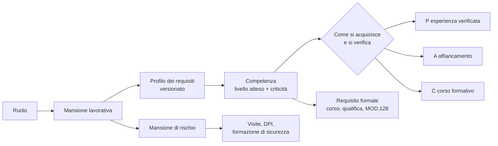

Le **fonti di requisito** che il motore compone:

| Fonte | Che cosa richiede | Esiste oggi? |
| --- | --- | --- |
| Mansione lavorativa (profilo) | Competenze con livello atteso e criticità | Modello sì, contenuti no |
| Mansione di rischio | Visite, DPI, corsi di sicurezza | Sì |
| Area / reparto | Corsi | Sì |
| Ruolo | Corsi, qualifiche | Sì |
| Macchina (asset) | Competenze legate a quella macchina | Sì, come mansione di tipo macchina |
| Processo qualificato MOD.128 / cliente | Corsi, visite, qualifiche, evidenze | Sì |
| Requisito sul singolo dipendente | Corsi, esposizioni dirette, deroghe | Sì (deroghe solo per le visite) |

### 2.2 Modello dati target

Legenda: 🆕 nuovo · ✏️ modificato · ⬜ invariato.

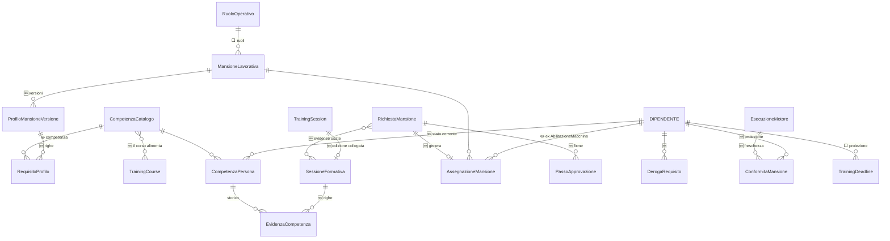

| Oggetto | Stato | Contenuto | Parte da |
| --- | --- | --- | --- |
| `MansioneLavorativa` | ⬜ (oggi `CompetenzaSkm`) | Invariata; eventuale rinomina **[deciso T6: da valutare]** | `models_skillmatrix.py:142` |
| `ProfiloMansioneVersione` + `RequisitoProfilo` | 🆕 | Fotografia versionata dei requisiti: competenza, livello atteso, criticità B/I/U, stato bozza/pubblicata/superata, date di validità, transitorio | Le righe attuali `VoceMacchinaCatalogo` diventano la versione 1 |
| `CompetenzaCatalogo` | ✏️ | Aggiunge il codice stabile (`CMP-0001`), il requisito formale e il segno «esercizio critico» | `models_skillmatrix.py:464` |
| `TrainingCourse` | ✏️ | Segno «formativo» e competenze alimentate (a molti) | `models_formazione.py:292` |
| `CompetenzaPersona` | 🆕 | Stato corrente persona × competenza: livello valutato, ultima valutazione, ultimo esercizio | Sostituisce `AbilitazioneMacchinaVoce` (oggi vuota in produzione) |
| `SessioneFormativa` | 🆕 | `SF-AAAA-NNNN`, causale, responsabile, stato, edizione collegata, registro di affiancamento | — |
| `EvidenzaCompetenza` | 🆕 | Riga della SF: persona, competenza, modalità P/A/C, evidenza, livello prima e dopo, valutatore, data | Assorbe `ValutazioneCompetenzaStorico` |
| `AssegnazioneMansione` | ✏️ (oggi `AbilitazioneMacchina`) | Aggiunge lo stato dell'assegnazione (avviata, effettiva, sospesa, revocata) e la RAM d'origine | `models_skillmatrix.py:324` |
| `RichiestaMansione` + `PassoApprovazione` | 🆕 | `RAM-AAAA-NNNN`, tipo (inserimento, aggiunta, revoca), richiedente, confronto congelato, firme, esito POS/NEG | — |
| `DerogaRequisito` | 🆕 | Deroga a termine su una competenza o un requisito: motivo, chi approva, da/a | Generalizza `DerogaOperativaVisita` (`models_mansioni_rischio.py:157`) |
| `ConformitaMansione` | 🆕 | Proiezione: stato della persona su ogni mansione, con il perché | Come `TrainingDeadline` |
| `EsecuzioneMotore` | 🆕 | Quando ha girato il motore, su chi, con quale versione delle regole, esito | Sostituisce l'inaffidabile `ricalcolato_il` |
| `TrainingDeadline`, visite, DPI | ⬜ | Restano proiezioni del motore di sicurezza | `services/scadenze.py` |

**Migrazione.** L'aggancio alla persona resta `legacy_anagrafica_id` (nessuna chiave esterna), come in tutto il
modulo. I 443 livelli attuali entrano con una **SF di impianto** per reparto, modalità P, alla data di demarcazione
**[deciso T3; data ipotizzata gennaio 2027]**: ogni livello nasce con un'evidenza e uno storico. Le 443 assegnazioni
diventano «effettive, da impianto». Nessun dato viene cancellato.

---

## 3. Il punto critico: i livelli e la reazione della mansione

### 3.1 Che cosa significa un livello

Le definizioni sono quelle di MT CN 06 Rev.21 §8.3, la procedura in vigore. La prima stesura ipotizzava che a
livello L non si firmasse: la procedura dice il contrario, e la tabella è stata corretta. Nei moduli MOD.187 e
MOD.053 la legenda è diversa («principiante», «insegna / programma a bordo macchina»): quale vocabolario valga
resta la domanda 1 del questionario.

| Livello | Nome | Che cosa sa fare | Lavora da sola | Firma / timbra | Forma altri |
| --- | --- | --- | --- | --- | --- |
| I | In formazione | Esegue l'attività solo in affiancamento o sotto tutoraggio | No | No | No |
| L | Intermedio | La esegue in autonomia sulle operazioni note; su quelle nuove o complesse la segue il capo reparto | Sì, sulle operazioni note | Sì: la firma resta all'operatore | No |
| U | Autonomo | La esegue in autonomia, nel rispetto delle istruzioni | Sì | Sì | No |
| O | Formatore / esperto | Forma altri operatori e sostiene la standardizzazione | Sì | Sì | Sì |

Cella vuota = competenza mai valutata. Non è un livello.

**Un livello per competenza, non per mansione** **[ipotesi D3]**. «Lettura del disegno» si valuta una volta e vale su
tutte le mansioni che la richiedono: è ciò che permette alla RAM di riusare le evidenze (regola decisiva della
Specifica). Dove la competenza dipende dalla macchina o dal processo si crea una competenza distinta («Set-up macchina
5 assi» non è «Set-up tornio CNC»); per i processi qualificati il legame con il cliente resta nel MOD.128, come
requisito formale. Alternativa scartata: livello per coppia competenza × mansione (è il modello attuale di
`AbilitazioneMacchinaVoce`): raddoppia il lavoro di valutazione e impedisce il riuso.

### 3.2 Come si sale

| Passaggio | Evidenze minime | Chi propone | Chi giudica | Chi autorizza |
| --- | --- | --- | --- | --- |
| — → I | Assegnazione della mansione (RAM approvata) oppure SF con P «esperienza verificata» | Responsabile | Responsabile | — |
| I → L | A: affiancamento registrato (tutor, ore, attività) **oppure** C: corso formativo completato; in entrambi i casi osservazione sul lavoro | Responsabile o tutor | Responsabile | — |
| L → U | Prova pratica o osservazione documentata; requisito formale valido, se la competenza lo prevede; nessuna non conformità attribuita nel periodo | Responsabile | Responsabile | RDD **solo** se la competenza è bloccante e dà diritto alla firma |
| U → O | Permanenza a U (proposta: 12 mesi); almeno un affiancamento condotto come tutor; proposta motivata | Responsabile | Responsabile | RDD |

- **Mai automatico.** Ogni salita è una riga di una SF chiusa, con data, valutatore ed evidenza. Il portale può
  *suggerire* («ha completato corso e 80 ore di affiancamento: valutare il passaggio a L») ma non scrive.
- **Chi giudica** è chi ha la «Responsabilità del reparto» della mansione **[deciso T7]**. Il merito resta suo, come
  oggi (D18); RDD e MSO autorizzano, non rivalutano.
- **Emissione approvata.** MT CN 06 §8.5 chiede che ogni emissione della skill matrix sia approvata e firmata da
  Direzione/RDD. Proposta: a ogni verifica semestrale RDD firma la fotografia della matrice; fra un'emissione e
  l'altra valgono le SF chiuse e le RAM approvate. Da confermare con la Qualità.
- **Tracciabilità**: la SF e le sue righe non si modificano dopo la chiusura; una correzione è una nuova SF che
  richiama la precedente.

### 3.3 Come si scende, come si consolida

Distinguiamo tre cose che oggi nel codice sono mescolate:

| Concetto | Chi lo decide | Quando cambia |
| --- | --- | --- |
| **Livello valutato** | Una persona, in una SF | Solo con una SF (anche in discesa: SF «di revisione») |
| **Stato di validità** | Il motore | Ogni giorno e a ogni evento |
| **Livello efficace** | Derivato | Modalità *segnalazione* (decisa): coincide sempre con il livello valutato. Modalità *blocco* (alternativa): vale «I» se la competenza è sospesa |

Stati di validità di una competenza posseduta:

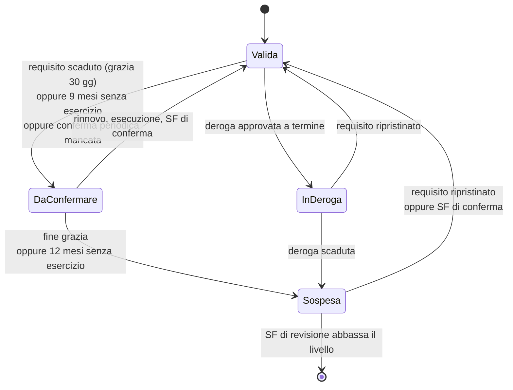

| Causa | Effetto | Automatico? | Come si rientra |
| --- | --- | --- | --- |
| Corso, qualifica o abilitazione MOD.128 scaduti | Da confermare per 30 giorni, poi sospesa | Sì | Basta il rinnovo: il livello non si tocca, non serve una SF |
| Mancato esercizio di una competenza «a esercizio critico» | Da confermare a 9 mesi, sospesa a 12 | Sì | SF di conferma (affiancamento breve + prova) |
| Conferma periodica non fatta entro 6 mesi | Da confermare, **senza** sospensione | Sì | SF di conferma del responsabile |
| Non conformità attribuita | Segnalazione al responsabile | No | Il responsabile decide: SF di revisione o nessuna azione, motivata |
| Revisione del requisito della mansione | Transitorio di 90 giorni, poi vale il nuovo profilo | Sì (il calcolo), no (il livello) | SF sui gap aperti dalla revisione |

**[ipotesi D5, D6, D7]** — sono le risposte proposte alle domande 5, 6 e 7 del questionario.

**Che cosa comporta «sospesa»: le due modalità.** Il calcolo degli stati è identico; cambia l'effetto.

| | Segnalazione **[deciso G2]** | Blocco (alternativa) |
| --- | --- | --- |
| Competenza sospesa | Resta al suo livello, marcata «non valida» | Vale «I» |
| Mansione che la richiede come bloccante | **Conforme con riserva**, con segnalazione grave | **Non conforme** |
| La persona opera e firma | Sì: decide il responsabile, che riceve l'avviso | No, finché non rimedia o non c'è una deroga |
| Può fare da tutor | No | No |
| Chi viene avvisato | Persona, responsabile, RDD | Gli stessi |
| Deroga | Serve a *giustificare* la segnalazione | Serve a *sbloccare* |
| Pro | Nessun fermo di produzione per un automatismo; il portale non decide al posto delle persone | Nessuna persona non qualificata risulta operativa |
| Contro | Una segnalazione ignorata lascia operare chi non ha il requisito: va presidiata (cruscotto RDD, sollecito, riepilogo periodico) | Un dato sbagliato o un rinnovo registrato in ritardo ferma una persona |
| Difendibilità in audit | Buona **se** ogni segnalazione ha una presa in carico tracciata | Forte |

**Eccezione scritta: i controlli non distruttivi.** MT CN 65 impone la sospensione dell'approvazione a visita visiva
scaduta, dopo 12 mesi consecutivi senza operare e a verifica annuale scaduta. Per le competenze regolate da quella
procedura la modalità è quindi **blocco**, qualunque sia la scelta generale.

È lo stesso schema già in uso per la visita del cambio mansione, dove un parametro sceglie fra «solo avviso»,
«deroga ammessa» e «blocco» (`services/stato_operativo.py:8-13`): la modalità si può cambiare in seguito senza toccare
i dati. Per rendere difendibile la segnalazione si propone la **presa in carico**: il responsabile, entro un termine,
indica che cosa fa (iscrizione, SF di conferma, deroga, mansione sospesa); senza presa in carico la segnalazione sale
a RDD.

**Consolidamento.** Un livello è *consolidato* quando è valido e confermato almeno una volta dopo la prima
attribuzione; prima è *da consolidare*. È un'etichetta informativa (compare nel MOD.053 e nella matrice), utile
soprattutto per U e O: «U da consolidare» = autonomo da meno di un ciclo di conferma.

**Contro l'effetto altalena.** Quattro accorgimenti: preavvisi a 90/60/30 giorni; periodo di grazia in cui la persona
continua a operare «con riserva»; stato intermedio «da confermare» prima di «sospesa»; rientro automatico quando il
requisito formale torna valido, senza rifare la valutazione.

### 3.4 Come reagisce la mansione

Ogni requisito del profilo ha un **livello atteso** e una **criticità** **[ipotesi D17]**:

| Criticità | Significato | Se manca |
| --- | --- | --- |
| **B** bloccante | Senza, la persona non può svolgere la mansione da sola | Mansione non conforme (o sotto supervisione se ancora in formazione) |
| **I** importante | Necessaria per l'autonomia piena | Sotto supervisione |
| **U** utile | Completa il profilo | Conforme con riserva |

Stato della persona rispetto a una mansione:

| Stato | Regola | Opera da sola | Firma | Forma |
| --- | --- | --- | --- | --- |
| **Conforme** | Tutti i requisiti raggiunti e validi | Sì | Sì, se livello sulla mansione ≥ L | Sì, se livello O |
| **Conforme con riserva** | Manca solo qualcosa di «utile», oppure c'è una competenza da confermare, in deroga o — in modalità segnalazione — sospesa | Sì | Sì, se ≥ L | No |
| **Sotto supervisione** | Manca un requisito «importante», oppure un «bloccante» mentre la mansione è ancora *avviata* | No | No | No |
| **Non conforme** | Manca un bloccante su una mansione *effettiva*; in modalità blocco, anche una competenza bloccante sospesa | No | No | No |

**Livello sulla mansione («livello M» del MOD.053).** Il **più basso fra le competenze bloccanti** **[deciso G2]**. La regola attuale (media con tetto, D16) ha un difetto emerso costruendo il motore di
riferimento: chi raggiunge *tutti* i minimi, ma ha una competenza «utile» con minimo L, ottiene una media che arrotonda
a L e risulta «in addestramento» pur essendo in regola (`services/mansionario_competenze.py:113-120`, `:242`). La
regola sulle bloccanti esiste già a sistema come opzione (`models_skillmatrix.py:62`, `REGOLA_BLOCCANTI`).

**Stato dell'assegnazione** — due passaggi, per conciliare i due documenti della Qualità **[deciso G2]**:

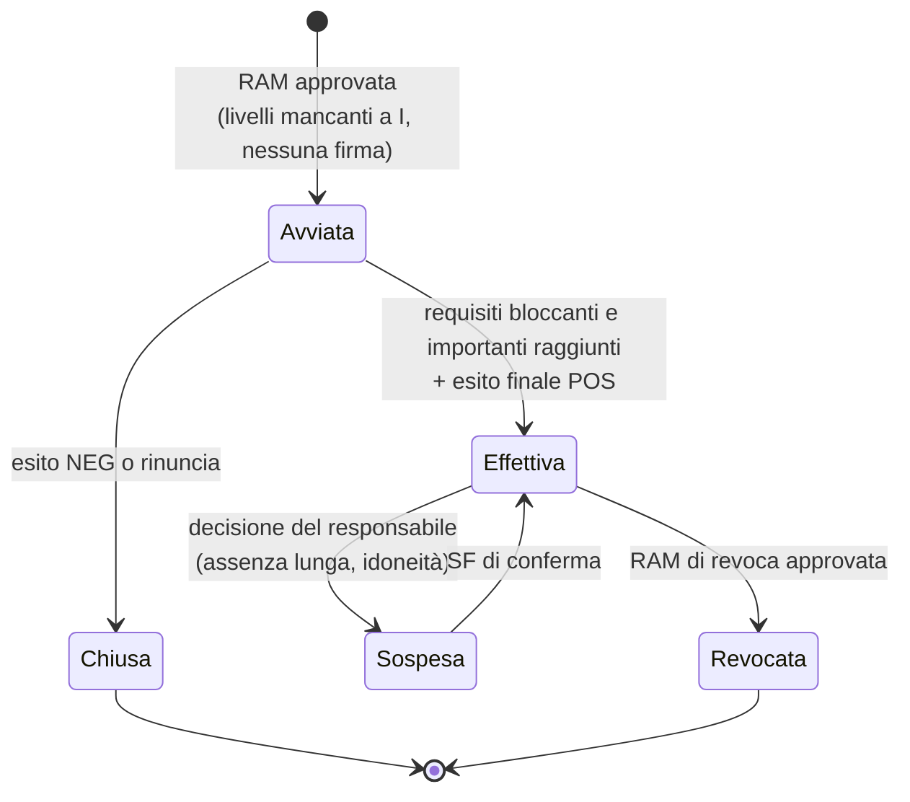

La skill matrix mostra le mansioni **avviate** (in formazione, come vuole il MOD.053) e quelle **effettive** (come
vuole la Specifica), distinte a colpo d'occhio. Se la Qualità risponde «in skill matrix solo le effettive», basta
filtrare: il modello non cambia.

**Effetti a valle di ogni variazione:**

| Evento | Effetto sulla persona | Notifiche | Altri effetti |
| --- | --- | --- | --- |
| Livello sale (SF chiusa) | Ricalcolo delle sue mansioni; può sbloccare «effettiva» e mansioni potenziali | Persona, responsabile | Si chiudono i fabbisogni formativi collegati; se arriva a O entra fra i tutor possibili |
| Competenza sospesa | Segnalazione grave sulle mansioni che la richiedono; conforme con riserva (in modalità blocco: non conforme) | Persona, responsabile, RDD se bloccante | Esce dai tutor; nasce il fabbisogno (iscrizione proposta) e la richiesta di presa in carico |
| Competenza torna valida | Ricalcolo; rientro automatico | Persona, responsabile | Si chiude il fabbisogno |
| Mansione diventa non conforme | Non opera da sola su quella mansione | Responsabile, RDD | Avviso «uomo solo» se la mansione resta con meno di 2 persone operative |
| Timbro / firma | Segue «può firmare» | — | Proposta: il portale **segnala** l'incoerenza con il timbro assegnato; sospendere il timbro resta un atto umano, come oggi per il MOD.128 |

### 3.5 Quando cambia il requisito della mansione

1. La Qualità modifica il profilo in **bozza** (nuova versione).
2. Il portale mostra l'**anteprima d'impatto**: chi cambia stato e perché.
3. RDD approva; la versione viene **pubblicata** con una data di decorrenza e un **transitorio** (proposta: 90 giorni).
4. Durante il transitorio vale ancora il profilo precedente per la conformità, ma i gap rispetto al nuovo sono già
   visibili come «da colmare entro il…» e generano fabbisogni.
5. Alla fine del transitorio vale il nuovo profilo.

Esempio calcolato sui dati di riferimento:

| Revisione | Titolari | Chi cambia stato |
| --- | --- | --- |
| DM3: si **aggiunge** «Programmazione a bordo macchina», livello L, importante | 6 | 2: Marco Rivalta (conforme → sotto supervisione), Stefano Guidotti (conforme → conforme con riserva) |
| DM6: «Programmazione a bordo macchina» da L a U, resta importante | 5 | 1: Piero Lombardini (conforme con riserva → sotto supervisione) |
| DM6: la stessa competenza da L a U **e** bloccante | 5 | 1: Piero Lombardini (conforme con riserva → non conforme) |
| CMM1: «Compilazione rapporti di collaudo» da L a U | 5 | 0 |

---

## 4. Quattro modelli a confronto

### 4.1 I modelli

**Modello A — Soglie discrete con approvazione esplicita.** Il livello cambia solo con una SF. Nessuna dinamica
automatica: scadenze e inattività producono soltanto avvisi nello scadenzario.

**Modello B — Punteggio da evidenze.** Ogni evidenza dà punti; il livello discende dal punteggio. Parametri usati
nella simulazione: esperienza verificata +10; affiancamento +1 ogni 4 ore (massimo 30); corso superato +20; prova
pratica +25; +2 per ogni mese di esercizio; −3 per ogni mese senza esercizio; soglie L ≥ 30, U ≥ 60, O ≥ 85; si scende
solo 10 punti sotto la soglia (isteresi).

**Modello C — Stati con decadimento del livello.** Come A per salire; ma è il **livello stesso** a scendere da solo:
un gradino se scade il requisito formale, se manca l'esercizio per 12 mesi o se salta la conferma periodica.

**Modello D — Ibrido.** Livello come in A (solo atti umani); validità calcolata come descritto al §3.3 (decadimento
della *validità*, non del livello, con grazia e stato intermedio); il punteggio di B resta, al più, un **indicatore di
prontezza** non vincolante. Ha due varianti:
- **D-segnalazione [deciso G2]**: la competenza non più valida viene segnalata; l'operatività resta una decisione del
  responsabile.
- **D-blocco (alternativa)**: la competenza sospesa toglie da sola l'operatività.

Nelle tabelle la colonna D riporta la variante bloccante, che è il caso più severo; dove la variante decisa si comporta
diversamente è indicato con «segn.:».

### 4.2 Simulazione su quattro persone, gennaio 2027 – giugno 2028

Mesi indicati come M1 (gennaio 2027) … M18 (giugno 2028). Sono riportati i mesi in cui accade qualcosa; negli altri
lo stato non cambia.

**Giulia Ferrante** — assunta a M1 su DM3; competenza osservata: «Set-up macchina 5 assi» (atteso U, bloccante).

| Mese | Evento | A | B (punti → livello) | C | D |
| --- | --- | --- | --- | --- | --- |
| M1 | Inserimento; SF con P «2 anni di esperienza precedente» | I | 10 → I | I | I · mansione **avviata**, sotto supervisione |
| M2 | Affiancamento 40 h | I | 20 → I | I | I |
| M3 | Affiancamento 40 h; SF con A (80 h) | L | 30 → L | L | L |
| M5 | Corso formativo | L | 54 → L | L | L · suggerimento «valutare U» non ancora |
| M7 | Prova pratica superata; SF | U | 83 → U | U | U · mansione **effettiva**, firma |
| M8 | Lavoro ordinario | U | **85 → O** | U | U da consolidare |
| M13 | Conferma periodica dovuta, il responsabile è in ritardo | U | 95 → O | **U → L** | U **da confermare**, conforme con riserva, sollecito |
| M14 | Conferma eseguita (SF di conferma) | U | 97 → O | L → U con nuova SF | U consolidato |

**Marco Rivalta** — effettivo su DM3; gli serve DM6; competenza mancante: «Programmazione a bordo macchina» (atteso L).

| Mese | Evento | A | B | C | D |
| --- | --- | --- | --- | --- | --- |
| M3 | Nessuno: il motore confronta i profili | — | — | — | DM6 **potenziale: 5 requisiti su 6** già coperti dalle evidenze di DM3 |
| M4 | Il responsabile apre la RAM per DM6 | Mansione assegnata subito | idem | idem | RAM: gap 1; mansione **avviata**; proposta SF sul solo gap |
| M5 | Affiancamento 40 h; SF con A | L | **10 → I** (il giudizio L non «entra») | L | L · RAM a esito POS · DM6 **effettiva** |
| M11 | Conferma periodica | — | — | — | SF di conferma |

**Aldo Bianchetti** — esperto (O) e tutor su DM6; il corso «Prevenzione FOD» (requisito formale di una competenza
bloccante) scade il 20/08/2027 (M8).

| Mese | Evento | A | B | C | D |
| --- | --- | --- | --- | --- | --- |
| M6 | Mancano 60 giorni | O (avviso in scadenzario) | 95 → O | O | O · avviso e iscrizione proposta |
| M8 | Corso scaduto | **O, opera e forma** | 75 → O (i punti del corso non bastano a scendere) | **O → U** | O **da confermare** (grazia 30 gg): opera con riserva, **non forma** |
| M9 | Fine della grazia | O, opera e forma | 75 → O | U → **L** | O **sospesa**: DM6 e DM3 non conformi, non firma; avviso a RDD. **Segn.:** conforme con riserva, opera e firma, non forma; segnalazione grave e presa in carico |
| M10 | Corso rifatto | O | 95 → O | L: serve una **SF per risalire a O** | O valida, **rientro automatico**; nessuna SF |

**Sara Colombari** — «Controllo pezzi di classe 1» (U, esercizio critico); ultima esecuzione a M1, assenza lunga da M2
a M15, rientro a M16.

| Mese | Evento | A | B | C | D |
| --- | --- | --- | --- | --- | --- |
| M8 | 7 mesi senza esercizio | U | **49 → L** | U | U valida |
| M10 | 9 mesi | U | 43 → L | U | U **da confermare** (preavviso) |
| M13 | 12 mesi | **U, formalmente operativa** | 34 → L | **U → L** | U **sospesa**: mansione non conforme. **Segn.:** conforme con riserva, segnalazione grave (la persona è assente) |
| M16 | Rientro | U | 30 → L | L | U sospesa; SF di conferma pianificata |
| M17 | Affiancamento 16 h + prova pratica superata | U | 57 → **L** (non basta) | L → U con SF | SF di conferma: U **valida** |
| M18 | Lavoro ordinario | U | 59 → L | U | U |

### 4.3 Confronto

| Criterio | A Soglie discrete | B Punteggio | C Decadimento del livello | D Ibrido |
| --- | --- | --- | --- | --- |
| Chi decide il livello | Sempre una persona | Una formula | Una persona per salire, il calendario per scendere | Sempre una persona |
| Persona non qualificata che risulta operativa | **Sì**, senza traccia (Aldo M8-M10, Sara M13-M16) | Sì (Aldo) | No | Blocco: **no**. Segnalazione: sì, ma **segnalata e presa in carico** |
| Livelli scritti senza un atto umano | No | Sì, sempre | Sì, in discesa | **No** |
| Coerenza con «la competenza cambia solo con una SF» | Piena | Nessuna | Parziale | **Piena** |
| Effetto altalena | Assente | Presente (Giulia diventa O a M8) | Presente (Giulia scende per un ritardo del responsabile) | Assente: grazia e stato intermedio |
| Lavoro per il responsabile | Basso | Basso, ma deve fidarsi della formula | Alto: ogni discesa va risalita con una SF | Medio: SF solo dove serve un giudizio |
| Lavoro per la Qualità | Basso | Alto: tarare punti e soglie | Medio | Medio: fissare 11 parametri (§4.5) |
| Adatto a 135 persone | Sì | No: troppa taratura per pochi dati | Sì | Sì |
| Difendibilità in audit EN 9100 | Debole su §7.2 (competenza «mantenuta»?) | Debole: «chi ha deciso?» | Debole: livelli abbassati da nessuno | Blocco: **forte**. Segnalazione: **buona**, se le prese in carico sono tracciate |
| Complessità di realizzazione | Bassa | Alta | Media | Media |

### 4.4 Raccomandazione

**Modello D, variante segnalazione [deciso G2].** Nessun livello cambia senza un atto umano (richiesta della Qualità,
decisione T4) e nessun automatismo ferma una persona. Rispetto ad A aggiunge ciò che ad A manca: il portale *sa* chi
non ha più il requisito e lo porta davanti a chi deve decidere.

La variante **blocco** resta l'alternativa per chi volesse la garanzia più forte («nessuna persona non qualificata
risulta operativa»): si attiva con un parametro, anche solo per le competenze di un processo qualificato. Passare da
una variante all'altra non richiede migrazioni. Costa poco più di A e riusa due meccanismi già scritti: il ricalcolo dei livelli (`services/competenze_ricalcolo.py`)
diventa il calcolo della validità, la continuità operativa (`services/skillmatrix_continuita.py`) si generalizza.

Il punteggio (B) **non** entra nel progetto iniziale: potrà essere aggiunto come indicatore di prontezza quando ci
saranno un paio d'anni di evidenze.

### 4.5 Parametri che deve fissare la Qualità

| Parametro | Valore proposto | Dove nasce |
| --- | --- | --- |
| Soglia di firma (livello minimo per firmare) | L, come da MT CN 06 §8.3; nel portale oggi è U | Da allineare |
| Periodicità della conferma della skill matrix | 6 mesi | Già a sistema |
| Finestra di esercizio per le competenze a esercizio critico | 12 mesi, preavviso a 9 | Già a sistema per i processi critici |
| Quali competenze sono «a esercizio critico» | Processi qualificati e competenze bloccanti scelte | Da decidere |
| Periodo di grazia dopo la scadenza di un requisito formale | 30 giorni | Nuovo |
| Modalità della validità | Segnalazione **[deciso G2]**; blocco come alternativa, anche per singole competenze | Nuovo |
| Termine per la presa in carico di una segnalazione | 10 giorni lavorativi, poi sale a RDD | Nuovo |
| Preavvisi di scadenza | 90, 60, 30 giorni | Già a sistema |
| Transitorio dopo la revisione di un profilo | 90 giorni | Nuovo |
| Durata massima di una mansione «avviata» prima dell'avviso | 6 mesi | Nuovo |
| Permanenza minima a U prima di O | 12 mesi | Nuovo |

---

## 5. Il motore unico

### 5.1 Che cosa sostituisce

| Oggi | Domani |
| --- | --- |
| `services/requisiti.py` (corsi, visite) | **Resta**, come risolutore del dominio sicurezza |
| `services/mansionario_competenze.valuta` + `competenze_ricalcolo` | Diventano il risolutore del dominio competenze: livello valutato, validità, conformità |
| `services/training_eligibility.py` | **Smette di espandere le regole**: legge il motore (chiude le divergenze D1-D6) |
| `services/conformita.py` | Legge il motore; una sola lettura di «mancante» (chiude D7) |
| `services/mpq_competenze.py` | Non assegna: produce proposte di RAM **[deciso T5]** |
| `CompetenzaSkm.corso_qualificante`, `VoceMacchinaCatalogo.corso`, regola d'obbligo su mansione | Un solo posto: il requisito formale della competenza (chiude D8) |
| `SkillMatrixConfig.soglia_operativa`, `livello_richiesto`, `SogliaCopertura.livello_minimo` | Il livello atteso sta nel profilo; la soglia operativa resta un parametro globale (chiude D9) |

### 5.2 Ingressi e uscite

**Ingresso:** una persona (o un insieme) e una data.

**Uscita, per persona:**

```
requisiti_effettivi = [
  { oggetto: competenza | corso | visita | DPI | qualifica,
    livello_atteso, criticità, obbligatorietà,
    fonti: [ {tipo, nome, versione, livello, criticità} ],     ← il «perché»
    posseduto: { livello_valutato, validità, motivo, scadenza, ultima_evidenza },
    gap, deroga } ]
mansioni = [ { mansione, stato_assegnazione, conformità, livello_M,
               opera_da_sola, può_firmare, può_formare, righe } ]
mansioni_potenziali = [ { mansione, esito: soddisfatta | parziale, coperti, totali } ]
azioni_proposte = [ SF da aprire, iscrizioni, RAM da proporre, conferme dovute ]
```

### 5.3 Regole di composizione

| Tema | Regola |
| --- | --- |
| Unione | I requisiti di tutte le fonti si sommano; lo stesso oggetto richiesto da più fonti compare una volta, con tutte le fonti |
| Conflitto di livello | Vince il **più alto**; ogni mansione viene però valutata sul **proprio** livello atteso |
| Conflitto di criticità | Vince la più severa (B > I > U) |
| Conflitto di validità | Vince la scadenza **più vicina** (già così per corsi e visite: «ricalcolo prudente») |
| Deroga | A termine, su un requisito, con motivo; la approva RDD (HSE per la sicurezza); la competenza risulta «in deroga» e la mansione «conforme con riserva»; alla scadenza decade da sola |
| Equivalenze | Un requisito può dichiarare alternative («basta una del gruppo»): esiste già nel MOD.128 (`models_mpq.py:731`) e si estende |
| Propedeuticità | Un corso con prerequisiti non è proponibile finché mancano (già così: `services/training_eligibility.py:175`); una competenza può richiederne un'altra a un livello minimo |
| Revisione di un corso | Proposta: gli attestati emessi restano validi fino alla loro scadenza, salvo che la revisione sia marcata «sostanziale»; in quel caso transitorio di 90 giorni. Il corso ha già le versioni (`models_formazione.py:417`) |
| Mai registrato | È un **gap**, sempre e ovunque (oggi è «neutro» nel semaforo di conformità): una sola lettura |

### 5.4 Quando gira

| Evento | Chi viene ricalcolato |
| --- | --- |
| Assunzione, cessazione | La persona |
| RAM approvata, mansione avviata/effettiva/revocata, cambio di ruolo o reparto | La persona |
| SF chiusa | I partecipanti |
| Completamento di un corso, visita, consegna DPI, qualifica | La persona |
| Esecuzione registrata su una competenza a esercizio critico | La persona |
| Profilo di una mansione pubblicato, corso o catalogo modificato | I titolari della mansione (o tutti) |
| Deroga concessa, scaduta, revocata | La persona |
| **Ogni notte** | Tutti: copre le scadenze che passano senza che nessuno salvi niente |
| **A richiesta** | Pulsante «Ricalcola» per una persona, un reparto, tutti |

È lo schema già in funzione per le scadenze (`segnali_scadenze.py`, `services/scadenze.py:217-241`): accumulo delle
persone toccate nella transazione, un solo ricalcolo a transazione conclusa, ricalcolo notturno di sicurezza.

### 5.5 Proprietà

| Proprietà | Come si ottiene |
| --- | --- |
| Deterministico | Funzione pura di (dati, data): nessun orologio interno, nessuna casualità |
| Idempotente | Ricalcolare due volte dà lo stesso risultato e non scrive nulla la seconda |
| Incrementale | Per persona; i cambi di catalogo ricalcolano i soli titolari |
| Spiegabile | Ogni requisito porta le sue fonti; ogni stato porta il suo motivo |
| Auditabile | SF, RAM, deroghe e versioni di profilo non si modificano; `EsecuzioneMotore` registra ogni giro |
| Testabile | Nessuna dipendenza dalla richiesta web; dati di prova in memoria |

### 5.6 `TrainingDeadline` e le proiezioni

`TrainingDeadline` **resta** una proiezione del motore di sicurezza: è già ricostruita correttamente. Tre correzioni:

1. **Indicatore di freschezza vero.** Oggi `ricalcolato_il` non si aggiorna con le scritture massive e le righe
   invariate non vengono riscritte. Proposta: tabella `EsecuzioneMotore` (inizio, fine, perimetro, righe create,
   aggiornate, cancellate, esito) e in ogni pagina che legge una proiezione la dicitura «Dati aggiornati al …», con
   avviso se l'ultimo giro riuscito ha più di 26 ore.
2. **Seconda proiezione** `ConformitaMansione` per le competenze, con la stessa disciplina.
3. **Chi legge** (selezione candidati, Mansionario, semaforo) legge la proiezione o chiama il motore: mai una terza via.

### 5.7 Pseudocodice

```
funzione RISOLVI(persona, data):
    # 1. Raccolta dei requisiti da tutte le fonti
    richiesti = {}
    per ogni assegnazione A di persona con stato in {avviata, effettiva}:
        profilo = versione_in_vigore(A.mansione, data)          # rispetta il transitorio
        per ogni riga R di profilo:
            AGGIUNGI(richiesti, R.competenza, R.livello, R.criticità, fonte = (mansione, profilo.versione))
        per ogni mansione di rischio M di A.mansione:
            AGGIUNGI_SICUREZZA(richiesti, M)                     # visite, DPI, corsi: motore esistente
    AGGIUNGI_SICUREZZA(richiesti, area, ruoli in essere, processi MOD.128, regole individuali)

    # 2. Posseduto e validità
    per ogni competenza C richiesta o posseduta:
        P = stato_corrente(persona, C)                           # livello valutato, ultima evidenza
        V = VALIDITÀ(persona, C, P, data)
        efficace = vuoto     se mai valutata
                   "I"       se V = sospesa e MODALITÀ = blocco
                   P.livello negli altri casi          # in modalità segnalazione la sospesa resta al suo livello

    # 3. Conformità per mansione (ognuna sul proprio profilo)
    per ogni assegnazione A:
        gap_B, gap_I, gap_U, riserve, segnalazioni = conta(profilo(A), efficace, validità)
        # modalità segnalazione: una competenza sospesa conta come riserva e genera una segnalazione grave;
        # modalità blocco: vale «I», quindi apre un gap
        se gap_B > 0 e A è effettiva:                          stato = NON CONFORME
        altrimenti se gap_B > 0 oppure gap_I > 0:              stato = SOTTO SUPERVISIONE
        altrimenti se gap_U > 0 oppure riserve > 0:            stato = CONFORME CON RISERVA
        altrimenti:                                            stato = CONFORME
        livello_M = minimo(efficace delle competenze bloccanti)
        opera = stato in {CONFORME, CON RISERVA}
        firma = opera e livello_M >= soglia_operativa
        forma = stato = CONFORME e livello_M = O

    # 4. Mansioni potenziali (mai assegnate dal motore)
    per ogni mansione N non assegnata:
        se nessun requisito B o I di N è scoperto:      potenziale SODDISFATTA
        altrimenti se coperti / totali >= 2/3:          potenziale PARZIALE

    # 5. Azioni proposte
    proponi SF per i gap, iscrizioni per i requisiti formali, conferme dovute, RAM dai ruoli MOD.128
    restituisci (richiesti, posseduto, mansioni, potenziali, azioni)


funzione VALIDITÀ(persona, C, P, data):
    se P è vuoto:                                         restituisci ASSENTE
    se C ha un requisito formale:
        se manca:                                         restituisci SOSPESA
        se scaduto:
            se c'è una deroga in corso:                   restituisci IN DEROGA
            se scaduto da meno di GRAZIA giorni:          restituisci DA CONFERMARE
            altrimenti:                                   restituisci SOSPESA
    se C è a esercizio critico:
        se mesi_dall'ultimo_esercizio > FINESTRA:         restituisci SOSPESA
        se mesi_dall'ultimo_esercizio >= PREAVVISO:       restituisci DA CONFERMARE
    se mesi_dall'ultima_valutazione > CONFERMA:           restituisci DA CONFERMARE
    restituisci VALIDA
```

L'implementazione eseguibile di queste regole è `build/motore_rif.py` (senza dipendenze esterne).

### 5.8 Casi d'esempio

Dati di riferimento al 15/03/2027: 32 persone, 14 mansioni, 30 competenze, **65 assegnazioni**.

| Quadro generale | Valore |
| --- | --- |
| Assegnazioni conformi | 30 |
| Conformi con riserva | 13 *(variante blocco: 11)* |
| Sotto supervisione | 10 |
| Non conformi | 12, su 8 persone *(variante blocco: 14, su 9 persone)* |
| Gap aperti | 42 *(variante blocco: 44)* |
| Assegnazioni con una segnalazione grave | 2 |
| Competenze sospese / da confermare | 2 / 15 |
| Requisiti formali scaduti · entro 30 · 60 · 90 giorni | 5 · 1 · 1 · 1 |
| Mansioni potenziali soddisfatte / parziali | 1 / 21 |

**Caso 1 — Cambio mansione.** Marco Rivalta, effettivo su «DM3 – Fresatura 5 assi» (conforme, livello U), viene
proposto per «DM6 – Fresatura 5 assi grande formato».
- Requisiti di DM6: 6. **Già coperti: 5** (lettura del disegno, set-up 5 assi, controllo dimensionale, gestione
  utensili, prevenzione FOD), tutti dalle evidenze di DM3.
- Mancante: «Programmazione a bordo macchina» (mai valutata; atteso L, importante).
- Esito: la RAM avvia DM6 in stato **sotto supervisione**; serve **una** SF sul solo gap. Nessuna SF per le altre
  cinque competenze (regola decisiva della Specifica).

**Caso 2 — Conflitto di livelli.** «Lettura del disegno tecnico» è richiesta a livello **L** (importante) da «Collaudo
da banco» e a livello **U** (bloccante) da «CMM1 – Collaudo a coordinate». Per le quattro persone che le svolgono entrambe il
requisito effettivo è **U, bloccante**, con due fonti. Ma ciascuna mansione si giudica sul proprio profilo: chi ha L
è conforme sul banco e non conforme sulla CMM. Analogo per Aldo Bianchetti: sei requisiti effettivi, cinque dei quali
con **due fonti** (DM3 e DM6).

**Caso 3 — Deroga.** Piero Lombardini, effettivo su DM6: il corso «CRS-006 Prevenzione FOD» è scaduto da 45 giorni,
oltre la grazia. RDD ha approvato una deroga di 30 giorni perché il corso è prenotato per il 02/04/2027.
- Senza deroga, modalità **segnalazione**: competenza sospesa → DM6 **conforme con riserva** con segnalazione grave;
  opera e firma, il responsabile deve prenderla in carico.
- Senza deroga, modalità **blocco**: DM6 **non conforme**, livello sulla mansione I, non opera e non firma.
- Con la deroga, in entrambe le modalità: competenza **in deroga** → DM6 **conforme con riserva**; opera e firma, non
  può fare da tutor. In modalità segnalazione la deroga vale come presa in carico.
- Al 04/04/2027 la deroga scade: se il corso non è stato fatto, torna la situazione «senza deroga».

**Caso 4 — Revisione di un corso.** «CRS-006 Prevenzione FOD» passa alla revisione B.
- Revisione **ordinaria**: gli attestati restano validi fino alla loro scadenza naturale; nessun effetto oggi.
- Revisione **sostanziale**: le **20 persone** titolari di una mansione che richiede la competenza «Prevenzione FOD»
  hanno 90 giorni per rifare il corso; nel transitorio restano conformi con riserva.

**Caso 5 — Abilitazione su una macchina specifica.** Giulia Ferrante, in formazione su DM3, chiede DM6: stessa
famiglia di macchine, profilo simile.
- Coperto 1 requisito su 6 (prevenzione FOD).
- Mancano: lettura del disegno (L, atteso U, bloccante), set-up 5 assi (L, atteso U, bloccante), programmazione a
  bordo (mai valutata), controllo dimensionale (I, atteso U), gestione utensili (I, atteso L).
- Esito: non è una mansione potenziale (1 su 6); una RAM è possibile ma apre cinque gap. Il simulatore lo mostra
  prima di chiedere.

**Caso 6 — Mansione di rischio.** Sara Colombari (collaudo) chiede «Collaudo da banco». Coperti 2 requisiti su 3;
manca «Uso strumenti di misura da banco» (bloccante, con requisito formale: corso «CRS-027 Metrologia di reparto»).
La mansione di rischio è la stessa («Addetto collaudo»): **nessuna** visita o DPI in più. Se chiedesse
«Movimentazione con carrello» cambierebbe mansione di rischio («Carrellista»): il piano di adeguamento esistente
aggiungerebbe visita, patentino e DPI. I due calcoli si presentano insieme nella stessa RAM.

**Caso 7 — Mansione potenziale.** Piero Lombardini non ha «DM3 – Fresatura 5 assi», ma ne soddisfa **5 requisiti su
5**: il motore la segnala come **potenziale soddisfatta**. Non viene assegnata: compare al responsabile come «RAM da
proporre»; se la apre, la RAM va direttamente in approvazione senza SF.

**Caso 8 — Inserimento.** Giulia Ferrante, DM3 avviata dall'11/01/2027: lettura del disegno L (atteso U, bloccante),
set-up L (atteso U, bloccante), controllo dimensionale I (atteso U, importante), gestione utensili I (atteso L,
utile), prevenzione FOD U (valida). Quattro gap → **sotto supervisione**, livello sulla mansione L, non firma. La
mansione diventerà effettiva quando i due bloccanti e l'importante avranno raggiunto il minimo.

---

## 6. I flussi

### 6.1 Profilo della mansione

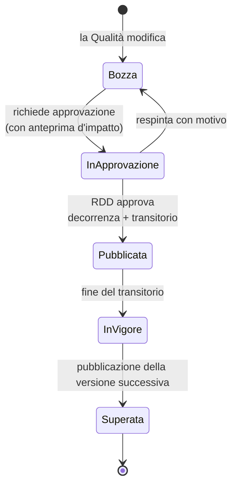

| | |
| --- | --- |
| Attori | Qualità (redige), responsabile di reparto (consultato), RDD (approva) |
| Permessi | `anagrafica.profilo.modifica`, `anagrafica.profilo.approva` |
| Notifiche | Ai titolari che cambiano stato e ai loro responsabili, alla pubblicazione e 30 giorni prima della fine del transitorio |

### 6.2 Richiesta di Aggiornamento Mansione

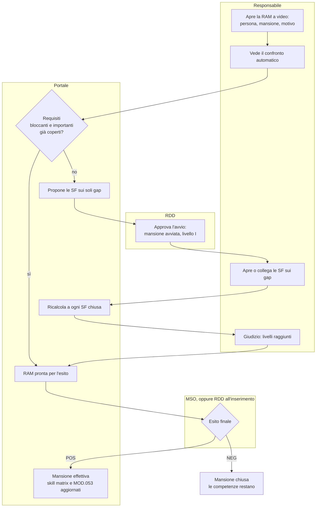

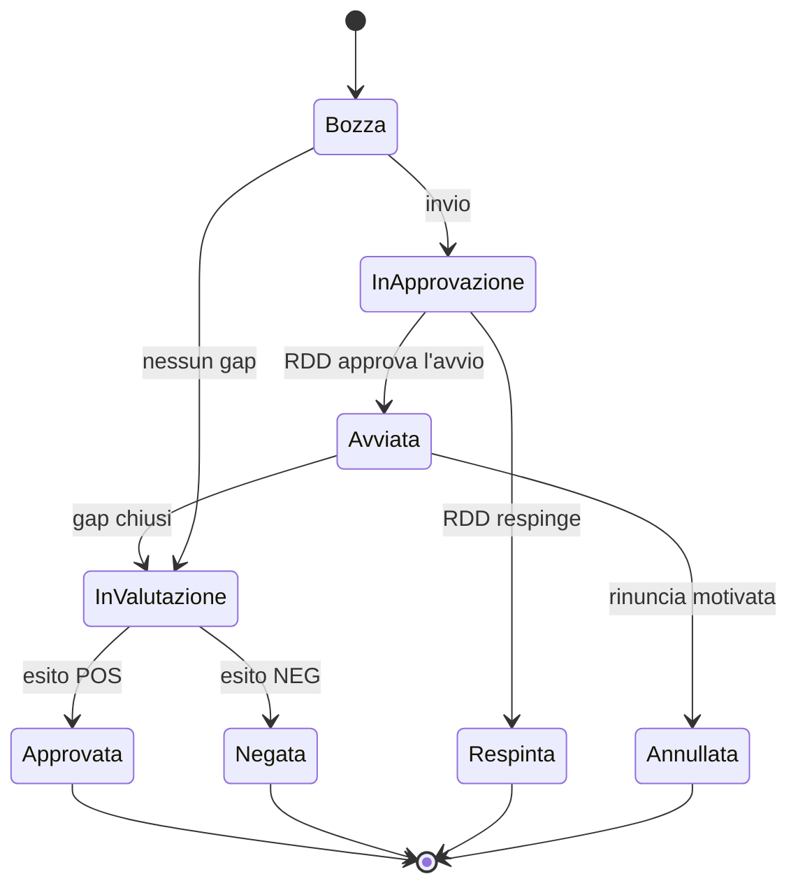

- **Tre tipi**: inserimento (dall'assunzione, con matricola e consegna del timbro **[ipotesi D13]**), aggiunta, revoca
  **[ipotesi D15]**.
- **Blocco dell'esito POS** se un requisito bloccante o importante è sotto il minimo (MOD.053).
- **Confronto congelato**: alla chiusura la RAM conserva la fotografia di requisiti, livelli e SF usate, anche
  precedenti alla RAM.
- **Amministratori**: possono ancora assegnare direttamente, con motivo obbligatorio; il portale genera una RAM
  «d'ufficio» già chiusa, così lo storico ha una sola forma **[deciso T2]**.
- **Cambio di mansione di rischio**: la RAM approvata genera lo spostamento organizzativo e il piano di adeguamento
  già esistenti (`services/cambio_mansione.py`).

| | |
| --- | --- |
| Permessi | `anagrafica.ram.richiedi` (responsabile sul proprio reparto), `anagrafica.ram.approva` (RDD), `anagrafica.ram.esito` (MSO/RDD), `anagrafica.mansione.assegna_diretta` (amministratori) |
| Notifiche | A ogni passaggio, al firmatario successivo; alla persona all'avvio e all'esito |
| Regola | Chi richiede può giudicare, non approvare **[ipotesi D14]** |

### 6.3 Sessione Formativa

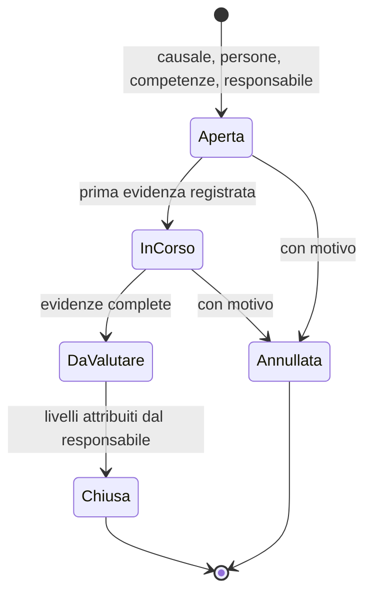

| Causale | Da dove nasce |
| --- | --- |
| Inserimento / gap di una RAM | Dalla RAM |
| Esperienza da formalizzare (P) | Dal responsabile |
| Corso formativo (C) | Dalla chiusura dell'edizione di un corso segnato «formativo» |
| Affiancamento (A) | Dal responsabile, con registro (tutor, periodo, ore, attività) |
| Conferma periodica | Dalla campagna di conferma (ex «refresh») |
| Revisione (anche in discesa) | Dal responsabile, dopo una segnalazione |
| Impianto | Una per reparto, alla data di demarcazione |

- Una SF riguarda **più persone e più competenze**; ogni riga porta modalità, evidenza, livello prima e dopo.
- Una SF **chiusa non si modifica**; una riga sbagliata si corregge con una SF di revisione.
- La chiusura di un'edizione di un corso formativo **prepara** la SF con gli iscritti idonei e le competenze
  dichiarate dal corso; il livello lo mette comunque il responsabile. L'aggancio è il punto unico dopo il
  completamento (`views/formazione.py:3265`).

| | |
| --- | --- |
| Permessi | `anagrafica.sf.apri`, `anagrafica.sf.valuta` (responsabile del reparto della competenza), `anagrafica.sf.vedi` |
| Notifiche | Al responsabile quando una SF è da valutare; alla persona alla chiusura |

### 6.4 Ciclo di vita della competenza individuale

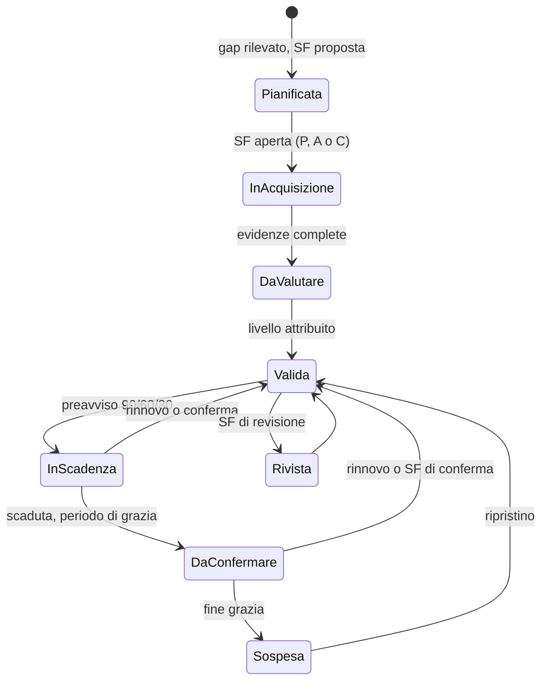

### 6.5 Pianificazione della formazione dai gap

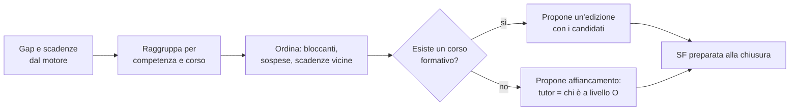

I candidati vengono dal motore, non da una seconda espansione delle regole: è la correzione delle divergenze D1-D6.

### 6.6 Inserimento di un nuovo dipendente

Proposta: **non un flusso nuovo**. L'inserimento resta la pratica a cinque fasi che il portale ha già
(`01_asis.md` §12); la scheda MOD.053 «Formazione assunzione» diventa una **richiesta di mansione di tipo
inserimento** agganciata a tre voci esistenti **[ipotesi D13]**.

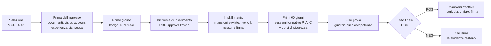

| Voce della pratica (oggi) | Diventa | Si chiude |
| --- | --- | --- |
| «Assegnare ruolo, area e mansioni» (primo giorno) | Apertura della **richiesta di inserimento**: mansioni scelte fra quelle proposte dal ruolo nel reparto | Da sola, quando RDD approva l'avvio |
| — (nuova, primi 60 giorni) | **Sessioni formative** sulle competenze: esperienza riconosciuta (P), affiancamento con il tutor (A), corsi (C) | Da sola, quando non restano mancanze bloccanti o importanti |
| «Valutazione di fine periodo di prova» | **Giudizio sulle competenze**: livelli raggiunti nelle sessioni | Da sola, con i livelli minimi raggiunti |
| «Registrare l'esito del periodo di prova» | **Esito finale POS/NEG** di RDD, con matricola e consegna del timbro | Alla firma |
| Formazione pregressa dichiarata in preinserimento | Resta per i corsi di sicurezza; per le competenze diventa una **proposta di sessione P**, che il responsabile verifica con una prova | — |
| Visite, DPI, corsi obbligatori, schede di sicurezza, account | Invariate | Invariate |

Regole:
- All'avvio le competenze richieste nascono a livello **I**; le mansioni sono **avviate**; la persona non firma.
- **Esito POS bloccato** finché un requisito bloccante o importante è sotto il minimo (MOD.053).
- L'esito NEG chiude l'inserimento senza assegnare le mansioni; le competenze acquisite restano nello storico.
- La matricola nasce all'avvio; il timbro si consegna con l'esito POS.

Da decidere con la Qualità e con HR:
- l'esito finale del MOD.053 **coincide** con l'esito del periodo di prova, o sono due atti con date diverse?
- l'inquadramento determina davvero matricola e timbro (domanda 18 del questionario)?
- chi firma l'esito finale all'assunzione: sempre RDD?

Stima: è il blocco **B11** del §7.6, senza lavoro aggiuntivo oltre a quello già previsto.

### 6.7 Permessi: chi può fare che cosa

| Azione | Persona | Responsabile di reparto | Qualità | RDD | MSO | HR | Amministratore |
| --- | --- | --- | --- | --- | --- | --- | --- |
| Vedere il proprio profilo | ✔ | ✔ | ✔ | ✔ | ✔ | ✔ | ✔ |
| Vedere le persone del reparto | | ✔ proprio | ✔ | ✔ | ✔ | ✔ | ✔ |
| Aprire e valutare una SF | | ✔ proprio | | | | | ✔ |
| Richiedere una RAM | | ✔ proprio | | | | ✔ inserimento | ✔ |
| Approvare l'avvio di una RAM | | | | ✔ | | | |
| Dare l'esito finale | | | | ✔ inserimento | ✔ aggiornamento | | |
| Modificare un profilo | | | ✔ | | | | ✔ |
| Approvare un profilo | | | | ✔ | | | |
| Concedere una deroga | | | | ✔ | | | |
| Assegnare direttamente | | | | | | | ✔ con motivo |

Il «proprio reparto» discende da chi ha la mansione «Responsabilità del reparto/area» **[deciso T7]**; i ruoli del
portale si collegano ai ruoli dell'organigramma con il meccanismo esistente (solo permessi positivi). Sostituti e
deleghe a termine: è la parte mai realizzata della «Proposta ruoli SGI», da riprendere qui.

---

## 7. Impatti tecnici

### 7.1 Struttura del codice

```
anagrafica/
  competenze/                      nuovo pacchetto
    modelli.py                     SessioneFormativa, EvidenzaCompetenza, CompetenzaPersona,
                                   RichiestaMansione, PassoApprovazione, ProfiloMansioneVersione,
                                   RequisitoProfilo, DerogaRequisito, ConformitaMansione, EsecuzioneMotore
    motore/
      validita.py                  stato di validità di una competenza (funzioni pure)
      conformita.py                stato sulla mansione, livello M, effetti
      potenziali.py                mansioni potenziali
      risolvi.py                   composizione e spiegazione
    selectors/                     letture per le pagine: matrice, scheda persona, code, cruscotti
    workflows/
      sf.py                        transizioni della Sessione Formativa
      ram.py                       transizioni della RAM, blocco dell'esito
      profilo.py                   versioni, anteprima d'impatto, transitorio
    proiezioni.py                  scrittura di ConformitaMansione, EsecuzioneMotore
    segnali.py                     eventi → ricalcolo a transazione conclusa
  services/completamento.py        estratto da views/formazione.py:3198-3300
```

Le transizioni stanno in un solo posto per oggetto (`workflows/`), con una tabella esplicita «da stato, azione, a
stato, chi può»: è la formalizzazione che oggi manca.

### 7.2 Punti di rottura

| Punto | Rischio | Mitigazione |
| --- | --- | --- |
| Assegnazione diretta tolta ai responsabili | Abitudine consolidata | Doppio binario a tempo, poi solo RAM |
| `AbilitazioneMacchina.livello` letto da skill matrix, carichi macchina, capo di reparto | Cambiare la regola del livello M sposta dei livelli | Simulazione prima dell'applicazione (esiste: `services/mansionario_regole.py:121`) |
| Ricalcolo automatico del livello | Oggi scrive il livello | Diventa calcolo della validità; i livelli già abbassati in automatico vanno ripristinati dallo storico (in produzione: nessuno) |
| MOD.128 → mansione | Oggi assegna | In produzione non è in uso (0 collegamenti): nessun dato da sistemare |
| Selezione candidati | Elenchi diversi da oggi | Confronto in parallelo vecchio/nuovo per un periodo, poi sostituzione |
| «Mancante = neutro» nel semaforo | I semafori diventano più rossi | Va comunicato: è lo stato reale |
| Estrazione del completamento dalle viste | Tocca il cuore dell'aula | Nessun cambio di comportamento, coperto dai test esistenti |

### 7.3 Test

| Livello | Che cosa |
| --- | --- |
| Motore, funzioni pure | Tabelle di casi: gli otto casi del §5.8 e le quattro simulazioni del §4.2 diventano test |
| Proprietà (generazione casuale di dati) | Determinismo; idempotenza; **monotonia** (alzare un livello non peggiora mai lo stato); **località** (cambiare una persona non tocca le altre); una deroga non peggiora mai; il requisito effettivo è sempre ≥ di ogni fonte |
| Flussi | Ogni transizione ammessa e ogni transizione vietata; blocco dell'esito POS; SF chiusa immodificabile |
| Permessi | Responsabile fuori reparto → rifiuto; richiedente che approva → rifiuto; endpoint JSON con 401/403 |
| Migrazione | SF di impianto: ogni livello attuale ha un'evidenza; conteggi prima/dopo identici |
| Confronto | Vecchio e nuovo motore sugli stessi dati, differenze elencate e spiegate |

Il motore di riferimento `build/motore_rif.py` è già il primo oracolo: l'implementazione Django dovrà dare gli stessi
risultati sugli stessi dati.

### 7.4 Prestazioni

Ordini di grandezza reali: 135 persone, 242 mansioni, 443 assegnazioni; a regime poche migliaia di righe di
competenza. Il motore attuale ricalcola l'intera azienda in «meno di un secondo» (`services/scadenze.py:221`). Il
calcolo delle competenze è lineare nelle righe di profilo delle mansioni assegnate: stesso ordine. L'anteprima
d'impatto ricalcola i soli titolari di una mansione (in media 2, al massimo qualche decina). Non servono code né
cache; la proiezione serve alle pagine di elenco, non alla velocità del calcolo.

### 7.5 Migrazione a tappe, sempre reversibile

| Tappa | Contenuto | Come si torna indietro |
| --- | --- | --- |
| 0 | Catalogo delle competenze caricato dalla tabella dei MOD.053 e MOD.039, completato con livello atteso e criticità su un reparto pilota; skill matrix caricata dal MOD.187 in vigore | Nessun effetto sul resto |
| 1 | Nuovi modelli, vuoti; motore in **sola lettura** accanto a quello attuale; pagina di confronto | Si spegne la pagina |
| 2 | SF attiva sul reparto pilota; i livelli si scrivono ancora anche col vecchio gesto | Si torna al vecchio gesto |
| 3 | SF di impianto alla data di demarcazione; validità calcolata; il ricalcolo automatico smette di scrivere livelli | Interruttore di configurazione |
| 4 | RAM attiva; assegnazione diretta solo agli amministratori | Interruttore |
| 5 | Selezione candidati e semaforo leggono il motore | Interruttore |
| 6 | Profili versionati con transitorio; MOD.053 dinamico; cruscotti | — |

### 7.6 Stima a blocchi

S fino a 3 giorni · M 1-2 settimane · L 3-4 settimane. Stime di sviluppo, senza il lavoro di contenuto della Qualità.

| Blocco | Contenuto | Stima | Dipende da |
| --- | --- | --- | --- |
| B0 | Catalogo: codice stabile, criticità a tre gradi, requisito formale unico, corso → competenze | M | — |
| B1 | Motore competenze (validità, conformità, potenziali) + proiezione + freschezza | L | B0 |
| B2 | Sessione Formativa: modello, flusso, pagine, registro di affiancamento | L | B0 |
| B3 | SF di impianto e migrazione dei livelli | S | B2 |
| B4 | RAM: modello, flusso, firme, modulo a video, collegamento alle SF | L | B1, B2 |
| B5 | Profilo versionato, anteprima d'impatto, transitorio | M | B1 |
| B6 | Selezione candidati, gap formativo e semaforo sul motore unico | M | B1 |
| B7 | Permessi per reparto, sostituti e deleghe | M | — |
| B8 | MOD.053 dinamico e stampa | M | B2, B4 |
| B9 | Cruscotti (responsabile, RDD, Qualità), vista personale | M | B1, B2, B4 |
| B10 | Estrazione del completamento in un servizio; collegamento edizione → SF | M | B2 |
| B11 | Cambio mansione e inserimento agganciati alla RAM | M | B4 |
| B12 | Rinomina dei modelli (facoltativo) **[deciso T6: da valutare]** | M | Tutto il resto fermo |
| B13 | Riordino dell'interfaccia a filo conduttore sull'intera Anagrafica: menu in sei pilastri, striscia «sei qui», «prossimo passo», cinque modelli di pagina, una sola matrice, uno scadenzario, stile rinfrescato facoltativo (`03_ux.md` §9-10) | S per menu e striscia, M per il resto | Menu e striscia: nessuna dipendenza, si possono fare per primi |

Percorso minimo per dare valore: **B0 → B1 → B2 → B3** (livelli con evidenza e validità calcolata), poi **B4** (RAM).
Complessivamente tre blocchi L sul percorso critico più il lavoro di contenuto, che è il vero vincolo di calendario.

**Somma delle stime** (sviluppo di una persona, in sequenza; S contato fino a 3 giorni):

| Perimetro | Blocchi | Settimane di sviluppo |
| --- | --- | --- |
| Percorso minimo | B0, B1, B2, B3 | da 7 a 11 |
| Percorso minimo più la RAM | B0-B4 | da 10 a 15 |
| Tutti i blocchi tranne la rinomina | B0-B11, B13 | da 18 a 31, cioè circa 4-7 mesi |

È un ordine di grandezza: non comprende il lavoro di contenuto della Qualità, i collaudi con i reparti e le attese
fra una tappa e l'altra.

**Sulla rinomina (B12).** Pro: il codice dice «mansione» dove oggi dice «competenza», e sparisce l'equivoco che ha
rallentato ogni analisi. Contro: tocca 73 file e tutti i rami paralleli aperti; nessun beneficio per gli utenti.
Proposta: **non ora**. I nuovi oggetti nascono con nomi corretti nel nuovo pacchetto; i vecchi si rinominano, se mai,
dopo B11, in un momento senza rami paralleli.

---

## 8. Rischi

| Rischio | Probabilità | Impatto | Mitigazione |
| --- | --- | --- | --- |
| Il catalogo delle competenze non viene completato | Media | Alto | La base esiste nei MOD.053 e MOD.039: si carica e si completa con livello atteso e criticità; reparto pilota; priorità alle mansioni con più persone e ai processi qualificati |
| Troppa burocrazia per i responsabili | Media | Alto | SF multi-persona e multi-competenza; conferma periodica in un gesto; nessuna SF per i rinnovi di requisiti formali |
| Le risposte della Qualità smentiscono un'ipotesi | Media | Medio | Ipotesi isolate e marcate; le alternative non cambiano il modello dati |
| I livelli «O» attuali non sono affidabili | Alta | Medio | SF di impianto come linea di demarcazione; revisione alla prima conferma |
| Semafori più rossi alla partenza | Alta | Basso | Comunicazione: è lo stato reale; transitorio |
| Fonte dell'«ultimo esercizio» non disponibile | Media | Medio | Si parte con la registrazione manuale nella SF di conferma; il collegamento alla produzione è un blocco successivo |
| Firme: chi sostituisce RDD e MSO | Media | Medio | Sostituti e deleghe a termine (B7) prima di attivare la RAM |
| In modalità segnalazione, una segnalazione ignorata lascia operare chi non ha il requisito | Media | Alto | Presa in carico con termine, poi salita a RDD; cruscotto RDD e riepilogo periodico; blocco attivabile per le competenze dei processi qualificati (§3.3) |

---

## 9. Che cosa resta da decidere

1. Le 18 risposte della Qualità (`Domande_per_la_Qualita.md`). Quelle che spostano di più il disegno: **1** (significato
   dei livelli), **5** (il livello può scendere), **12** (chi è in formazione compare in skill matrix), **14** (chi firma).
2. La **data di demarcazione** e il destino dei corsi storici, con la possibilità di «ripescare» dal vecchio catalogo:
   dubbio aperto con la Qualità, da riportare nei documenti finali.
3. La regola del **livello sulla mansione**: confermare il passaggio da «media con tetto» a «minimo delle bloccanti».
4. Il **reparto pilota** per la tappa 0.
5. La **revisione di MT CN 06** e dei moduli collegati, se la nuova richiesta viene adottata (`04_gap_sgi.md` §4).
6. La **soglia di firma**: L come da procedura, oppure U come oggi nel portale.
