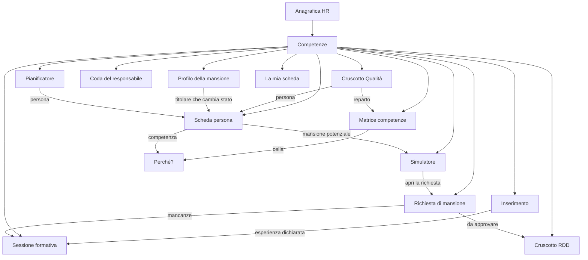
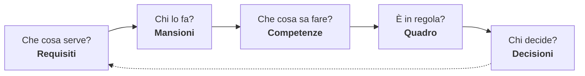

# 03 — UX/UI e prototipo

**Analisi di fattibilità: Ruoli → Mansioni → Competenze → Formazione (NOVICROM HUB, app `anagrafica`)**
Versione 0.3 · 21/11/2026 · Fase 3. Stato: prototipo rivisto dopo il confronto con il portale reale (§8) e con la
proposta di riordino a filo conduttore (§9); in attesa di riscontro.

> Proposta di interfaccia. Il prototipo usa **dati inventati** (32 persone, 14 mansioni, 30 competenze, data di
> riferimento 15/03/2027): nessun dato reale, nessun collegamento al database.

- Prototipo: `prototipo/prototipo_rmc.html` — un solo file (circa 1,1 MB), si apre con un doppio clic.
- Variante per la pubblicazione come pagina web privata: `prototipo/pubblicazione/prototipo-competenze-hub.html` (stesso contenuto).
- Schermate: `prototipo/png/` (19 immagini, 1440×900; la vista del dipendente anche a 390×844).
- Rigenerare: `python build/motore_rif.py && python build/costruisci_prototipo.py && python build/verifica_prototipo.py`.

---

## 1. Come è costruito

**Parte dall'HUB vero** **[deciso T8: template reali, dati finti]**. Lo script `build/costruisci_prototipo.py` incorpora
i fogli di stile reali del portale, presi dal repository al momento della costruzione:

| Preso dal portale | File |
| --- | --- |
| Colori, barra in alto, struttura di pagina | `core/static/core/css/tokens.css`, `theme.css`, `layout.css`, `components.css`, `hub.css`, `hub-percorso.css` |
| Menu del modulo Anagrafica (due righe) | `anagrafica/static/anagrafica/css/subnav.css` |
| Componenti delle pagine HR: testata, tessere dei numeri, schede con barra, tabelle, etichette, pulsanti | `anagrafica/static/anagrafica/css/formazione_design.css`, `hr_restyle.css`, `mansionario.css` |
| Variabili di colore del modulo | `anagrafica/templates/anagrafica/components/_hr_tokens.html` |
| Icone | `anagrafica/templates/anagrafica/components/_fm_icons.html` |

Il markup usa le **stesse classi** delle pagine attuali (`topnav`, `hrnav`, `fmd-pagehead`, `fmd-mtr`, `fmd-cc`,
`fmd-panel`, `fmd-table`, `fmd-badge`, `fmd-btn`): ogni schermata si traduce in un template Django quasi uno a uno,
senza framework JavaScript. Le sole aggiunte sono in `prototipo/src/app.css` (prefisso `px-`): la cella della matrice
con lettera e segno, lo stato di conformità, il pannello «Perché?», la barra del tour.

**La logica è quella della Fase 2.** `prototipo/src/app.js` riscrive in JavaScript le regole di
`build/motore_rif.py`; lo script di verifica controlla che i numeri a video coincidano con quelli del motore di
riferimento.

**Vincoli rispettati.** File unico; nessuna richiesta di rete (verificato: 0); carattere del portale (Outfit)
incorporato nel file al posto dei font di sistema, per fedeltà (§8); nessuna finestra di
avviso o conferma del browser, nessuno scaricamento, nessuna nuova finestra; la memoria del browser è usata solo per
ricordare l'ultima schermata, dentro un blocco protetto; utilizzabile da 360 px (verificato su tutte le schermate:
nessuno scorrimento orizzontale della pagina, le tabelle larghe scorrono dentro il proprio riquadro); nessun errore
in console.

---

## 2. Persone e domande a cui rispondere in dieci secondi

| Chi | Che cosa deve ottenere | La domanda | Dove trova la risposta |
| --- | --- | --- | --- |
| **Qualità** | Sapere se l'azienda è in regola e prepararsi all'audit | «Quante persone non sono in regola, dove, e che cosa scade?» | Cruscotto Qualità |
| **Qualità** | Cambiare un requisito senza sorprese | «Se alzo questo livello, chi resta fuori?» | Profilo della mansione |
| **Responsabile di reparto** | Sapere che cosa deve fare oggi | «Chi devo valutare, che cosa devo approvare, che cosa mi è stato segnalato?» | Coda del responsabile |
| **Responsabile di reparto** | Coprire una macchina | «Chi può già andare su DM6, e che cosa gli manca?» | Simulatore, mansioni potenziali |
| **HR** | Organizzare la formazione | «Chi va formato su che cosa, e con quale corso?» | Pianificatore |
| **Direzione** | Decidere dove investire | «Dove siamo scoperti?» | Cruscotto Qualità, copertura per reparto |
| **Persona** | Capire la propria situazione | «Che cosa posso fare, che cosa mi manca, quando scade?» | La mia scheda |

---

## 3. Architettura dell'informazione

La sezione vive nel pilastro **Competenze** del menu esistente, dove oggi stanno Mansionario e Skill Matrix; la
seconda riga del menu elenca le dodici pagine. Da ogni numero o riga si arriva alla pagina dove si agisce (regola già
in uso nel modulo: «dove una riga dice che c'è qualcosa da fare, accanto c'è un pulsante»).

---

## 4. Le schermate

| # | Schermata | Rotta | Immagine | Che cosa funziona davvero | Esiste oggi? |
| --- | --- | --- | --- | --- | --- |
| 1 | Cruscotto Qualità | `#cruscotto-qualita` | `01_cruscotto_qualita.png` | Numeri calcolati dal motore; copertura per reparto; casi da sistemare; scadenze 30/60/90 | Nuova |
| 2 | Matrice competenze | `#matrice` | `02_matrice_proposta.png`, `03_matrice_perche.png`, `04_matrice_oggi.png` | Filtri per reparto, mansione, nome, «solo chi ha mancanze»; pannello «Perché?»; **Oggi / Proposta** | Sì (skill matrix) |
| 3 | Scheda persona | `#dipendente-rinaldi` (e `#dipendente-<cognome>`) | `05_scheda_persona.png`, `06_scheda_persona_oggi.png` | Mansioni con stato e che cosa la persona può fare; requisiti con origine; mansioni potenziali; **Oggi / Proposta** | Sì (persona nel Mansionario) |
| 4 | Profilo della mansione | `#editor-mansione` | `07_editor_mansione.png` | Modifica di livello e criticità, aggiunta e rimozione di competenze; **anteprima d'impatto** ricalcolata a ogni modifica; **Oggi / Proposta** | Sì (scheda mansione) |
| 5 | Simulatore cambio mansione | `#simulatore` | `08_simulatore.png` | Scelta di persona e mansione; coperti, da colmare, effetto sulla mansione di rischio; apertura della richiesta | Nuova |
| 5a | Inserimento | `#inserimento` | `18_inserimento.png`, `19_inserimento_avviato.png` | La pratica di inserimento esistente (cinque fasi, dodici voci: otto già nel portale, tre collegate, una nuova) accanto alla scheda MOD.053: scelta delle mansioni proposte dal ruolo, ingresso in skill matrix a livello I, sessione P sull'esperienza dichiarata, esito POS bloccato finché mancano i minimi, matricola e timbro | Sì (pratica di inserimento) |
| 5b | Richiesta di mansione (RAM) | `#ram` | `13_richiesta_mansione.png`, `15_richiesta_approvata.png` | Il MOD.053 «aggiornamento mansione» a video: campi compilati dal portale, confronto automatico, evidenze riusate, avanzamento in cinque passi, firme, **esito POS bloccato** finché manca un livello minimo | Nuova |
| 5c | Sessione formativa | `#sessione-formativa` | `14_sessione_formativa.png`, `16_sessione_formativa_effetti.png` | Più persone e più competenze, modalità P/A/C, evidenza, livello raggiunto; **anteprima degli effetti** prima della chiusura; alla chiusura i livelli cambiano e tutto si ricalcola | Nuova |
| 6 | Coda del responsabile | `#coda-car` | `09_coda_responsabile.png` | Conferma o rifiuto di una valutazione e approvazione di una richiesta: i dati cambiano in memoria e tutto si ricalcola | Parziale (refresh del reparto) |
| 6b | Cruscotto RDD | `#cruscotto-rdd` | `17_cruscotto_rdd.png` | Richieste da approvare, deroghe in corso con revoca, profili da pubblicare, segnalazioni senza presa in carico con sollecito | Nuova |
| 7 | Pianificatore | `#pianificatore` | `10_pianificatore.png` | Mancanze raggruppate per competenza, ordinate per urgenza; corso o affiancamento; tutor proposti | Parziale (copertura corsi) |
| 8 | La mia scheda | `#vista-dipendente` | `11_vista_dipendente_desktop.png`, `12_vista_dipendente_telefono.png` | Vista personale, in parole semplici | Sì (La mia scheda, solo corsi) |

**Comandi comuni** (barra arancio, solo nel prototipo):
- **Tour**: avanti e indietro fra le dodici schermate nell'ordine del filo conduttore, con una frase ciascuna.
- **Solo segnalazione / Blocco**: mostra le due varianti del modello **[deciso G2: segnalazione]**. In «segnalazione»
  le mansioni non conformi sono 12; in «blocco» 14.
- **Ripristina i dati**: annulla le modifiche fatte in memoria.

**Numeri verificati contro il motore di riferimento:**

| Verifica | Valore |
| --- | --- |
| Cruscotto, modalità segnalazione | 30 conformi · 13 con riserva · 10 sotto supervisione · 12 non conformi |
| Cruscotto, modalità blocco | 30 · 11 · 10 · 14 |
| Filtro per reparto «Fresatura 5 assi» | da 32 a 10 persone |
| Simulatore: Marco Rinaldi su DM6 | 5 requisiti coperti, 1 da colmare |
| Simulatore: Giulia Ferrante su DM6 | 5 da colmare |
| Profilo di DM3: si aggiunge «Programmazione a bordo macchina» | 2 titolari su 6 cambiano stato |
| Coda: si conferma la sessione di Marco | DM6 passa a «requisiti soddisfatti» |
| Richiesta di Marco per DM6: bozza → RDD → avviata | L'esito finale resta bloccato: 1 competenza da colmare |
| Sessione formativa sulla sola competenza mancante, poi esito POS | DM6 diventa effettiva per Marco |
| Sessione di esempio (3 righe, 2 persone) | 1 effetto in anteprima: DM6 diventa mansione potenziale soddisfatta |

| Inserimento di una nuova persona | All'avvio: mansione avviata e tutte le competenze a livello I; esito POS non disponibile |

In tutto 37 controlli automatici, tutti superati; nessun errore in console; nessuna richiesta di rete; a 360 px
nessuna delle dodici schermate scorre in orizzontale.

---

## 5. Scelte di progetto e principi applicati

| Principio | Come è applicato |
| --- | --- |
| **Visibilità dello stato** (Nielsen 1) | Ogni mansione mostra uno stato in parole; ogni azione nella coda restituisce un messaggio su che cosa è cambiato |
| **Corrispondenza con il mondo reale** (Nielsen 2) | Parole della Qualità e dell'officina: mansione, competenza, livello, «lavora da sola», «firma», «forma i colleghi». Nessun termine informatico |
| **Controllo e libertà** (Nielsen 3) | Simulatore e anteprima d'impatto non modificano nulla; «Annulla le modifiche»; rifiuto nella coda |
| **Coerenza e standard** (Nielsen 4, legge di Jakob) | Stesse testate, tessere, tabelle e pulsanti delle pagine HR esistenti: chi usa il portale non deve imparare nulla |
| **Prevenzione dell'errore** (Nielsen 5) | Prima di pubblicare un profilo si vede chi cambia stato; prima di chiedere una mansione si vede che cosa manca |
| **Riconoscere, non ricordare** (Nielsen 6) | Il «Perché?» riporta la catena ruolo → mansione → requisito e l'evidenza posseduta: non serve ricordare la regola |
| **Essenzialità** (Nielsen 8, legge di Hick) | Una domanda per pagina; sei numeri in cima, mai di più; filtri ridotti a quattro |
| **Legge di Miller** | Quattro stati di conformità, quattro livelli, tre gradi di criticità: insiemi piccoli e stabili |
| **Legge di Fitts** | Pulsanti d'azione grandi e accanto al dato; sul telefono bersagli da 44 px |
| **Gerarchia visiva** | Prima lo stato (etichetta colorata con icona), poi il dettaglio, poi lo storico |
| **Divulgazione progressiva** | La matrice mostra una lettera; il segno accanto dice che c'è qualcosa; il pannello spiega tutto |

**Accessibilità.**
- Il significato non è mai affidato al solo colore: i livelli hanno **sempre la lettera** (I, L, U, O); gli stati
  hanno testo e icona (✓ ◐ ◑ ✕); le mancanze hanno il segno ▼, le competenze non più valide ✕.
- Contrasto misurato sui colori aggiunti dal prototipo: da 4,55:1 a 8,8:1, sempre sopra la soglia AA di 4,5:1 (livelli e stati sopra 8:1). I colori ereditati dal portale non sono stati rimisurati.
- Fuoco da tastiera sempre visibile (bordo arancio di 3 px); il pannello «Perché?» si chiude con Esc e riceve il fuoco
  all'apertura.
- Ogni cella della matrice ha un'etichetta letta dagli ausili: persona, competenza, livello, atteso, validità.
- Bersagli di almeno 44 px sotto gli 860 px di larghezza.
- Le tabelle larghe scorrono in orizzontale nel proprio riquadro, con la prima colonna fissa.

---

## 6. Oggi e proposta, a confronto

| Pagina | Oggi | Proposta |
| --- | --- | --- |
| Matrice | Una lettera per mansione, scritta a mano | Una lettera per competenza, con validità e mancanze; il perché a un clic |
| Scheda persona | Livello, esito, «livello sotto la soglia» | Che cosa è richiesto e da chi, che cosa possiede e con quale evidenza, che cosa può fare, che cosa potrebbe fare |
| Profilo della mansione | Nessuna competenza definita; la modifica vale subito | Requisiti con livello e criticità, versioni, anteprima d'impatto, transitorio |

Quattro pagine (matrice, scheda persona, profilo della mansione, inserimento) hanno l'interruttore **Oggi /
Proposta**. La vista «Oggi» mostra la **cattura della pagina reale** del portale (§8).

---

## 7. Limiti del prototipo

- Inserimento, richiesta di mansione e sessione formativa hanno la loro pagina; manca la richiesta di **revoca**.
- Le firme sono pulsanti: nel prototipo una sola persona recita tutti i ruoli (richiedente, RDD, MSO).
- Il registro di affiancamento allegato alla sessione è solo citato.
- Il MOD.053 riepilogativo stampabile non è incluso.
- Le modifiche valgono finché la pagina resta aperta.

---

## 8. Confronto con il portale reale

Il primo prototipo usava i fogli di stile veri ma **barra, menu e carattere rifatti a mano**: al primo sguardo
risultava diverso dal portale. Per verificarlo ho catturato le pagine reali da un server di prova locale, su un
database SQLite usa-e-getta con sei persone inventate (mai la produzione, mai il database di sviluppo; il database è
stato cancellato a cattura finita).

| Differenza trovata | Nel portale | Correzione nel prototipo |
| --- | --- | --- |
| Carattere | Outfit | Outfit incorporato nel file (dal repository) |
| Barra in alto | Logo, griglia dei moduli, preferiti, menu a tendina, ricerca, notifiche, utente | Markup **reale**, estratto dalla pagina e ripulito dai collegamenti |
| Menu del modulo | Otto pilastri con icona; seconda riga con sezioni e voci | Markup **reale** della prima riga; seconda riga con le stesse classi |
| Percorso | «Home › pagina» | Stesso markup |
| Nomi delle persone | COGNOME NOME in maiuscolo | Allineato |
| Pagine «Oggi» | — | **Catture reali** al posto delle ricostruzioni |

Le catture reali sono in `prototipo/src/oggi/` (quattro immagini); barra e menu in `prototipo/src/guscio/`. Lo script
`build/prepara_guscio.py` documenta come rigenerarli.

Restano differenze volute: la barra arancio del tour, il filo conduttore e la seconda riga del menu, che sono la
proposta.

---

## 9. Diagnosi dell'interfaccia attuale e proposta di riordino

### 9.1 Che cosa si vede oggi

Osservazioni sulle pagine reali catturate (`01_asis.md` per i riferimenti al codice).

| # | Osservazione | Dove | Effetto |
| --- | --- | --- | --- |
| 1 | **Il tema è sparso su quattro pilastri del menu**: Persone › Ingressi › Onboarding; Organizzazione › Struttura › Mansionario; Competenze › Formazione, Qualifiche, Abilitazioni; Salute e sicurezza › cambi mansione | Menu del modulo | Chi segue una persona dall'ingresso all'autonomia cambia pilastro quattro volte: non c'è un percorso |
| 2 | **Due matrici per gli stessi dati**: «Abilitazioni macchina» (Skill Matrix) e «Matrice competenze», più il Mansionario | Competenze › Abilitazioni; Organizzazione › Mansionario | Con gli stessi dati di prova la Skill Matrix risulta vuota e il Mansionario pieno: regole diverse, fiducia bassa |
| 3 | **Quattro stili di testata**: fascia scura con numeri (Mansionario), testata semplice (persona), riquadro con icona (Skill Matrix), testata propria (Onboarding) | Pagine | Il portale sembra fatto di moduli diversi |
| 4 | **Troppi comandi alla pari**: nel Mansionario 9 pulsanti nella fascia e 10 riquadri numerici | Mansionario | Nessuna gerarchia: non si capisce da dove partire |
| 5 | **L'azione principale è la più rischiosa**: in cima alla scheda persona c'è l'assegnazione diretta di una mansione, con il livello scelto a mano | Scheda persona | È il gesto che la Qualità chiede di togliere |
| 6 | **«Cosa manca» è testo**, senza azione accanto | Scheda persona | Si legge il problema, non si arriva al rimedio |
| 7 | **Il livello cambia da solo**: nello storico della persona di prova compare «Ricalcolo automatico: livello U → L (non abilitato)» subito dopo l'assegnazione | Scheda persona | È il difetto della regola attuale visto dal vivo (`02_tobe` §3.4) |
| 8 | **L'inserimento è una lista lunga a colonna unica**: 13 voci, tutte uguali per peso | Pratica di onboarding | Il passaggio decisivo («Assegnare ruolo, area e mansioni») è una voce fra le altre |

Punti di forza da conservare: il linguaggio visivo è curato e coerente dentro ogni pagina; i riquadri numerici sono
cliccabili e filtrano; la pratica di inserimento ha già fasi, scadenze e chiusura automatica; esiste già un componente
«filo» (ruolo → mansione → competenza → requisito) nella scheda della competenza.

### 9.2 La proposta: un filo conduttore

**Cinque domande, sempre nello stesso ordine.** Sono insieme le sezioni del menu e la striscia in cima a ogni pagina.

| Sezione | Domanda | Pagine | Pagine di oggi che confluiscono |
| --- | --- | --- | --- |
| **Requisiti** | Che cosa serve? | Profilo della mansione | Mansionario (schede delle mansioni), Struttura e import, Catalogo competenze, Regole |
| **Mansioni** | Chi lo fa? | Inserimento · Simulatore · Richiesta di mansione | Onboarding, «Aggiungi mansioni» della scheda persona, Mansioni in blocco, cambi mansione |
| **Competenze** | Che cosa sa fare? | Sessione formativa · Pianificatore | Valutazione per competenza, Refresh del caporeparto, Formazione (corsi ed edizioni restano dove sono, collegati) |
| **Quadro** | È in regola? | Cruscotto · Matrice · Scheda persona · La mia scheda | Skill Matrix, Matrice competenze, Lacune, Copertura, Conformità |
| **Decisioni** | Chi decide? | Coda del responsabile · Cruscotto RDD | Scadenzario abilitazioni, approvazioni |

**Quattro regole di interfaccia.**

1. **Sei qui.** Ogni pagina mostra la striscia delle cinque domande con la propria evidenziata; le altre sono
   collegamenti. Riusa il componente «filo» già esistente (`mansionario.css`, classi `mns-filo`).
2. **Un prossimo passo.** In fondo a ogni pagina c'è un solo pulsante che porta al passo successivo, già compilato:
   dal simulatore alla richiesta, dalla richiesta alla sessione formativa sulle sole mancanze, dalla sessione alla
   matrice. È la regola già adottata nel modulo («accanto a ogni stato da gestire un solo pulsante»), estesa
   all'intero percorso.
3. **Una sola testata.** Titolo, una riga di contesto, le azioni a destra. La fascia scura con i numeri resta solo
   sulla pagina d'ingresso della sezione. Al massimo sei numeri in cima.
4. **Una sola matrice.** Skill Matrix e Matrice competenze diventano la stessa pagina, con due viste: per mansione
   (una lettera) e per competenza (lettera, validità, mancanza).

### 9.3 È necessario?

**Sì per il menu e il percorso, no per il linguaggio visivo.** Componenti, colori e tabelle funzionano e non vanno
ridisegnati. Va riordinato *dove stanno le cose* e *in che ordine si incontrano*: senza questo, Sessione Formativa e
Richiesta di mansione finirebbero in un quinto e in un sesto posto del menu.

### 9.4 Quanto costa e come si fa senza fermare nulla

| Passo | Contenuto | Stima | Rischio |
| --- | --- | --- | --- |
| 1 | Riordino del menu nelle cinque sezioni. Il menu del modulo è già configurabile dal portale (`models.py:2676`, `:2713`): è configurazione, non sviluppo | S | Basso: gli indirizzi non cambiano |
| 2 | Striscia «filo» e «prossimo passo» come componenti condivisi, inclusi nelle pagine esistenti | S | Basso |
| 3 | Testata unica sulle pagine del percorso | M | Basso: solo template |
| 4 | Una sola matrice con due viste | M | Medio: va chiarita la regola unica dei livelli (`02_tobe` §3.4) |
| 5 | Scheda persona: via l'assegnazione diretta dalla testa della pagina (resta agli amministratori), «Cosa manca» con azione | S | Legato all'introduzione della richiesta di mansione |
| 6 | Pratica di inserimento: il passaggio «mansioni» in evidenza, collegato alla richiesta di inserimento | M | Basso |

I passi 1 e 2 si possono fare **subito**, prima di ogni altro blocco: danno il percorso anche alle pagine di oggi.
Nel prototipo la proposta si vede nella seconda riga del menu, nella striscia in cima a ogni pagina e nel riquadro
«Prossimo passo» in fondo.
