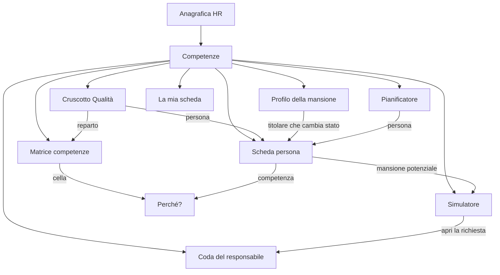

# 03 — UX/UI e prototipo

**Analisi di fattibilità: Ruoli → Mansioni → Competenze → Formazione (NOVICROM HUB, app `anagrafica`)**
Versione 0.1 · 21/11/2026 · Fase 3. Stato: in attesa di GATE 3.

> Proposta di interfaccia. Il prototipo usa **dati inventati** (32 persone, 14 mansioni, 30 competenze, data di
> riferimento 15/03/2027): nessun dato reale, nessun collegamento al database.

- Prototipo: `prototipo/prototipo_rmc.html` — un solo file (332 KB), si apre con un doppio clic.
- Schermate: `prototipo/png/` (12 immagini, 1440×900; la vista del dipendente anche a 390×844).
- Rigenerare: `python build/motore_rif.py && python build/costruisci_prototipo.py && python build/verifica_prototipo.py`.

---

## 1. Come è costruito

**Parte dall'HUB vero** **[deciso T8: template reali, dati finti]**. Lo script `build/costruisci_prototipo.py` incorpora
i fogli di stile reali del portale, presi dal repository al momento della costruzione:

| Preso dal portale | File |
| --- | --- |
| Colori, barra in alto, struttura di pagina | `core/static/core/css/tokens.css`, `theme.css`, `layout.css`, `components.css`, `hub.css`, `hub-percorso.css` |
| Menu del modulo Anagrafica (due righe) | `anagrafica/static/anagrafica/css/subnav.css` |
| Componenti delle pagine HR: testata, tessere dei numeri, schede con barra, tabelle, etichette, pulsanti | `anagrafica/static/anagrafica/css/formazione_design.css`, `hr_restyle.css`, `mansionario.css` |
| Variabili di colore del modulo | `anagrafica/templates/anagrafica/components/_hr_tokens.html` |
| Icone | `anagrafica/templates/anagrafica/components/_fm_icons.html` |

Il markup usa le **stesse classi** delle pagine attuali (`topnav`, `hrnav`, `fmd-pagehead`, `fmd-mtr`, `fmd-cc`,
`fmd-panel`, `fmd-table`, `fmd-badge`, `fmd-btn`): ogni schermata si traduce in un template Django quasi uno a uno,
senza framework JavaScript. Le sole aggiunte sono in `prototipo/src/app.css` (prefisso `px-`): la cella della matrice
con lettera e segno, lo stato di conformità, il pannello «Perché?», la barra del tour.

**La logica è quella della Fase 2.** `prototipo/src/app.js` riscrive in JavaScript le regole di
`build/motore_rif.py`; lo script di verifica controlla che i numeri a video coincidano con quelli del motore di
riferimento.

**Vincoli rispettati.** File unico; nessuna richiesta di rete (verificato: 0); font di sistema; nessuna finestra di
avviso o conferma del browser, nessuno scaricamento, nessuna nuova finestra; la memoria del browser è usata solo per
ricordare l'ultima schermata, dentro un blocco protetto; utilizzabile da 360 px (verificato su tutte le schermate:
nessuno scorrimento orizzontale della pagina, le tabelle larghe scorrono dentro il proprio riquadro); nessun errore
in console.

---

## 2. Persone e domande a cui rispondere in dieci secondi

| Chi | Che cosa deve ottenere | La domanda | Dove trova la risposta |
| --- | --- | --- | --- |
| **Qualità** | Sapere se l'azienda è in regola e prepararsi all'audit | «Quante persone non sono in regola, dove, e che cosa scade?» | Cruscotto Qualità |
| **Qualità** | Cambiare un requisito senza sorprese | «Se alzo questo livello, chi resta fuori?» | Profilo della mansione |
| **Responsabile di reparto** | Sapere che cosa deve fare oggi | «Chi devo valutare, che cosa devo approvare, che cosa mi è stato segnalato?» | Coda del responsabile |
| **Responsabile di reparto** | Coprire una macchina | «Chi può già andare su DM6, e che cosa gli manca?» | Simulatore, mansioni potenziali |
| **HR** | Organizzare la formazione | «Chi va formato su che cosa, e con quale corso?» | Pianificatore |
| **Direzione** | Decidere dove investire | «Dove siamo scoperti?» | Cruscotto Qualità, copertura per reparto |
| **Persona** | Capire la propria situazione | «Che cosa posso fare, che cosa mi manca, quando scade?» | La mia scheda |

---

## 3. Architettura dell'informazione

La sezione vive nel pilastro **Competenze** del menu esistente, dove oggi stanno Mansionario e Skill Matrix; la
seconda riga del menu elenca le otto pagine. Da ogni numero o riga si arriva alla pagina dove si agisce (regola già
in uso nel modulo: «dove una riga dice che c'è qualcosa da fare, accanto c'è un pulsante»).

---

## 4. Le schermate

| # | Schermata | Rotta | Immagine | Che cosa funziona davvero | Esiste oggi? |
| --- | --- | --- | --- | --- | --- |
| 1 | Cruscotto Qualità | `#cruscotto-qualita` | `01_cruscotto_qualita.png` | Numeri calcolati dal motore; copertura per reparto; casi da sistemare; scadenze 30/60/90 | Nuova |
| 2 | Matrice competenze | `#matrice` | `02_matrice_proposta.png`, `03_matrice_perche.png`, `04_matrice_oggi.png` | Filtri per reparto, mansione, nome, «solo chi ha mancanze»; pannello «Perché?»; **Oggi / Proposta** | Sì (skill matrix) |
| 3 | Scheda persona | `#dipendente-rinaldi` (e `#dipendente-<cognome>`) | `05_scheda_persona.png`, `06_scheda_persona_oggi.png` | Mansioni con stato e che cosa la persona può fare; requisiti con origine; mansioni potenziali; **Oggi / Proposta** | Sì (persona nel Mansionario) |
| 4 | Profilo della mansione | `#editor-mansione` | `07_editor_mansione.png` | Modifica di livello e criticità, aggiunta e rimozione di competenze; **anteprima d'impatto** ricalcolata a ogni modifica; **Oggi / Proposta** | Sì (scheda mansione) |
| 5 | Simulatore cambio mansione | `#simulatore` | `08_simulatore.png` | Scelta di persona e mansione; coperti, da colmare, effetto sulla mansione di rischio; apertura della richiesta | Nuova |
| 6 | Coda del responsabile | `#coda-car` | `09_coda_responsabile.png` | Conferma o rifiuto di una valutazione e approvazione di una richiesta: i dati cambiano in memoria e tutto si ricalcola | Parziale (refresh del reparto) |
| 7 | Pianificatore | `#pianificatore` | `10_pianificatore.png` | Mancanze raggruppate per competenza, ordinate per urgenza; corso o affiancamento; tutor proposti | Parziale (copertura corsi) |
| 8 | La mia scheda | `#vista-dipendente` | `11_vista_dipendente_desktop.png`, `12_vista_dipendente_telefono.png` | Vista personale, in parole semplici | Sì (La mia scheda, solo corsi) |

**Comandi comuni** (barra arancio, solo nel prototipo):
- **Tour**: avanti e indietro fra le otto schermate, con una frase di spiegazione ciascuna.
- **Solo segnalazione / Blocco**: mostra le due varianti del modello **[deciso G2: segnalazione]**. In «segnalazione»
  le mansioni non conformi sono 12; in «blocco» 14.
- **Ripristina i dati**: annulla le modifiche fatte in memoria.

**Numeri verificati contro il motore di riferimento:**

| Verifica | Valore |
| --- | --- |
| Cruscotto, modalità segnalazione | 30 conformi · 13 con riserva · 10 sotto supervisione · 12 non conformi |
| Cruscotto, modalità blocco | 30 · 11 · 10 · 14 |
| Filtro per reparto «Fresatura 5 assi» | da 32 a 10 persone |
| Simulatore: Marco Rinaldi su DM6 | 5 requisiti coperti, 1 da colmare |
| Simulatore: Giulia Ferrante su DM6 | 5 da colmare |
| Profilo di DM3: si aggiunge «Programmazione a bordo macchina» | 2 titolari su 6 cambiano stato |
| Coda: si conferma la sessione di Marco | DM6 passa a «requisiti soddisfatti» |

---

## 5. Scelte di progetto e principi applicati

| Principio | Come è applicato |
| --- | --- |
| **Visibilità dello stato** (Nielsen 1) | Ogni mansione mostra uno stato in parole; ogni azione nella coda restituisce un messaggio su che cosa è cambiato |
| **Corrispondenza con il mondo reale** (Nielsen 2) | Parole della Qualità e dell'officina: mansione, competenza, livello, «lavora da sola», «firma», «forma i colleghi». Nessun termine informatico |
| **Controllo e libertà** (Nielsen 3) | Simulatore e anteprima d'impatto non modificano nulla; «Annulla le modifiche»; rifiuto nella coda |
| **Coerenza e standard** (Nielsen 4, legge di Jakob) | Stesse testate, tessere, tabelle e pulsanti delle pagine HR esistenti: chi usa il portale non deve imparare nulla |
| **Prevenzione dell'errore** (Nielsen 5) | Prima di pubblicare un profilo si vede chi cambia stato; prima di chiedere una mansione si vede che cosa manca |
| **Riconoscere, non ricordare** (Nielsen 6) | Il «Perché?» riporta la catena ruolo → mansione → requisito e l'evidenza posseduta: non serve ricordare la regola |
| **Essenzialità** (Nielsen 8, legge di Hick) | Una domanda per pagina; sei numeri in cima, mai di più; filtri ridotti a quattro |
| **Legge di Miller** | Quattro stati di conformità, quattro livelli, tre gradi di criticità: insiemi piccoli e stabili |
| **Legge di Fitts** | Pulsanti d'azione grandi e accanto al dato; sul telefono bersagli da 44 px |
| **Gerarchia visiva** | Prima lo stato (etichetta colorata con icona), poi il dettaglio, poi lo storico |
| **Divulgazione progressiva** | La matrice mostra una lettera; il segno accanto dice che c'è qualcosa; il pannello spiega tutto |

**Accessibilità.**
- Il significato non è mai affidato al solo colore: i livelli hanno **sempre la lettera** (I, L, U, O); gli stati
  hanno testo e icona (✓ ◐ ◑ ✕); le mancanze hanno il segno ▼, le competenze non più valide ✕.
- Contrasto misurato sui colori aggiunti dal prototipo: da 4,55:1 a 8,8:1, sempre sopra la soglia AA di 4,5:1 (livelli e stati sopra 8:1). I colori ereditati dal portale non sono stati rimisurati.
- Fuoco da tastiera sempre visibile (bordo arancio di 3 px); il pannello «Perché?» si chiude con Esc e riceve il fuoco
  all'apertura.
- Ogni cella della matrice ha un'etichetta letta dagli ausili: persona, competenza, livello, atteso, validità.
- Bersagli di almeno 44 px sotto gli 860 px di larghezza.
- Le tabelle larghe scorrono in orizzontale nel proprio riquadro, con la prima colonna fissa.

---

## 6. Oggi e proposta, a confronto

| Pagina | Oggi | Proposta |
| --- | --- | --- |
| Matrice | Una lettera per mansione, scritta a mano | Una lettera per competenza, con validità e mancanze; il perché a un clic |
| Scheda persona | Livello, esito, «livello sotto la soglia» | Che cosa è richiesto e da chi, che cosa possiede e con quale evidenza, che cosa può fare, che cosa potrebbe fare |
| Profilo della mansione | Nessuna competenza definita; la modifica vale subito | Requisiti con livello e criticità, versioni, anteprima d'impatto, transitorio |

Le tre pagine hanno l'interruttore **Oggi / Proposta**. La vista «Oggi» ricostruisce la pagina attuale con le stesse
classi e gli stessi testi dei template reali (`mansionario_persona.html`, `skill_matrix_macchina.html`,
`mansionario_mansione.html`), applicati ai dati inventati.

---

## 7. Limiti del prototipo

- Dimostra l'interfaccia e il calcolo, non i flussi completi: Sessione Formativa e Richiesta di Aggiornamento Mansione
  compaiono nella coda e nel simulatore, non hanno ancora le loro pagine di compilazione (modulo a video del MOD.053).
- Le firme di RDD e MSO sono rappresentate da un solo pulsante «Approva».
- Il cruscotto di RDD e il MOD.053 stampabile non sono inclusi.
- Le viste «Oggi» sono ricostruzioni fedeli nelle classi e nei testi, non catture del portale.
- Le modifiche valgono finché la pagina resta aperta.
