# Navigazione di Anagrafica: analisi e proposta

Versione 2.0 · 22/11/2026 · sostituisce la versione 1.0, che ragionava sull'elenco delle voci senza guardare come il
menu funziona davvero.

> **Metodo.** Ho avviato il portale in locale, sul codice del ramo principale, con un database di prova usa e getta e
> un utente amministratore. Ho visitato le 57 pagine raggiungibili dal menu e per ciascuna ho registrato che cosa si
> accende, che cosa mostra la seconda riga, il percorso e i pulsanti in testa. Nessun dato reale, nessun file del
> portale modificato; server fermato e database cancellato a fine lavoro. I bozzetti della proposta sono fatti sulle
> stesse pagine, sostituendo barra e contenuto: stili e componenti sono quelli veri, nomi e numeri sono inventati.

## In breve

1. **Oggi si attraversano cinque strati** prima del contenuto: barra del portale, pilastri, sezioni e voci, percorso,
   e in molte pagine una fila di pulsanti che fa da menu. Il contenuto comincia a 179 punti su 900.
2. **Il menu ha tre livelli**, e le voci si vedono una sezione alla volta: 25 voci su 53 richiedono tre clic e tre
   caricamenti di pagina.
3. **Le mappe non coincidono.** Per Sicurezza esistono due menu diversi, uno sul computer e uno sul telefono. Su 50
   voci, 22 portano a una pagina che nel percorso ha un altro nome. Il percorso nomina il pilastro in 5 pagine su 57.
4. **Proposta: due livelli invece di tre.** Sei pilastri, al massimo sei voci ciascuno, tutte visibili insieme. Un
   solo elenco da cui nascono barra, telefono e percorso. La barra passa da 14 stati a 8.
5. **Costo:** 10-19 giorni per la navigazione, più 6-12 per unire le pagine doppie.

---

## 1. Com'è fatta oggi: cinque strati

<figure class="schermata">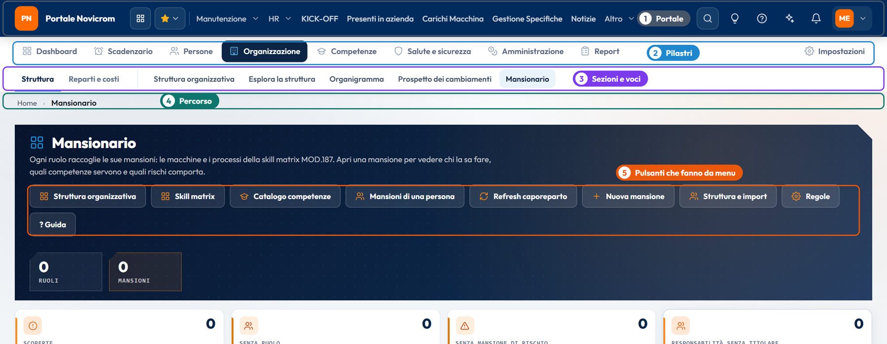
<figcaption><b>Oggi, pagina «Mansionario».</b> Cinque strati prima del contenuto. L'ultimo non è un menu, ma lo
sostituisce: sei dei nove pulsanti portano ad altre pagine.</figcaption></figure>

| Strato | Che cosa contiene | Altezza |
| --- | --- | --- |
| 1. Barra del portale | I moduli del portale | 60 |
| 2. Pilastri | 9 voci: Dashboard, Scadenzario, quattro pilastri, Amministrazione, Report, Impostazioni | 48 |
| 3. Sezioni e voci | A sinistra le sezioni del pilastro (fino a 4), a destra le voci della sezione accesa (fino a 8) | 42 |
| 4. Percorso | «Home › …» | 29 |
| 5. Pulsanti in testa alla pagina | Azioni e collegamenti ad altre pagine, mescolati | variabile |

Il contenuto comincia a 179 punti dall'alto, su uno schermo alto 900: un quinto. Il titolo della pagina sta fra 203 e
240.

<figure class="schermata">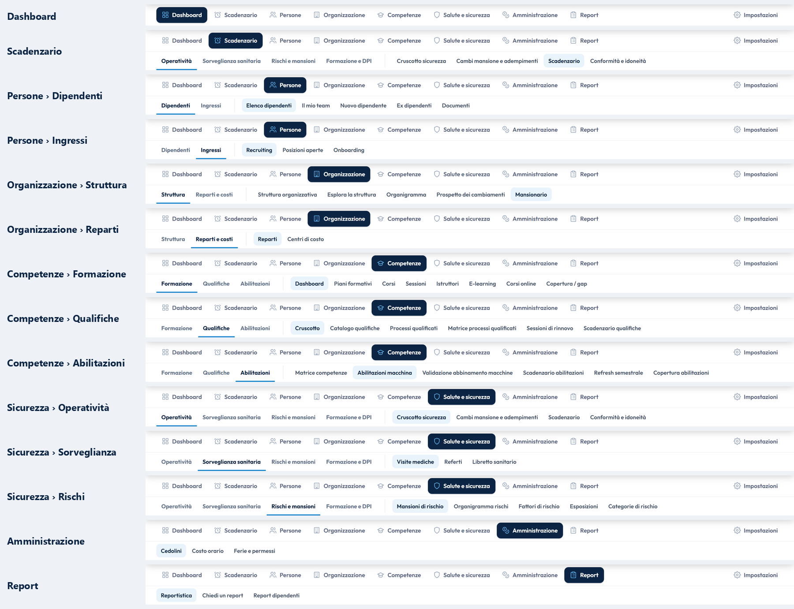
<figcaption><b>Oggi, tutti gli stati della barra.</b> Sono 14. Per vedere le voci di una sezione bisogna aprirne una
pagina: da «Formazione» non si vede che cosa c'è sotto «Abilitazioni».</figcaption></figure>

## 2. Che cosa ho misurato

| Misura | Valore |
| --- | --- |
| Pagine visitate dal menu | 57, tutte aperte |
| Voci nel menu configurato | 53 |
| Voci che il computer mostra davvero | 60: Sicurezza ne mostra 16, non le 9 configurate |
| Stati diversi della barra | 14 |
| Voci raggiungibili in due clic | 28 |
| Voci che ne richiedono tre, con tre caricamenti | 25, più 4 di una sezione che porta altrove |
| Voci il cui nome non è quello del percorso | 22 su 50 |
| Voci il cui nome è il titolo della pagina | 15 su 50; altre 15 pagine non hanno un titolo principale |
| Pagine in cui il percorso nomina il pilastro | 5 su 57 |
| Pagine con più di tre pulsanti in testa | 10 |
| Pagine con un pulsante «torna a…» | 5 |
| Collegamenti interni contati nelle pagine, fuori dal menu | 284; otto pagine ne hanno dieci o più |
| Larghezza: la barra entra senza ridursi | Da 1.280 a 1.920 punti sì. A 1.100 si restringe, e «Abilitazioni» va su due righe |

## 3. I difetti, con le prove

**1. Le voci si vedono una sezione alla volta.** La seconda riga mostra le sezioni del pilastro e solo le voci di
quella accesa. Per arrivare a «Scadenzario abilitazioni» servono tre clic: Competenze, poi la sezione Abilitazioni,
poi la voce. Ogni clic carica una pagina che non interessa. Vale per 25 voci su 53.

**2. Per Sicurezza i menu sono due.** La seconda riga del computer non legge il menu configurato: ha un elenco suo,
scritto nel codice (`anagrafica/templatetags/anagrafica_extras.py:585`). Il telefono legge invece il menu configurato.

| | Computer | Telefono |
| --- | --- | --- |
| Sezioni | Operatività, Sorveglianza sanitaria, Rischi e mansioni, Formazione e DPI | Panoramica, Sorveglianza sanitaria, Conformità, Rischi e mansioni |
| Voci | 16 | 9 |
| Solo qui | Organigramma rischi, Fattori di rischio, Esposizioni, Categorie di rischio, DPI, Guida | Sessioni di visita, Registro referti |

<figure class="schermata">
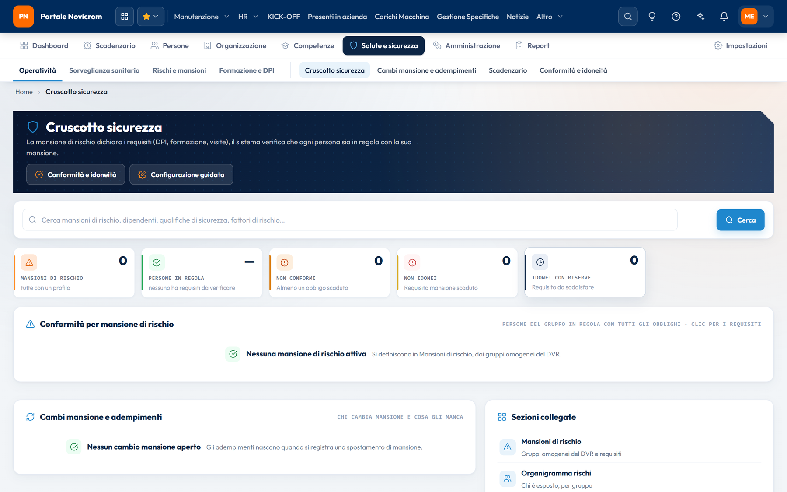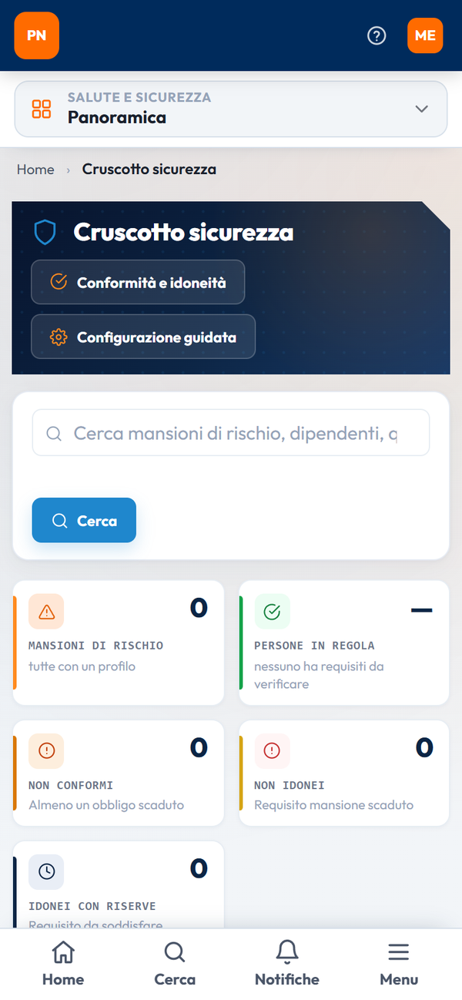

<figcaption><b>Oggi, la stessa pagina.</b> Sul computer la sezione si chiama «Operatività», sul telefono
«Panoramica».</figcaption></figure>

**3. Una sezione porta fuori dal pilastro.** In Sicurezza la sezione «Formazione e DPI» apre «Matrice qualifiche»,
che è la stessa pagina di «Matrice competenze»: si accende Competenze › Abilitazioni e la riga di Sicurezza sparisce.
Lo «Scadenzario» è una voce a sé nella prima riga, ma sotto mostra la seconda riga di Sicurezza: quattro pagine
stanno in due posti.

**4. La stessa pagina ha più nomi.** Su 50 voci, 22 aprono una pagina che nel percorso si chiama in un altro modo.

| Nel menu | Nel percorso |
| --- | --- |
| Abilitazioni macchina | Skill Matrix |
| Matrice competenze | Matrice qualifiche |
| Copertura abilitazioni | Copertura minima |
| Refresh semestrale | Refresh abilitazioni |
| Istruttori | Docenti / Formatori |
| Recruiting | Selezione risorse — MOD. 05-01 |
| Reparti | Reparti, aree e capi |
| Cruscotto (delle qualifiche) | Qualifiche & Certificazioni |

**5. Il percorso racconta un'altra struttura.** Nomina il pilastro in 5 pagine su 57. «Struttura organizzativa» sta
nel menu sotto Organizzazione › Struttura, ma il percorso dice «Home › Mansionario › Struttura organizzativa». Il
«Catalogo qualifiche» sta sotto Competenze › Qualifiche, ma il percorso dice «Home › Formazione».

**6. Alcune pagine fanno da menu.** Dieci pagine hanno più di tre pulsanti in testa. Nel Mansionario sono nove, e sei
portano ad altre pagine; tre di queste (Catalogo competenze, Regole, Struttura e import) non hanno una voce nel menu:
ci si arriva solo da lì.

<figure class="schermata">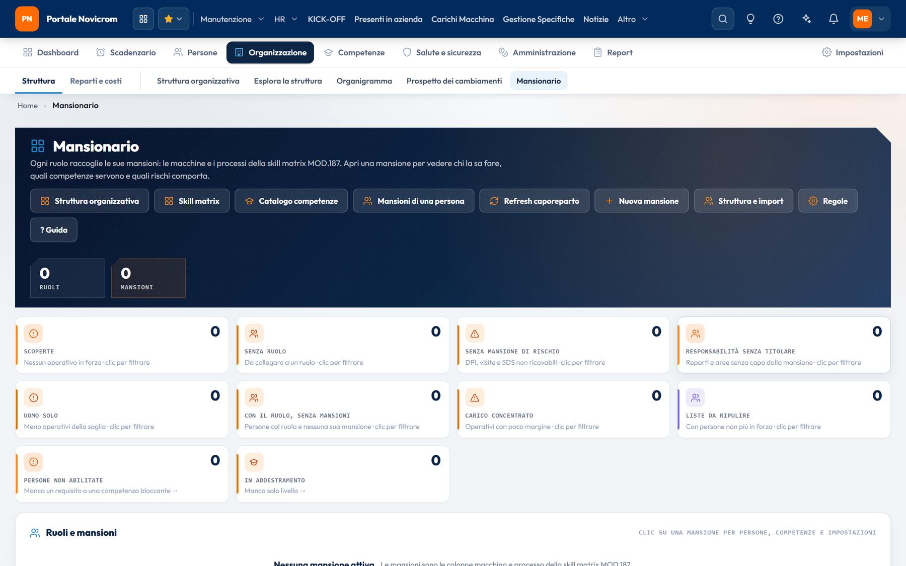
<figcaption><b>Oggi, «Mansionario».</b> Nove pulsanti in testa e dieci riquadri numerici.</figcaption></figure>

**7. Lo stesso tipo di pagina è ripetuto.** Tre scadenzari, quattro cruscotti, tre matrici, due coperture, tre tipi
di «sessione». La mansione sta in tre pilastri: Organizzazione, Sicurezza, Competenze.

**Che cosa funziona e si conserva.** Il menu è configurabile dal portale (`anagrafica/models.py:2676`, `:2713`). Le
voci che l'utente non può aprire spariscono da sole (`anagrafica/subnav_gates.py`). La barra si adatta alla
larghezza. I numeri sui pilastri esistono già, per Scadenzario e Sicurezza.

## 4. La proposta: due livelli invece di tre

<figure class="schermata">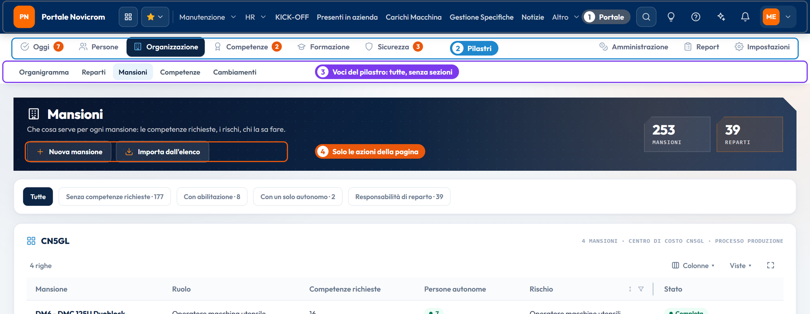
<figcaption><b>Proposta, pagina «Mansioni».</b> Tre strati. Le voci del pilastro sono tutte visibili; in testa
restano solo le azioni della pagina.</figcaption></figure>

**Sette regole.**

1. **Due livelli: pilastro e voce.** Le sezioni spariscono. Al massimo sei voci per pilastro, tutte visibili.
2. **Un solo elenco del menu.** Da quello nascono la barra del computer, il pannello del telefono e il percorso.
3. **Il nome della voce è il titolo della pagina.**
4. **Il percorso compare solo sotto il primo livello**, cioè nelle schede: una persona, una mansione, un corso.
5. **In testa alla pagina solo azioni**, al massimo tre. Per andare altrove c'è il menu.
6. **Un numero su ogni pilastro** dove c'è qualcosa da fare.
7. **Si entra da «Oggi».**

<figure class="schermata">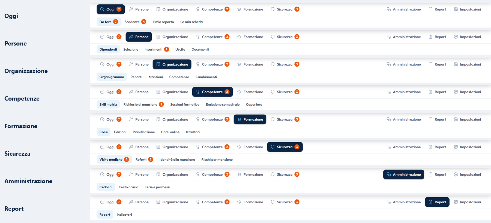
<figcaption><b>Proposta, tutti gli stati della barra.</b> Sono 8. A destra restano Amministrazione, Report e
Impostazioni.</figcaption></figure>

| Pilastro | Domanda | Voci |
| --- | --- | --- |
| **Oggi** | Che cosa aspetta me? | Da fare · Scadenze · Il mio reparto · La mia scheda |
| **Persone** | Chi c'è? | Dipendenti · Selezione · Inserimenti · Uscite · Documenti |
| **Organizzazione** | Che cosa serve? | Organigramma · Reparti · Mansioni · Competenze · Cambiamenti |
| **Competenze** | Chi sa fare che cosa? | Skill matrix · Richieste di mansione · Sessioni formative · Emissione semestrale · Copertura |
| **Formazione** | Come si impara? | Corsi · Edizioni · Pianificazione · Corsi online · Istruttori |
| **Sicurezza** | È idonea? | Visite mediche · Referti · Idoneità alla mansione · Rischi per mansione |
| Amministrazione | | Cedolini · Costo orario · Ferie e permessi |
| Report | | Report · Indicatori |
| Impostazioni | | Impostazioni |

**Prima e dopo.**

| Misura | Oggi | Proposta |
| --- | --- | --- |
| Livelli del menu | 3 | 2 |
| Stati della barra | 14 | 8 |
| Voci mostrate | 60 | 34 |
| Clic per la voce più lontana | 3 | 2 |
| Inizio del contenuto, in punti | 179 | 150 |
| Elenchi del menu da tenere allineati | 2, più il percorso | 1 |
| Larghezza minima senza ridursi | 1.280 | 1.100 |

## 5. Le pagine nuove

<figure class="schermata">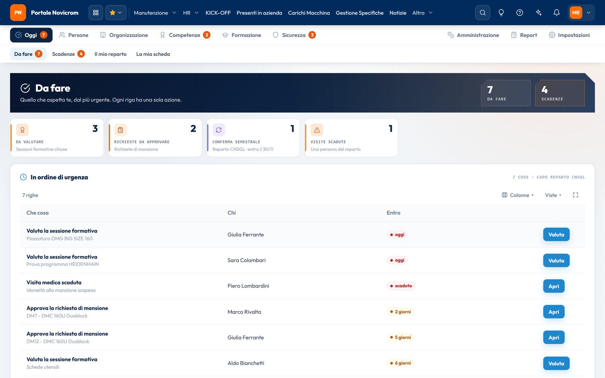
<figcaption><b>Oggi › Da fare.</b> Un elenco solo, in ordine di urgenza, con una azione per riga. Sostituisce
Dashboard e Scadenzario come ingresso. Qui è visto da un capo reparto.</figcaption></figure>

<figure class="schermata">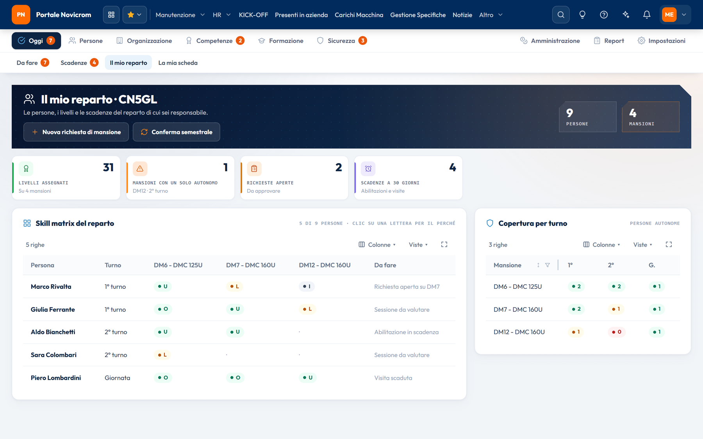
<figcaption><b>Oggi › Il mio reparto.</b> Persone, livelli, copertura per turno e richieste del reparto di cui si è
responsabili. Il responsabile si ricava dalla mansione «Responsabilità del reparto» della bozza della
Qualità.</figcaption></figure>

<figure class="schermata">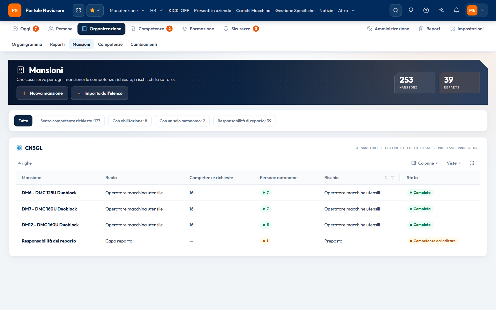
<figcaption><b>Organizzazione › Mansioni.</b> Al posto del Mansionario. I nove pulsanti diventano due azioni; i
filtri sostituiscono i dieci riquadri.</figcaption></figure>

<figure class="schermata">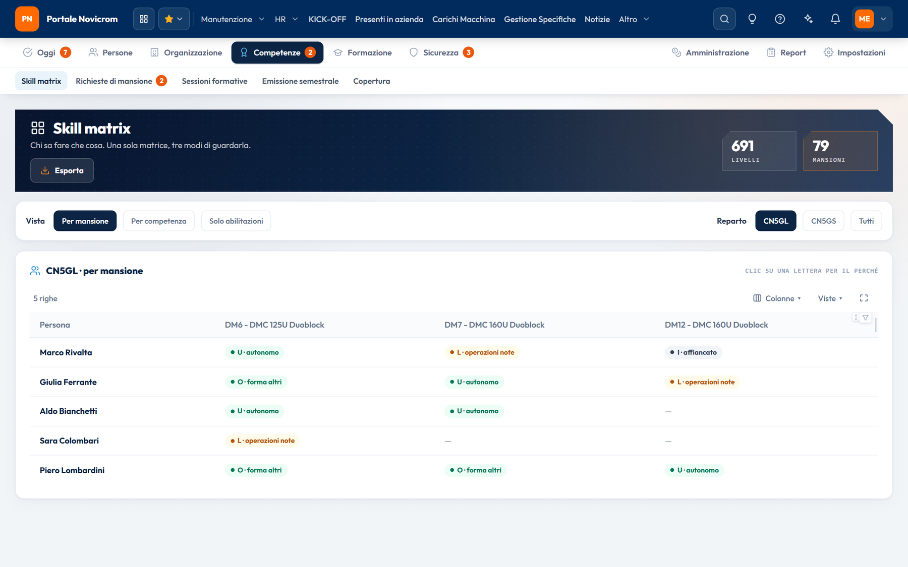
<figcaption><b>Competenze › Skill matrix.</b> Una matrice sola, con tre viste: per mansione, per competenza, solo
abilitazioni.</figcaption></figure>

## 6. Variante: l'anteprima del pilastro

<figure class="schermata">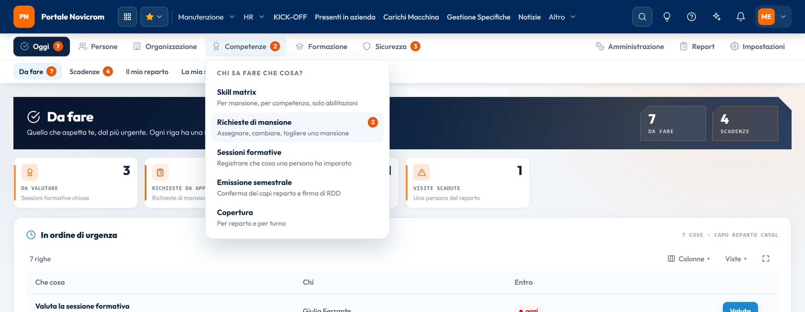
<figcaption><b>Variante.</b> Fermando il puntatore su un pilastro si vedono le sue voci, con una riga che dice a che
cosa servono, senza lasciare la pagina.</figcaption></figure>

| Pregi | Difetti |
| --- | --- |
| Ogni voce a un clic, da qualunque pagina | Un elemento in più che si apre da solo: può dare fastidio |
| La riga di spiegazione aiuta chi usa poco il modulo | Sul telefono non serve: lì il menu è già un pannello |
| Le voci esistono già nella pagina, nascoste: si tratta di mostrarle | Va provata con chi usa il portale tutti i giorni |

**Raccomandazione:** partire senza, e aggiungerla come secondo passo se chi usa il portale la chiede.

## 7. Chi vede che cosa

Il filtro per permessi c'è già: la tabella dice che cosa si vuole ottenere.

| Chi | Da dove entra | Usa soprattutto |
| --- | --- | --- |
| Operatore | Oggi › La mia scheda | I suoi livelli, le scadenze, i corsi online |
| Capo reparto | Oggi › Il mio reparto | Skill matrix del reparto, richieste, conferma semestrale, copertura per turno |
| Qualità | Oggi › Da fare | Mansioni e competenze, sessioni formative, emissione |
| RDD | Oggi › Da fare | Firma dell'emissione, richieste da approvare, indicatori |
| Risorse umane | Persone | Inserimenti, uscite, formazione, amministrazione |
| Sicurezza | Sicurezza | Visite, referti, idoneità, rischi per mansione |

## 8. Come arrivarci

| Passo | Contenuto | Giorni | Rischio |
| --- | --- | --- | --- |
| 1 | Voci riordinate e rinominate, senza sezioni. È configurazione del menu | 1-2 | Basso: gli indirizzi non cambiano |
| 2 | Un solo elenco: la seconda riga di Sicurezza letta dal menu configurato, con i suoi numeri | 1-2 | Basso |
| 3 | Titoli delle pagine uguali alle voci; percorso ricavato dal menu | 2-4 | Basso: sono testi |
| 4 | Pagine «Da fare» e «Il mio reparto» | 3-6 | Medio: «Il mio reparto» chiede i responsabili caricati |
| 5 | Via i pulsanti di navigazione dalla testa di dieci pagine | 2-3 | Basso |
| 6 | Pagine uniche: uno scadenzario, una skill matrix, una copertura | 6-12 | Medio: la matrice unica aspetta la regola unica dei livelli |
| 7 | Anteprima del pilastro, se richiesta | 1-2 | Basso |
| 8 | Guide del portale: percorsi e nomi aggiornati | 1-2 | Basso |

I passi 1-5 e 8 valgono 10-19 giorni e non dipendono dal resto del progetto. Le voci nuove (richieste di mansione,
sessioni formative, emissione, indicatori) arrivano con le tappe del progetto e trovano il posto già pronto.

## 9. Rischi e limiti

- **Abitudine.** Le voci cambiano posto e nome. Gli indirizzi restano, quindi i preferiti funzionano; per il primo
  mese conviene una nota «spostato in…» sulle pagine d'ingresso.
- **Vocabolario.** Unire qualifiche e abilitazioni sotto la skill matrix richiede l'accordo della Qualità.
- **Dati sanitari.** Libretto e referti cambiano posto nel menu, non i permessi: decide sempre il server.
- **Regole esistenti.** I ruoli restano in Impostazioni, come oggi. Le verifiche automatiche del menu vanno
  aggiornate (`anagrafica/tests_subnav_due_livelli.py`, dieci prove).
- **Un solo punto di vista.** Ho misurato il menu come lo vede un amministratore, con il database vuoto: gli altri
  ruoli vedono meno voci, e i numeri sui pilastri erano a zero.
- **Bozzetti.** Mostrano la forma, non il funzionamento. Il prototipo navigabile ha ancora il menu della prima
  stesura: si allinea dopo l'approvazione.
- **Barra del portale.** Resta fuori: quel riordino è stato accantonato l'8/11/2026.

---

## Appendice: dove finisce ogni voce di oggi

| Oggi | Proposta |
| --- | --- |
| Dashboard | Oggi › Da fare |
| Scadenzario | Oggi › Scadenze |
| Persone › Elenco dipendenti | Persone › Dipendenti |
| Persone › Il mio team | Oggi › Il mio reparto |
| Persone › Nuovo dipendente | Pulsante in Dipendenti |
| Persone › Ex dipendenti | Filtro in Dipendenti |
| Persone › Documenti | Persone › Documenti |
| Persone › Recruiting | Persone › Selezione |
| Persone › Posizioni aperte | Persone › Selezione (filtro) |
| Persone › Onboarding | Persone › Inserimenti |
| Organizzazione › Struttura organizzativa | Organizzazione › Organigramma (vista) |
| Organizzazione › Esplora la struttura | Organizzazione › Organigramma (vista) |
| Organizzazione › Organigramma | Organizzazione › Organigramma |
| Organizzazione › Prospetto dei cambiamenti | Organizzazione › Cambiamenti |
| Organizzazione › Mansionario | Organizzazione › Mansioni |
| Mansionario › Catalogo competenze (solo da pulsante) | Organizzazione › Competenze |
| Mansionario › Regole, Struttura e import (solo da pulsante) | Impostazioni |
| Organizzazione › Reparti | Organizzazione › Reparti |
| Organizzazione › Centri di costo | Organizzazione › Reparti (colonna e filtro) |
| Formazione › Dashboard | Formazione › Corsi (ingresso) |
| Formazione › Piani formativi | Formazione › Corsi (raggruppamento) |
| Formazione › Corsi | Formazione › Corsi |
| Formazione › Sessioni | Formazione › Edizioni |
| Formazione › Istruttori | Formazione › Istruttori |
| Formazione › E-learning | Formazione › Corsi online |
| Formazione › Corsi online | Formazione › Corsi online |
| Formazione › Copertura / gap | Formazione › Pianificazione |
| Qualifiche › Cruscotto | Competenze › Skill matrix (vista abilitazioni) |
| Qualifiche › Catalogo qualifiche | Organizzazione › Competenze (tipo abilitazione) |
| Qualifiche › Processi qualificati | Organizzazione › Competenze (tipo abilitazione) |
| Qualifiche › Matrice processi qualificati | Competenze › Skill matrix (vista abilitazioni) |
| Qualifiche › Sessioni di rinnovo | Competenze › Sessioni formative (tipo rinnovo) |
| Qualifiche › Scadenzario qualifiche | Oggi › Scadenze (filtro) |
| Abilitazioni › Matrice competenze | Competenze › Skill matrix (vista per competenza) |
| Abilitazioni › Abilitazioni macchina | Competenze › Skill matrix (vista per mansione) |
| Abilitazioni › Validazione abbinamento macchine | Impostazioni |
| Abilitazioni › Scadenzario abilitazioni | Oggi › Scadenze (filtro) |
| Abilitazioni › Refresh semestrale | Competenze › Emissione semestrale |
| Abilitazioni › Copertura abilitazioni | Competenze › Copertura |
| Sicurezza › Cruscotto sicurezza | Sicurezza › Visite mediche (ingresso) |
| Sicurezza › Cambi mansione e adempimenti | Competenze › Richieste di mansione |
| Sicurezza › Scadenzario | Oggi › Scadenze (filtro) |
| Sicurezza › Conformità e idoneità | Sicurezza › Idoneità alla mansione |
| Sicurezza › Visite mediche, Sessioni di visita | Sicurezza › Visite mediche (elenco e calendario) |
| Sicurezza › Referti, Registro referti | Sicurezza › Referti (filtro) |
| Sicurezza › Libretto sanitario | Sicurezza › Visite mediche (scheda della persona) |
| Sicurezza › Mansioni di rischio | Sicurezza › Rischi per mansione |
| Sicurezza › Fattori di rischio, Esposizioni, Categorie di rischio | Sicurezza › Rischi per mansione (schede della pagina) |
| Sicurezza › Organigramma rischi | Organizzazione › Organigramma (vista) |
| Sicurezza › Matrice qualifiche | Competenze › Skill matrix (vista abilitazioni) |
| Sicurezza › Qualifiche di sicurezza | Organizzazione › Competenze (filtro) |
| Sicurezza › DPI | Resta nel modulo DPI del portale; collegamento da Rischi per mansione |
| Sicurezza › Guida | Pulsante «? Guida» della pagina |
| Amministrazione › Cedolini, Costo orario, Ferie e permessi | Invariate |
| Report › Reportistica, Report dipendenti | Report › Report |
| Report › Chiedi un report | Pulsante in Report |
| Impostazioni | Invariata |
