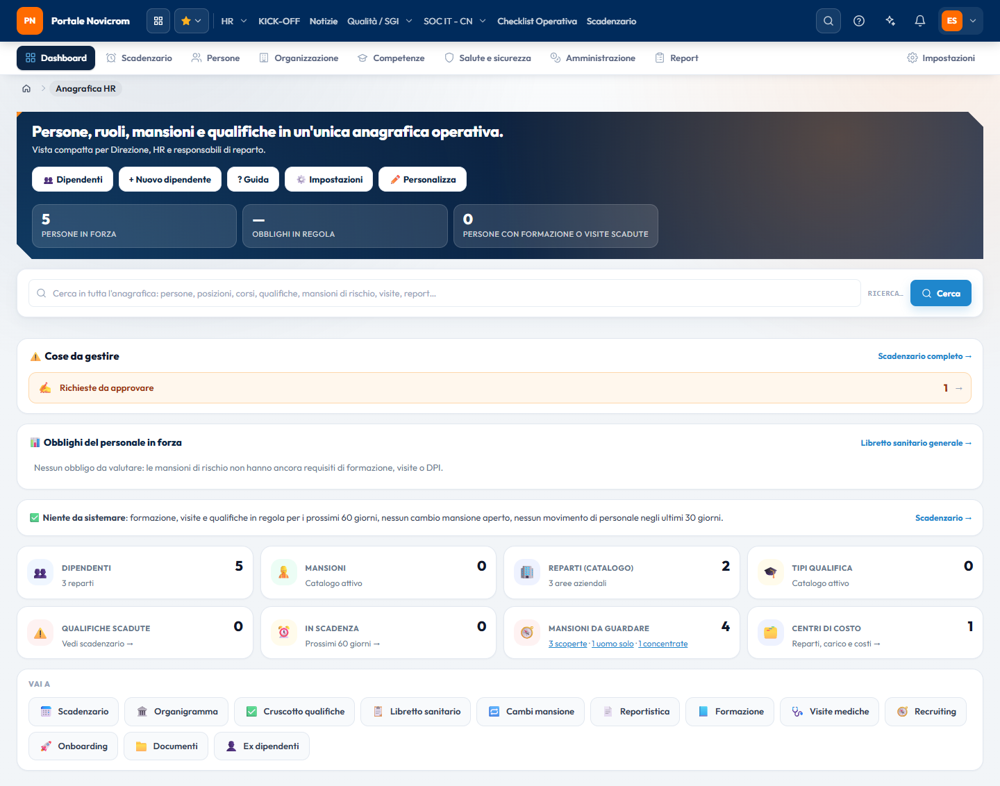
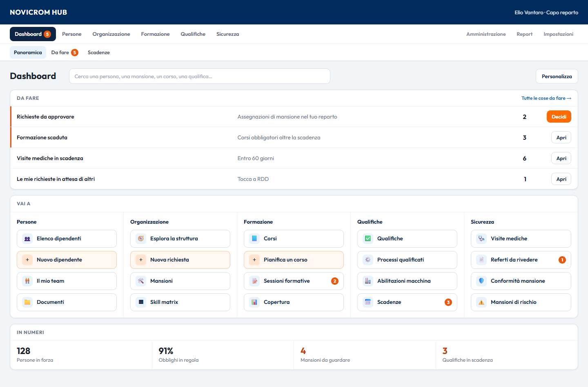
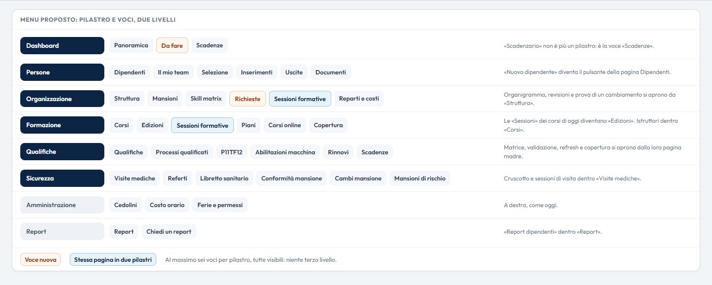

<!-- Proposta del 23/11/2026, dopo le indicazioni del proprietario e della Qualità. Sostituisce la tabella dei
     pilastri di 06_menu_anagrafica.md §4; le misure del menu di oggi restano quelle di 06 §2-3.
     Le tavole 02 e 03 sono bozze statiche con dati inventati; la 01 è la pagina vera con i dati di prova dei test. -->

# Interfaccia e menu di Anagrafica: proposta completa

## In breve

- La Dashboard diventa il posto da cui si parte: prima le cose da fare, poi venti collegamenti diretti, poi quattro numeri.
- Il menu passa da tre livelli a due: sei pilastri, al massimo sei voci ciascuno, tutte visibili.
- Le richieste stanno in Organizzazione. Le sessioni formative si vedono sia in Organizzazione sia in Formazione.
- Ogni pagina segue lo stesso schema già costruito su «Esplora la struttura», «Il mio team» e «Richieste».

Niente di questo è costruito: serve il via del proprietario.

## 1. La Dashboard di oggi

Misure a 1.440 punti di larghezza, con i dati di prova dei test (quasi vuoti: con i dati veri la pagina è più lunga).

| Che cosa | Misura |
| --- | --- |
| Blocchi spostabili | 5 |
| Testata | Una frase, 5 pulsanti, 3 numeri |
| Riquadri con un numero | 8 |
| «Cose da gestire» | Comincia a 487 punti dall'alto |
| «Vai a» | 12 pulsanti piccoli, a 1.004 punti: sotto la prima schermata, che è alta 900 |

I collegamenti diretti ci sono già, ma sono l'ultima cosa della pagina. Prima vengono una frase, undici numeri e la ricerca.

## 2. La Dashboard proposta

| Blocco | Che cosa cambia |
| --- | --- |
| Da fare | In cima. Una riga per cosa da fare, con il numero e un pulsante. Comprende le richieste da approvare e le scadenze |
| Vai a | 20 pulsanti grandi in cinque colonne, una per pilastro, a 521 punti dall'alto. L'azione più usata di ogni colonna è evidenziata. Un numero dove c'è qualcosa in attesa |
| In numeri | Quattro numeri invece di undici, ognuno cliccabile |
| Ricerca | Accanto al titolo |
| Tolti | La frase di testata e i pulsanti ripetuti |

Resta «Personalizza»: ognuno può nascondere o riordinare i blocchi, come oggi. I pulsanti di «Vai a» seguono i permessi: chi non può aprire una pagina non ne vede il pulsante.

## 3. Il menu proposto

| Misura | Oggi | Proposta |
| --- | --- | --- |
| Livelli | 3: pilastro, sezione, voce | 2: pilastro, voce |
| Voci | 55, più due pilastri senza voci | 38 |
| Voci del pilastro più pieno | 21 (Competenze, in tre sezioni) | 6 |

**Che cosa si sposta.**

- **Competenze si divide in due:** «Formazione» (corsi) e «Qualifiche» (qualifiche, processi qualificati, abilitazioni macchina). Oggi stanno insieme e le sezioni vicine si confondono.
- **Richieste e skill matrix in Organizzazione:** dicono chi ha quale mansione.
- **Sessioni formative in due pilastri:** la stessa pagina in Organizzazione e in Formazione. In Formazione le «Sessioni» dei corsi di oggi prendono il nome «Edizioni», per non avere due cose con lo stesso nome.
- **Da fare e Scadenze sotto Dashboard:** «Scadenzario» non è più un pilastro.
- **Le pagine di servizio escono dal menu:** si aprono dalla loro pagina madre (organigramma da «Struttura», matrice dei processi da «Processi qualificati», istruttori da «Corsi»).

## 4. Lo schema di ogni pagina

È quello delle pagine già costruite.

1. Il titolo è il nome della voce di menu.
2. Ogni dato ha la sua etichetta: «Ruolo:», «Mansione:», «Chi approva:».
3. Un solo pulsante principale per pagina; gli altri sono secondari.
4. I livelli sono scritti con la lettera e la parola, con la legenda sotto la tabella.
5. Dove serve, la pagina dice a chi tocca il passo successivo.
6. Niente numeri decorativi: un numero c'è solo se si può cliccare e porta all'elenco che conta.

## 5. Come arrivarci

| Passo | Che cosa | Stima |
| --- | --- | --- |
| 1 | Dashboard nuova, sugli stessi dati di oggi | 2-3 giorni |
| 2 | Menu a due livelli con le voci di oggi spostate, senza toccare le pagine | 3-5 giorni |
| 3 | Pagine madri che raccolgono le pagine di servizio uscite dal menu | 5-10 giorni |

Sono stime di massima. Il passo 1 si può fare da solo. Il passo 2 cambia il menu di tutti: conviene farlo in una volta, con la guida aggiornata.

## 6. Le scelte da fare

1. Dividere «Competenze» in «Formazione» e «Qualifiche».
2. «Skill matrix» in Organizzazione.
3. Il nome «Edizioni» per le sessioni dei corsi.
4. Quali venti collegamenti nella Dashboard: l'elenco della tavola è una proposta.
