<!-- Scheda tecnica: tre pagine. Il dettaglio è in 01_asis.md, 02_tobe_flusso_algoritmo.md, 03_ux.md, 04_gap_sgi.md. -->

# Ruoli, mansioni e competenze: scheda tecnica

## La proposta in cinque punti

1. **Due atti, due effetti.** La Sessione Formativa (SF) cambia ciò che la persona sa fare; la Richiesta di
   Aggiornamento Mansione (RAM) ciò che è autorizzata a fare. Nessun'altra via scrive livelli o mansioni.
2. **Il livello è un giudizio, la validità è un calcolo.** Il livello lo dà il capo reparto in una SF e non cambia da
   solo. Il portale calcola ogni giorno se è ancora valido e lo segnala; blocca solo sui controlli non distruttivi.
3. **Un solo motore** dice, per ogni persona, che cosa è richiesto e perché, che cosa possiede, che cosa manca, che
   cosa potrebbe fare in più.
4. **Assegnazione in due passaggi**: avviata (in formazione, non firma), poi effettiva.
5. **Emissione firmata**: ogni sei mesi RDD firma la fotografia della skill matrix, come chiede MT CN 06.

## Che cosa si riusa

| Esiste già | Diventa |
| --- | --- |
| Catalogo mansioni, livelli I/L/U/O, storici | Restano; il livello passa dalla mansione alla competenza |
| Motore unico dei requisiti di sicurezza (`services/requisiti.py`) | Resta; si affianca il motore delle competenze |
| Ricalcolo automatico del livello (`services/competenze_ricalcolo.py`) | Diventa calcolo della validità: non scrive più livelli |
| Pratica di inserimento, cambio mansione | Si agganciano alla RAM |
| Edizioni dei corsi, MOD.040 | L'edizione di un corso «formativo» prepara una SF |

**Dati.** Ciò che oggi è nel portale per skill matrix e mansionario è un caricamento di prova: all'avvio si caricano
la skill matrix firmata (MOD.187) e la tabella delle competenze (MOD.053 Rev.4).

## Lo schema

<figure class="diagramma"></figure>

**Validità di una competenza.** Valida → da confermare (requisito scaduto da meno di 30 giorni, 9 mesi senza
esercizio, conferma semestrale mancata) → sospesa. Il rientro è automatico quando il requisito torna valido.

<h2 class="np">Tappe e stime</h2>

S fino a 3 giorni · M 1-2 settimane · L 3-4 settimane. Sviluppo di una persona, senza il lavoro di contenuto.

| Blocco | Contenuto | Stima | Dipende da |
| --- | --- | --- | --- |
| B0 | Catalogo: codice stabile, criticità, requisito formale, corso → competenze | M | — |
| B1 | Motore competenze: validità, conformità, potenziali | L | B0 |
| B2 | Sessione Formativa: modello, flusso, pagine | L | B0 |
| B3 | SF di impianto e caricamento dei livelli | S | B2 |
| B4 | RAM: modello, flusso, firme, modulo a video | L | B1, B2 |
| B5 | Profilo versionato con anteprima d'impatto | M | B1 |
| B6 | Selezione candidati e semaforo sul motore unico | M | B1 |
| B7 | Permessi per reparto, sostituti e deleghe | M | — |
| B8 | MOD.053 generato e stampa | M | B2, B4 |
| B9 | Cruscotti e vista personale | M | B1, B2, B4 |
| B10 | Collegamento edizione → SF | M | B2 |
| B11 | Inserimento e cambio mansione agganciati alla RAM | M | B4 |
| B13 | Riordino del menu a filo conduttore | S + M | — |

| Perimetro | Settimane |
| --- | --- |
| Percorso minimo: B0, B1, B2, B3 | da 7 a 11 |
| Più la RAM: B0-B4 | da 10 a 15 |
| Tutto | da 18 a 31, cioè 4-7 mesi |

Ogni tappa ha un interruttore per tornare indietro. Il motore di riferimento `build/motore_rif.py` fa da oracolo per i
test: l'implementazione deve dare gli stessi risultati sugli stessi dati.

<h2 class="np">Rischi e punti aperti</h2>

| Rischio | Come si gestisce |
| --- | --- |
| Il catalogo non viene completato | La base è nel MOD.053: si carica e si completa per un reparto alla volta |
| Troppa burocrazia per i capi reparto | Una SF vale per più persone e più competenze; i rinnovi non richiedono una SF |
| Una segnalazione ignorata | Presa in carico con termine, poi sale a RDD; blocco dove la procedura lo impone |
| Le risposte della Qualità cambiano un'ipotesi | Ipotesi isolate: le alternative non cambiano il modello dati |
| Manca la fonte dell'«ultimo esercizio» | Si parte con la registrazione manuale nella SF di conferma |

**Aperto.** Le nove domande alla Qualità; la revisione di MT CN 06 e dei moduli MOD.053, MOD.040, MOD.187; la soglia
di firma, che la procedura fissa a L e il portale oggi a U; se RDD firma nel portale o su carta.

**Non verificato.** Il MOD.130 (registro timbri) è un'immagine; il MOD.192 non è nella cartella del sistema di
gestione; il legame fra timbro e skill matrix nel portale non è stato controllato nel dettaglio.

**Dove sta il dettaglio.** `Fattibilita_RMC_Tecnico.pdf` (92 pagine) e i documenti `01`-`04` nella stessa cartella;
prototipo in `prototipo/prototipo_rmc.html`.
