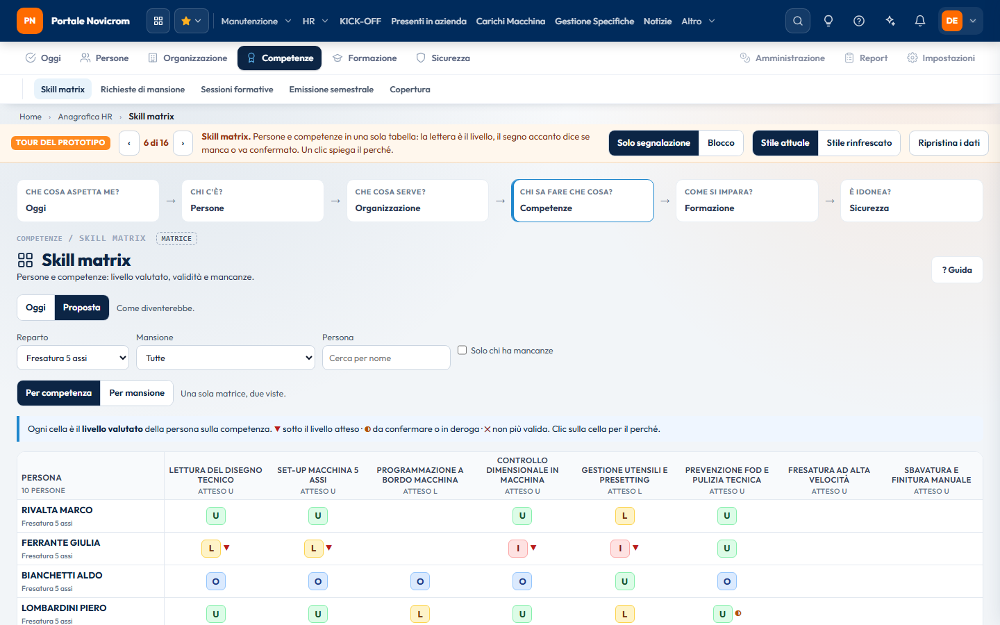
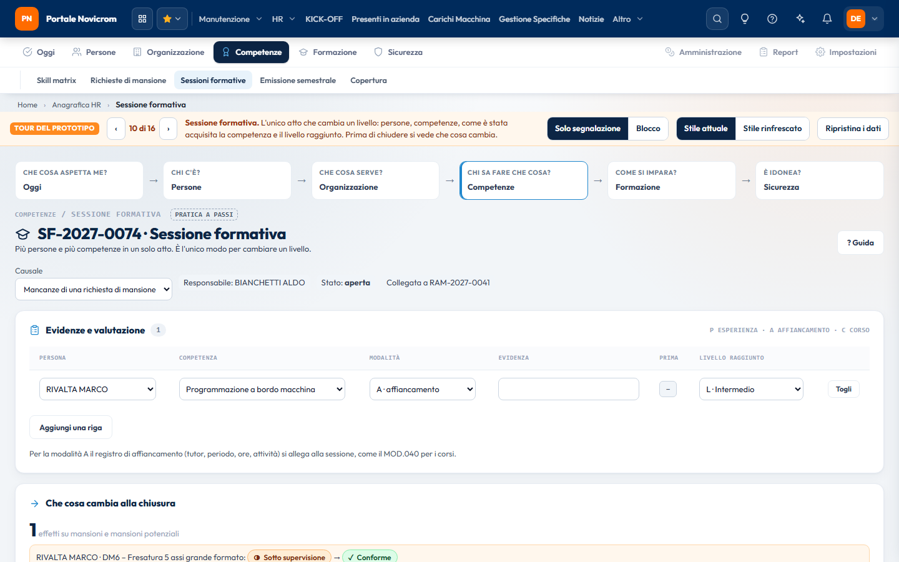
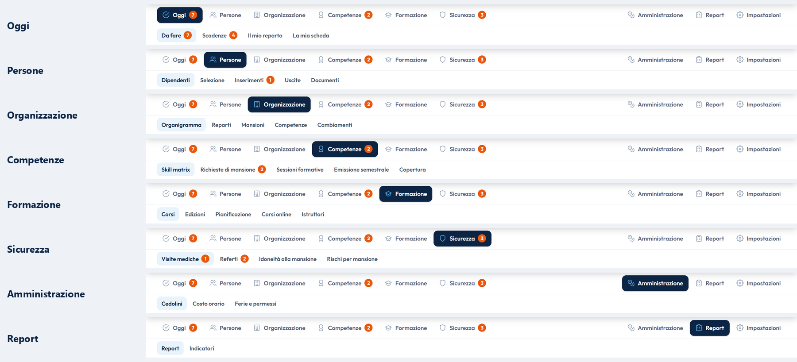

<!-- Documento per la Qualità: una decina di pagine, con le immagini. Sostituisce la scheda di due pagine.
     Il dettaglio è in 04_gap_sgi.md, 05_approfondimenti.md, 06_menu_anagrafica.md e Domande_per_la_Qualita.md.
     Le schermate vengono dal prototipo: nomi e dati sono inventati. -->

# Ruoli, mansioni e competenze: proposta per la Qualità

Abbiamo confrontato la vostra richiesta (Specifica v2, bozza del MOD.053, matrice per reparto) con i documenti in
vigore e con ciò che il portale fa già. In sintesi: **le regole ci sono quasi tutte, e la struttura che state
scrivendo è quella giusta da caricare.** Qui trovate la proposta, che cosa cambierebbe nei documenti e nove domande.

## 1. La proposta in cinque punti

1. **Due atti soli.** La *sessione formativa* cambia ciò che una persona sa fare. La *richiesta di mansione* cambia
   ciò che è autorizzata a fare. Nient'altro scrive livelli o mansioni.
2. **Il livello lo dà una persona.** Lo assegna il capo reparto dopo la formazione, con la prova accanto. Il portale
   non lo cambia mai da solo.
3. **Il portale controlla la validità.** Se un corso scade o una conferma salta, avvisa la persona e il capo reparto.
   Ferma da solo soltanto dove la procedura lo impone già: i liquidi penetranti.
4. **La ricetta è la vostra matrice.** Per ogni mansione, le competenze richieste: «sì» o «no», con U come livello
   richiesto. Il portale confronta la ricetta con ciò che la persona sa fare e dice che cosa manca.
5. **RDD firma nel portale.** Ogni sei mesi, come oggi firma il foglio.

## 2. Come si vede

Sono schermate del prototipo: si può provare dal vivo. Nomi e dati sono inventati.

<figure class="schermata">
<figcaption><b>Skill matrix.</b> Una riga per persona. La lettera è il livello; il segno accanto dice se manca qualcosa o se va confermato.</figcaption></figure>

<figure class="schermata">
<figcaption><b>«Perché?»</b> Un clic su una lettera mostra da dove viene: chi l'ha data, quando, con quale prova, e che cosa la mansione richiede.</figcaption></figure>

<figure class="schermata">
<figcaption><b>Sessione formativa.</b> Persone, competenze, come è stata fatta la formazione e il livello raggiunto. È l'unico atto che cambia un livello.</figcaption></figure>

<figure class="schermata">
<figcaption><b>Richiesta di mansione.</b> Il MOD.053 compilato a video: il portale riempie ciò che sa, le persone mettono giudizio e firme.</figcaption></figure>

## 3. Che cosa dice già il sistema di gestione

| Tema | Regola in vigore | Dove |
| --- | --- | --- |
| Livelli | I solo affiancato; L in autonomia sulle operazioni note, e firma; U in autonomia; O forma altri | MT CN 06 §8.3 |
| Skill matrix | Una lettera per persona e per mansione; verifica ogni sei mesi | MT CN 06 §8.2, §8.4 |
| Approvazione | Ogni emissione è approvata e firmata da Direzione/RDD | MT CN 06 §8.5 |
| Chi valuta | Il capo reparto; la Qualità approva il MOD.040 solo in forma | MT CN 06 §7.2, §7.3 |
| Firma | Serve il timbro valido e l'autorizzazione nella skill matrix | MT CN 06 §8.1, §10.2 |
| Ridondanza | Almeno due persone a livello U per ogni fase | MT CN 06 §8.2.2 |
| Controlli non distruttivi | Sospensione obbligatoria a requisito scaduto o dopo 12 mesi senza operare | MT CN 65 §3 |

## 4. Che cosa cambierebbe nei documenti

| Documento | Oggi | Con la vostra richiesta |
| --- | --- | --- |
| MT CN 06 §8.2 | Un livello per mansione | Un livello per competenza, e una regola per ricavare quello sulla mansione |
| MT CN 06 §8.4-8.5 | La Qualità aggiorna, RDD firma l'emissione | Due atti: sessione formativa e richiesta di mansione. Resta da dire che cosa firma RDD ogni sei mesi |
| MT CN 06 §9, MOD.040 | Corso registrato e approvato in forma | La sessione formativa raccoglie prove e valutazione; il MOD.040 diventa il registro dell'affiancamento |
| MOD.053 | Scheda compilata a mano | Documento prodotto dal portale; firma MSO sull'aggiornamento mansione: ruolo nuovo |
| MOD.187 | Foglio firmato | Fotografia prodotta dal portale |

## 5. La vostra bozza

L'elenco delle mansioni (versione 9) e la matrice per reparto: 253 mansioni in 39 reparti, 208 competenze.

**Che cosa risolve.**

- **Una competenza vale su più macchine.** La mansione dell'operatore è la singola macchina; le competenze sono per
  famiglia: 20 «piazzature» coprono 44 macchine.
- **Il personale non operativo c'è già**, con la stessa struttura.
- **Chi approva in ogni reparto** si ricava dalla mansione «Responsabilità del reparto».
- **Le otto mansioni con abilitazione** sono il perimetro dove il portale può fermare invece di segnalare.

**Che cosa manca.**

| Punto | Misura |
| --- | --- |
| Fogli della matrice ancora vuoti | 22 su 27: tutta la produzione, 177 mansioni |
| Tipo e origine della competenza | Indicati su 45 competenze su 208 |
| Competenze con il controllo numerico «da definire» | 2, in 5 fogli |
| Mansioni diverse fra elenco e matrice | 5: tre solo nell'elenco, due solo nella matrice |
| Foglio dei punti aperti, citato in legenda | Assente |

**Caricare la skill matrix firmata.** Delle 79 colonne, 73 si ritrovano nella bozza: 657 livelli su 691 si caricano
da soli. Sei colonne sono state divise in più mansioni (per esempio «Marcatura» in quattro): i loro 34 livelli li
riparte il capo reparto. Il dettaglio, colonna per colonna, è in `Catalogo_competenze_completo.xlsx`.

## 6. Nove domande

Per ciascuna trovate la nostra ipotesi: è quella che useremo finché non ci dite diversamente.

| # | Domanda | Nostra ipotesi |
| --- | --- | --- |
| 1 | Una competenza ha lo stesso livello su tutte le macchine che la richiedono? | Sì: la vostra matrice è già fatta così |
| 2 | Un livello può scendere? Con quale atto? | Non scende da solo: il portale segnala che non è più valido; lo abbassa solo il capo reparto |
| 3 | Quali corsi fanno crescere una competenza? | Lo decidete voi quando create il corso |
| 4 | Che cosa facciamo dei corsi svolti prima della data di partenza? | Si recupera solo la parte che scegliete, se ancora valida |
| 5 | Chi è in formazione su una mansione compare nella skill matrix? | Sì, come mansione «avviata», distinta da «effettiva» |
| 6 | L'assunzione è una richiesta di mansione come le altre? | Sì, con in più matricola e timbro |
| 7 | Una mansione si può togliere o sospendere? | Sì, con una richiesta di revoca approvata |
| 8 | Quanto pesa una competenza? | Come nella vostra matrice: «sì» o «no», senza gradi |
| 9 | I campi con il punto di domanda nella bozza del MOD.053 restano? | Solo il titolo di studio, se richiesto dalla mansione |

**Due conferme.** I moduli scrivono «principiante» e «insegna / programma BM», la procedura «in formazione» e
«formatore/esperto»: quale vocabolario vale? E confermate che dal livello L si firma, come dice MT CN 06 §8.3?

**Tre cose emerse leggendo i documenti.**

- Skill matrix e MOD.053 non usano gli stessi nomi: su 79 colonne, 49 coincidono, 29 hanno nome o livello diverso.
- Il MOD.128 elenca quattro persone qualificate per la verifica di pulizia; la skill matrix, sulla stessa colonna,
  una sola persona autonoma.
- Due mansioni hanno una sola persona autonoma, nove un solo formatore: la procedura ne chiede almeno due.

## 7. Dove si troverebbe nel portale

Il menu di Anagrafica oggi ha tre livelli e 60 voci. La proposta lo porta a due livelli e 34 voci, con le parole dei
vostri documenti: skill matrix, mansioni, abilitazioni, emissione semestrale.

<figure class="schermata">
<figcaption><b>Il menu proposto.</b> Sei pilastri. Sotto «Organizzazione» stanno reparti, mansioni e competenze: nell'ordine in cui li scrivete.</figcaption></figure>

## 8. Che cosa vi chiediamo

| Che cosa | Impegno |
| --- | --- |
| Rispondere alle nove domande | Una riunione di un paio d'ore |
| Compilare la matrice di un reparto di produzione, per partire | Mezza giornata con il capo reparto |
| Completare gli altri fogli della matrice | Un reparto alla volta, mentre si lavora al portale |
| Aggiornare MT CN 06 e i tre moduli | Secondo il vostro iter di approvazione |

Il portale può caricare da subito la skill matrix firmata. La prima tappa completa (livelli con la prova e avvisi, su
un reparto) richiede 7-11 settimane di sviluppo.
