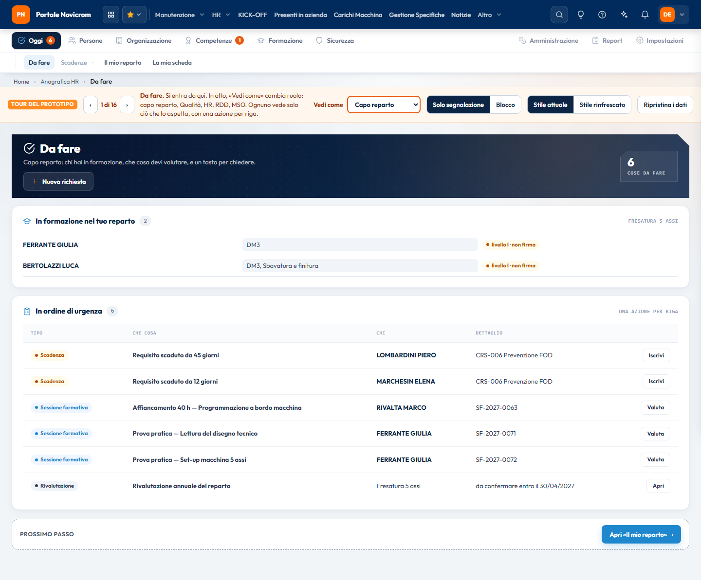
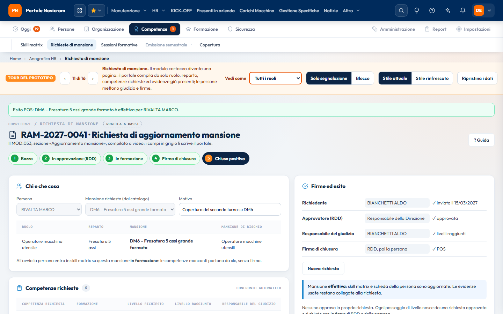
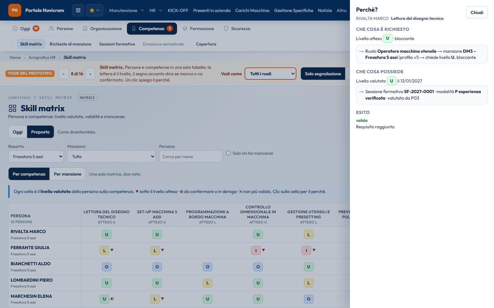

<!-- Documento per la Qualità, riscritto sulla loro specifica v1.0 del 23/11/2026.
     Il dettaglio è in 07_specifica_v1_confronto.md, 04_gap_sgi.md, 05_approfondimenti.md, 06_menu_anagrafica.md.
     Le schermate vengono dal prototipo: nomi e dati sono inventati. -->

# Formazione, competenze e skill matrix: riscontro alla vostra specifica

Abbiamo letto la specifica v1.0 del 23/11/2026 e l'abbiamo confrontata con i documenti in vigore e con ciò che il
portale fa già. In sintesi: **l'impianto si può costruire così com'è scritto.** Qui trovate che cosa abbiamo capito,
come si vedrebbe, cinque punti che toccano i documenti in vigore e le nostre proposte sui vostri sette punti aperti.

## 1. Che cosa abbiamo capito

1. **Ogni formazione nasce da una richiesta approvata.** Sulla mansione (RAM) approva RDD; sulla competenza (RAC)
   approva MSO. Nessuno approva la propria richiesta.
2. **La sessione formativa la aprono Qualità o HR.** Il capo reparto valuta le competenze del suo reparto, la Qualità
   quelle trasversali. Se due reparti danno livelli diversi, decide la Qualità.
3. **Si chiude con le firme.** RDD per le mansioni, MSO per le competenze, poi la persona. Solo allora cambiano il
   livello e la skill matrix.
4. **Sospensione e rimozione** sono richieste approvate da RDD, senza sessione.
5. **Il capo reparto vede poco:** chi ha in formazione, che cosa deve valutare, e un tasto per chiedere.

## 2. Come si vedrebbe

Sono schermate del prototipo: si può provare dal vivo. Nomi e dati sono inventati.

<figure class="schermata">
<figcaption><b>Il capo reparto.</b> I nomi in formazione, le valutazioni da fare, il tasto «Nuova richiesta». Ogni ruolo ha la sua pagina: Qualità, HR, RDD, MSO.</figcaption></figure>

<figure class="schermata">
<figcaption><b>Richiesta di mansione.</b> Il portale compila ciò che sa: competenze richieste, prove già presenti, che cosa manca. Le persone mettono giudizio e firme.</figcaption></figure>

<figure class="schermata">
<figcaption><b>Sessione formativa.</b> Una riga per competenza: modalità P, A o C, prova e livello raggiunto.</figcaption></figure>

<figure class="schermata">
<figcaption><b>Skill matrix.</b> Un clic su una lettera mostra da dove viene: chi l'ha data, quando, con quale prova.</figcaption></figure>

## 3. Cinque punti che toccano i documenti in vigore

| Punto | La specifica dice | I documenti in vigore dicono |
| --- | --- | --- |
| Cadenza | Rivalutazione annuale | MT CN 06 §8.4: verifica ogni sei mesi |
| Livelli | «I, U…», da confermare | MT CN 06 §8.3: I, L, U, O, e da L si firma. Nella skill matrix firmata i livelli L sono 118 |
| Firma | Nessun altro atto oltre alle firme della richiesta e della chiusura | MT CN 06 §8.1 e §10.2: serve anche il timbro valido |
| Scadenze | Le qualifiche a scadenza restano fuori dal flusso | MT CN 65 §3: sospensione obbligatoria sui liquidi penetranti. Otto mansioni del vostro elenco sono marcate «abilitazione» |
| Mancato esercizio | Non trattato | MT CN 65 §3: 12 mesi senza operare |

Sulle scadenze il portale può fare tre cose: niente, avvisare, oppure fermare. La nostra proposta è avvisare, e
fermare solo dove la procedura lo impone già.

## 4. I vostri sette punti aperti: le nostre proposte

| # | Punto aperto | Proposta |
| --- | --- | --- |
| 1 | Matrice C→M e regola di combinazione | Per partire: un solo livello richiesto (U) e la regola del minimo. La vostra matrice per reparto, a «sì» e «no», basta già |
| 2 | Competenza valutata da più reparti | Dopo la decisione della Qualità vale un solo livello per persona |
| 3 | Utenti di ogni passo | Ricavati dal ruolo e dalla mansione «Responsabilità del reparto» del vostro elenco |
| 4 | Approvazione periodica della skill matrix | Ogni sei mesi, firmata da RDD nel portale: è l'emissione di MT CN 06 §8.5 |
| 5 | Matricola | Ci serve l'ultimo numero usato per ciascun prefisso (CNO, T, A) |
| 6 | Nomi | Vanno bene: sessione formativa, RAM, RAC |
| 7 | Scala dei livelli | I, L, U, O come in MT CN 06 §8.3 |

**Tre punti in più, nostri.**

- **Il caricamento iniziale.** La skill matrix firmata ha 691 livelli. Serve un atto unico di avvio, approvato da
  RDD: altrimenti servirebbero 691 richieste.
- **La matrice C→M è molto lavoro.** Un livello minimo per ogni livello di ogni mansione, su 253 mansioni. Con la
  proposta del punto 1 si parte subito e si raffina dopo.
- **I campi con il punto di domanda** nella bozza del MOD.053: nostra ipotesi, resta solo il titolo di studio, se
  richiesto dalla mansione.

## 5. Il vostro elenco e la matrice per reparto

253 mansioni in 39 reparti, 208 competenze.

| Punto | Misura |
| --- | --- |
| Fogli della matrice ancora vuoti | 22 su 27: tutta la produzione, 177 mansioni |
| Tipo della competenza | Indicato su 45 competenze su 208; il valutatore, chiesto dalla specifica, manca |
| Competenze con il controllo numerico «da definire» | 2, in 5 fogli |
| Mansioni diverse fra elenco e matrice | 5: tre solo nell'elenco, due solo nella matrice |

**Caricare la skill matrix firmata.** Delle 79 colonne, 73 si ritrovano nell'elenco: 657 livelli su 691 si caricano
da soli. Sei colonne sono state divise in più mansioni (per esempio «Marcatura» in quattro): i loro 34 livelli li
riparte il capo reparto. Il dettaglio è in `Catalogo_competenze_completo.xlsx`.

## 6. Dove si troverebbe nel portale

Il menu di Anagrafica oggi ha tre livelli e 60 voci. La proposta lo porta a due livelli e 34 voci, con le parole dei
vostri documenti.

<figure class="schermata">
<figcaption><b>Il menu proposto.</b> Sotto «Organizzazione» stanno reparti, mansioni e competenze; sotto «Competenze» skill matrix, richieste e sessioni formative.</figcaption></figure>

## 7. Che cosa vi chiediamo

| Che cosa | Impegno |
| --- | --- |
| Decidere sui cinque punti del capitolo 3 e sui sette punti aperti | Una riunione di un paio d'ore |
| Compilare la matrice di un reparto di produzione, per partire | Mezza giornata con il capo reparto |
| Completare gli altri fogli della matrice | Un reparto alla volta, mentre si lavora al portale |
| Aggiornare MT CN 06 e i moduli MOD.053, MOD.040, MOD.187 | Secondo il vostro iter di approvazione |

Il portale può caricare da subito la skill matrix firmata. La prima tappa completa richiede 7-11 settimane di sviluppo.
