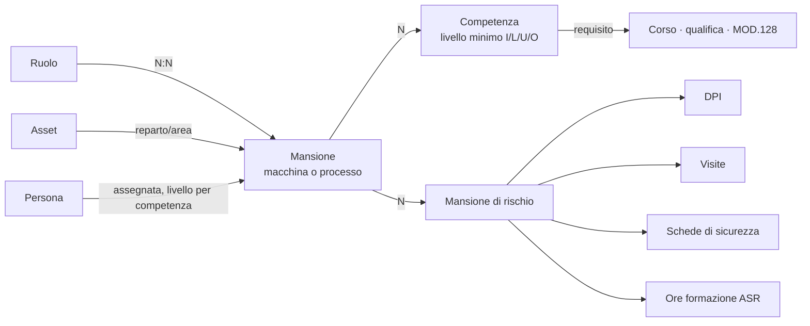

# Mansionario: ruolo, mansione, competenze e mansione di rischio

Stato: **proposta da valutare** (15/10/2026). Prototipo a video con dati di esempio: https://claude.ai/artifact/TqWgdJep51Dt8cLs7wMAgh

## 1. Perché

Oggi nel portale due piani diversi sono mescolati nello stesso catalogo:

- **cosa la persona sa fare e dove** (piano qualità, EN 9100, MT CN 06): ruolo, reparto, macchina o processo, competenze;
- **a cosa la persona è esposta** (piano sicurezza, ISO 45001, D.Lgs. 81/08): mansione di rischio del DVR, protocollo sanitario, DPI, schede di sicurezza.

Il catalogo che il portale chiama «Mansione» (13 voci, «ADDETTO MACCHINE UTENSILI», «ADDETTO CONTROLLO»…) contiene in realtà le **mansioni di rischio** del medico competente, con i DPI, le visite e le SDS collegate. La mansione lavorativa vera, cioè la macchina o il processo su cui si lavora, non esiste come concetto: c'è solo, sparsa, nella skill matrix MOD.187 e nel MOD.128.

### Dati in produzione (15/10/2026, solo conteggi)

| Cosa | Quanti |
|---|---|
| Catalogo «Mansione» (di fatto mansioni di rischio) | 13, con 54 DPI, 19 visite, 51 prodotti SDS collegati |
| Modello `MansioneRischio` (introdotto il 10/10) | 0 righe, 0 collegamenti |
| Fattori di rischio / esposizioni | 0 / 0 |
| Regole formative per mansione | 0 |
| Dipendenti in forza con mansione compilata | 12 su 134 (119 assegnabili dal file del medico con `importa_mansioni_idoneita`) |
| Ruoli (`RuoloOperativo`) / assegnazioni a persone | 79 / 211 |
| Reparti / aree aziendali | 8 / 25 (36 dipendenti collegati all'area) |
| Colonne skill matrix (`CompetenzaSkm`) | 84: 42 macchina, 41 processo |
| Abilitazioni persona × macchina (I/L/U/O) | 421 |
| Processi qualificati MOD.128 / abilitazioni persona × processo | 14 / 7 |
| Tipi qualifica / qualifiche assegnate | 23 / 0 |
| Corsi attivi | 773 |
| Protocollo sanitario individuale (`RequisitoVisitaDipendente`) | 1683 |

## 2. Decisioni già prese (15/10/2026)

| # | Decisione |
|---|---|
| D1 | Il catalogo attuale «Mansione» **è** il catalogo delle mansioni di rischio, con tutto quello che vi è collegato. |
| D2 | Struttura organizzativa su quattro livelli: **ruolo → N mansioni → N competenze**, con il **reparto** come contesto. Una mansione sta quasi sempre sotto un solo ruolo. |
| D3 | La **mansione** è un singolo asset (macchina) o un singolo processo: coincide con le **colonne** macchina/processo della skill matrix MOD.187. |
| D4 | Il **reparto** della mansione viene dal reparto/area dell'asset; per un processo senza asset si sceglie in configurazione. |
| D5 | Una persona ha **più mansioni**, assegnate a mano, quasi sempre nello stesso ruolo, anche in reparti diversi. Il portale controlla le abilitazioni e mostra le lacune. |
| D6 | **Competenze** che abilitano a una mansione: livello di esperienza I/L/U/O (MT CN 06 §8.3), corsi di formazione, qualifiche/patentini, abilitazioni MOD.128. Alcune mansioni chiedono corsi, altre solo esperienza. |
| D7 | La **mansione di rischio** della persona si **ricava** dalle mansioni assegnate (unione). |
| D8 | Una qualifica genera il rischio **solo se usata**. Carrello elevatore e lavori in quota sono quindi **mansioni** (es. «Conduzione carrello elevatore», «Lavori in quota») che richiedono la qualifica come competenza e portano la loro mansione di rischio. Possedere il patentino non basta. |
| D9 | Uffici, pulizie, magazzino hanno la loro mansione (processo) e la loro mansione di rischio, come tutti. |
| D10 | L'elenco del **medico competente** è un **controllo periodico**: il portale confronta e segnala le differenze. |
| D11 | Una mansione **può** stare sotto più ruoli (molti a molti), per non bloccare i casi reali. |
| D12 | Il livello minimo si fissa sulla **competenza**, non sulla mansione: il livello della persona sulla mansione è il **risultato delle competenze** (regola di calcolo in §3.3). |
| D13 | Reparto principale di chi ha mansioni in più reparti: quello della mansione con il **livello più alto**; a parità, quello della mansione con l'**anzianità** maggiore (assegnazione più vecchia). |
| D14 | La manutenzione dei dati passa da un **refresh periodico al caporeparto**: il caporeparto riceve la richiesta di rivedere livelli e assegnazioni delle sue persone. |
| D15 | Interfaccia nello **stile del modulo Anagrafica** (sezioni «stile C»: schede per oggetto, identità fmd). |

## 3. Modello dati proposto



### 3.1 Mansione di rischio = catalogo attuale «Mansione»

- **Tabella invariata** (`anagrafica_mansione`): nessun riferimento si rompe. Cambiano etichette e menu: «Mansioni di rischio».
- Si spostano qui i campi utili del modello `MansioneRischio` oggi vuoto: codice, revisione e data del DVR, livello DVR, fattori. Il modello `MansioneRischio` e il collegamento `MansioneLavorativaRischio` si eliminano (0 righe in produzione).
- Le **eccezioni individuali** (`DipendenteMansioneRischioOverride`, 0 righe) puntano alla nuova tabella: restano per i casi eccezionali (esclusione su indicazione del medico).
- Restano collegati come oggi: DPI, visite, livello ASR, prodotti SDS (51 collegamenti già corretti).

### 3.2 Mansione = colonna della skill matrix

- Si parte dal modello esistente `CompetenzaSkm` (84 voci, ciascuna con asset o processo). In interfaccia diventa «Mansione»; il nome tecnico si può lasciare per non toccare la skill matrix.
- Campi nuovi: **ruoli** (molti a molti, D11), **reparto** solo per i processi senza asset (per le macchine è letto dall'asset), **mansioni di rischio** che comporta (M2M verso il catalogo §3.1), attiva/disattiva.
- Il collegamento al MOD.128 resta: un processo qualificato è una mansione di tipo processo, o una competenza richiesta da una mansione (vedi §3.3).

### 3.3 Competenze della mansione (D12)

Le competenze sono le **righe sotto ogni colonna** della skill matrix. Esiste già il meccanismo «macchina multivoce»: `VoceMacchinaCatalogo` (voce, bloccante, ordine) e `AbilitazioneMacchinaVoce` (livello della persona su ogni voce). Oggi le voci sono definite per *tipo* di macchina e il catalogo è vuoto; si estende così:

- la voce si lega alla **mansione** (resta possibile copiarla dal tipo di macchina, per non riscrivere le stesse voci su ogni tornio);
- ogni voce ha il suo **livello minimo** I/L/U/O e il flag **bloccante**;
- ogni voce può avere **requisiti formali**: corso valido (`TrainingCourse`), qualifica/patentino valido (`TipoQualifica`), abilitazione MOD.128 operativa. Senza il requisito la persona non supera «I – in formazione» su quella voce (stessa logica già usata da `corso_qualificante`).

Esempi: «Tornio CNC TC-02» → *set-up* (min U, bloccante), *programmazione a bordo macchina* (min L), *controllo dimensionale* (min U). «Conduzione carrello elevatore» → *guida* (min U, requisito: qualifica Carrellista valida).

**Livello della persona sulla mansione** = calcolo dalle voci, con la regola già configurabile in `SkillMatrixConfig.regola_multivoce`:

| Regola | Effetto |
|---|---|
| Minimo delle voci | il livello è quello della voce più debole (più rigoroso) |
| Media delle voci | media degli ordinali I=1 … O=4, arrotondata per difetto |
| Minimo sulle bloccanti | conta solo il minimo delle voci bloccanti |

Proposta: **media, ma mai sopra la voce bloccante più bassa** (nuova regola «Media con tetto»): le competenze si «sommano», ma una competenza critica insufficiente blocca.

Esito per persona e mansione: **Abilitato** (livello ≥ soglia operativa, nessuna voce sotto il proprio minimo), **In addestramento** (manca solo livello), **Non abilitato** (manca un requisito formale o una voce bloccante sotto minimo).

### 3.4 Persona ↔ mansione

- **Assegnazione** = la persona è «in lista» sulla colonna della skill matrix. Oggi `AbilitazioneMacchina` è legata all'asset: va estesa alla mansione, così vale anche per i processi senza asset (le 421 abilitazioni esistenti si collegano alla mansione del loro asset).
- Più mansioni per persona. Data di inizio e fine per lo storico.
- **Reparto principale** (D13): reparto della mansione con livello più alto; a parità, quello della mansione assegnata da più tempo (`data_assegnazione`). Alimenta organigramma e caporeparto di riferimento.

### 3.5 Mansione di rischio della persona (calcolata)

```
mansioni di rischio = ∪ (mansioni di rischio delle mansioni assegnate e attive)
                    + aggiunte individuali − esclusioni individuali
```

- Ogni voce porta la **provenienza** («da Tornio CNC TC-02», «da Conduzione carrello elevatore»), come già fa il motore dei requisiti. Le qualifiche non generano rischio da sole (D8).
- DPI, visite, SDS e formazione ASR della persona leggono **solo** questo calcolo. Il servizio esistente `anagrafica/services/mansionario.py` diventa l'unico punto, alimentato da qui invece che dal testo `anagrafica_dipendenti.mansione`.
- Il protocollo sanitario individuale del medico (`RequisitoVisitaDipendente`) **prevale** su quello della mansione di rischio per periodicità ed esami.

### 3.6 Testo legacy `anagrafica_dipendenti.mansione`

Oggi è il collegamento usato da circa 36 file (DPI, visite, SDS, formazione, onboarding, recruiting, cambio mansione, assistente AI, trigger automazioni). Nella transizione resta valorizzato con la **mansione di rischio principale** (quella che carica `importa_mansioni_idoneita`), così nulla si rompe; i moduli passano uno alla volta al calcolo §3.5, poi il campo diventa solo descrittivo.

## 4. Sezione di configurazione «Mansionario»

In Anagrafica → Configurazione. Schede (vedi prototipo):

1. **Struttura**: albero ruolo → mansioni, con reparto, mansione di rischio, numero di competenze e abilitati/assegnati. Filtro per reparto.
2. **Mansione**: asset e reparto, competenze richieste, cosa comporta (DPI, visite, SDS, ASR), persone assegnate con stato e cosa manca.
3. **Persona**: mansioni assegnate e stato, mansioni di rischio ricavate con provenienza, confronto con il medico.
4. **Mansioni di rischio**: catalogo DVR, da cosa sono generate, persone, DPI, visite, SDS, livello ASR.
5. **Report**.

Stile: pagine del modulo Anagrafica nello «stile C» (scheda per oggetto con barra impilata, numeri cliccabili, elenco + «Aree» a destra), riusando `services/sezioni_c.py` e i componenti `_fmd_cc_grid.html` / `_fmd_arealist.html`. L'oggetto della sezione Mansionario è la **mansione**.

Permessi: lettura per chi gestisce anagrafica e sicurezza; modifica della struttura e delle competenze a qualità; livelli e assegnazioni al caporeparto del proprio reparto (via refresh, §4.1); modifica delle mansioni di rischio a RSPP; protocollo sanitario solo con il permesso visite (dati art. 9).

### 4.1 Refresh al caporeparto (D14)

Si estende il refresh semestrale già esistente della skill matrix (`CampagnaRefresh`, `services/skillmatrix_refresh.py`: apertura campagna per reparto, notifica al caporeparto, decisioni, storico append-only, scadenzario per reparto, periodicità in `SkillMatrixConfig.periodicita_refresh_mesi`, oggi 6 mesi):

- la campagna elenca le persone del reparto con le **mansioni assegnate** e il **livello per competenza**;
- il caporeparto conferma o modifica livelli, aggiunge o toglie mansioni, segnala chi ha cambiato lavoro;
- in coda, i punti di **coerenza rischio** del reparto (persone su mansioni senza DPI, visita o presa visione SDS) da girare all'RSPP;
- promemoria a scadenza e sollecito; la chiusura aggiorna `prossima_revisione`.

## 5. Report

| Report | Per chi | Contenuto |
|---|---|---|
| Copertura per ruolo e reparto | qualità, caporeparto | abilitati / assegnati per mansione |
| Lacune di competenza | qualità, HR | per persona e mansione: livello, corsi, qualifiche mancanti; esportabile per il piano formativo |
| Coerenza rischio | RSPP | chi lavora su una mansione senza DPI consegnati, visita valida o presa visione SDS |
| Elenco per il medico | RSPP, medico | persone per mansione di rischio, con mansioni e qualifiche che la generano |
| Confronto con il medico | RSPP | differenze persona per persona tra portale ed elenco idoneità |
| Persone senza mansione | HR | dipendenti in forza senza alcuna mansione assegnata |

## 6. Migrazione dei dati attuali

1. Etichette: «Mansione» → «Mansione di rischio» ovunque nell'interfaccia (SDS compreso).
2. `importa_mansioni_idoneita --commit` in produzione: 119 dipendenti ricevono la mansione di rischio principale.
3. Campi DVR e override spostati sul catalogo; `MansioneRischio` e il suo collegamento eliminati (vuoti).
4. Colonne skill matrix: si assegnano ruolo, reparto (dall'asset) e mansioni di rischio; si importano i requisiti dove già noti (corsi dei processi MOD.128, livello richiesto della skill matrix).
5. Abilitazioni persona × macchina collegate alla mansione.
6. Mansioni «Conduzione carrello elevatore» e «Lavori in quota» con le loro mansioni di rischio; dal file del medico (15 carrello, 7 lavori in altezza) si propongono le assegnazioni, da confermare con il caporeparto nel primo refresh.
7. Primo confronto con il medico: le differenze diventano la lista di lavoro dell'RSPP.

## 7. Fasi

| Fase | Contenuto | Rischio |
|---|---|---|
| 1 | Etichette, import del medico, campi DVR sul catalogo, eliminazione `MansioneRischio` vuoto | basso: nessuna tabella usata cambia |
| 2 | Mansione = colonna skill matrix: ruolo, reparto, mansioni di rischio; sezione Mansionario (Struttura, Mansione) | medio: tocca la skill matrix |
| 3 | Competenze richieste, esito di abilitazione, scheda Persona, report copertura e lacune | medio |
| 4 | Mansione di rischio calcolata §3.5; DPI, visite, SDS, formazione passano al calcolo; confronto con il medico | alto: tocca i moduli che leggono la mansione; un modulo alla volta, con test |
| 5 | Pulizia: fattori/esposizioni non usati, campi deprecati, testo legacy solo descrittivo | basso |

Ogni fase: worktree dedicato, test del modulo, CHANGELOG, scheda modulo, guida in-app.

## 8. Punti decisi il 15/10 e ancora aperti

Decisi: D8 (qualifica solo se usata), D11 (più ruoli), D12 (livello sulla competenza), D13 (reparto principale), D14 (refresh al caporeparto), D15 (stile Anagrafica).

Decisi in seguito (15/10):

- D16 — Livello sulla mansione: **media delle competenze con tetto sulla competenza bloccante più bassa** (nuova regola, §3.3).
- D17 — Competenze: **ogni mansione ha le sue**, anche tra macchine uguali (nessun catalogo per tipo).
- D18 — Refresh al caporeparto: **a richiesta della qualità**, non a scadenza fissa (la campagna si apre da un pulsante; nessuna schedulazione automatica).

## 9. Valutazione dell'implementazione

### Cosa si riusa

| Pezzo esistente | Uso nel nuovo modello |
|---|---|
| Catalogo `Mansione` (13, con DPI/visite/SDS/ASR) | catalogo mansioni di rischio, invariato in tabella |
| `CompetenzaSkm` (84 colonne macchina/processo, asset collegato) | catalogo mansioni |
| `AbilitazioneMacchina` (421, livello, data assegnazione, in lista) | assegnazione persona ↔ mansione |
| `VoceMacchinaCatalogo` + `AbilitazioneMacchinaVoce` + `regola_multivoce` | competenze con livello e calcolo del livello sulla mansione |
| `corso_qualificante` + `services/skillmatrix_qualifica.py` | requisiti formali delle competenze (esteso a qualifiche e MOD.128) |
| `CampagnaRefresh` + `services/skillmatrix_refresh.py` | refresh al caporeparto |
| `RuoloOperativo` (79), `Reparto`/`AreaAziendale`, asset con reparto | ruolo e reparto |
| `services/mansionario.py` (requisiti con provenienza, override) | calcolo della mansione di rischio della persona |
| `services/sezioni_c.py` e componenti stile C | interfaccia |
| `importa_mansioni_idoneita` | primo caricamento e confronto con il medico |

### Cosa è nuovo

- ruoli e mansioni di rischio sulla colonna; reparto per i processi senza asset;
- voce di competenza legata alla mansione, con livello minimo e requisiti formali;
- abilitazione estesa ai processi senza asset (oggi l'abilitazione è solo per asset);
- regola «media con tetto»; esito Abilitato / In addestramento / Non abilitato;
- reparto principale calcolato;
- sezione Mansionario (5 schede) e report;
- campagna di refresh estesa a mansioni e coerenza rischio;
- passaggio di DPI, visite, SDS e formazione al calcolo della mansione di rischio, un modulo per volta.

### Stima

| Fase | Contenuto | Migrazioni | Impegno indicativo |
|---|---|---|---|
| 1 | Etichette «Mansioni di rischio», campi DVR sul catalogo, eliminazione `MansioneRischio` vuoto, import del medico in produzione | 1 (anagrafica) | 1 sessione |
| 2 | Colonna = mansione: ruoli, mansioni di rischio, reparto; abilitazione anche per processi; sezione Mansionario (Struttura, Mansione) | 1-2 | 2 sessioni |
| 3 | Competenze per mansione con livello minimo e requisiti; regola di calcolo; esiti; scheda Persona; report copertura e lacune | 1 | 2 sessioni |
| 4 | Refresh al caporeparto esteso | 0-1 | 1 sessione |
| 5 | Mansione di rischio calcolata; DPI, visite, SDS, formazione passano al calcolo; confronto con il medico | 0-1 | 2-3 sessioni, un modulo per volta |
| 6 | Pulizia (fattori/esposizioni inutilizzati, campi deprecati, testo legacy descrittivo) | 1 | 1 sessione |

### Rischi principali

1. **Fase 5**: circa 36 file leggono oggi la mansione per nome. Mitigazione: il testo legacy resta valorizzato con la mansione di rischio principale finché l'ultimo modulo non è passato al calcolo; test per modulo.
2. **Skill matrix in uso** (421 abilitazioni, refresh esistente): le estensioni devono essere additive; nessun dato esistente cambia significato.
3. **Dati di partenza scarsi**: competenze per mansione e livelli per voce non esistono ancora (catalogo voci vuoto). Il valore arriva dopo il primo refresh dei caporeparto: va pianificato come attività, non solo come rilascio.
4. **Privacy**: la scheda Persona e il confronto con il medico mostrano mansioni di rischio, non giudizi di idoneità; protocollo sanitario solo con il permesso visite.
