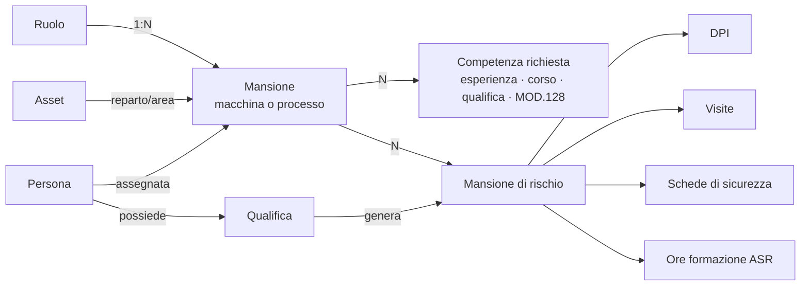

# Mansionario: ruolo, mansione, competenze e mansione di rischio

Stato: **proposta da valutare** (15/10/2026). Prototipo a video con dati di esempio: https://claude.ai/artifact/TqWgdJep51Dt8cLs7wMAgh

## 1. Perché

Oggi nel portale due piani diversi sono mescolati nello stesso catalogo:

- **cosa la persona sa fare e dove** (piano qualità, EN 9100, MT CN 06): ruolo, reparto, macchina o processo, competenze;
- **a cosa la persona è esposta** (piano sicurezza, ISO 45001, D.Lgs. 81/08): mansione di rischio del DVR, protocollo sanitario, DPI, schede di sicurezza.

Il catalogo che il portale chiama «Mansione» (13 voci, «ADDETTO MACCHINE UTENSILI», «ADDETTO CONTROLLO»…) contiene in realtà le **mansioni di rischio** del medico competente, con i DPI, le visite e le SDS collegate. La mansione lavorativa vera, cioè la macchina o il processo su cui si lavora, non esiste come concetto: c'è solo, sparsa, nella skill matrix MOD.187 e nel MOD.128.

### Dati in produzione (15/10/2026, solo conteggi)

| Cosa | Quanti |
|---|---|
| Catalogo «Mansione» (di fatto mansioni di rischio) | 13, con 54 DPI, 19 visite, 51 prodotti SDS collegati |
| Modello `MansioneRischio` (introdotto il 10/10) | 0 righe, 0 collegamenti |
| Fattori di rischio / esposizioni | 0 / 0 |
| Regole formative per mansione | 0 |
| Dipendenti in forza con mansione compilata | 12 su 134 (119 assegnabili dal file del medico con `importa_mansioni_idoneita`) |
| Ruoli (`RuoloOperativo`) / assegnazioni a persone | 79 / 211 |
| Reparti / aree aziendali | 8 / 25 (36 dipendenti collegati all'area) |
| Colonne skill matrix (`CompetenzaSkm`) | 84: 42 macchina, 41 processo |
| Abilitazioni persona × macchina (I/L/U/O) | 421 |
| Processi qualificati MOD.128 / abilitazioni persona × processo | 14 / 7 |
| Tipi qualifica / qualifiche assegnate | 23 / 0 |
| Corsi attivi | 773 |
| Protocollo sanitario individuale (`RequisitoVisitaDipendente`) | 1683 |

## 2. Decisioni già prese (15/10/2026)

| # | Decisione |
|---|---|
| D1 | Il catalogo attuale «Mansione» **è** il catalogo delle mansioni di rischio, con tutto quello che vi è collegato. |
| D2 | Struttura organizzativa su quattro livelli: **ruolo → N mansioni → N competenze**, con il **reparto** come contesto. Una mansione sta quasi sempre sotto un solo ruolo. |
| D3 | La **mansione** è un singolo asset (macchina) o un singolo processo: coincide con le **colonne** macchina/processo della skill matrix MOD.187. |
| D4 | Il **reparto** della mansione viene dal reparto/area dell'asset; per un processo senza asset si sceglie in configurazione. |
| D5 | Una persona ha **più mansioni**, assegnate a mano, quasi sempre nello stesso ruolo, anche in reparti diversi. Il portale controlla le abilitazioni e mostra le lacune. |
| D6 | **Competenze** che abilitano a una mansione: livello di esperienza I/L/U/O (MT CN 06 §8.3), corsi di formazione, qualifiche/patentini, abilitazioni MOD.128. Alcune mansioni chiedono corsi, altre solo esperienza. |
| D7 | La **mansione di rischio** della persona si **ricava** dalle mansioni assegnate (unione). |
| D8 | Rischi aggiuntivi come carrello elevatore e lavori in quota sono **qualifiche**: una qualifica può generare una mansione di rischio. |
| D9 | Uffici, pulizie, magazzino hanno la loro mansione (processo) e la loro mansione di rischio, come tutti. |
| D10 | L'elenco del **medico competente** è un **controllo periodico**: il portale confronta e segnala le differenze. |

## 3. Modello dati proposto



### 3.1 Mansione di rischio = catalogo attuale «Mansione»

- **Tabella invariata** (`anagrafica_mansione`): nessun riferimento si rompe. Cambiano etichette e menu: «Mansioni di rischio».
- Si spostano qui i campi utili del modello `MansioneRischio` oggi vuoto: codice, revisione e data del DVR, livello DVR, fattori. Il modello `MansioneRischio` e il collegamento `MansioneLavorativaRischio` si eliminano (0 righe in produzione).
- Le **eccezioni individuali** (`DipendenteMansioneRischioOverride`, 0 righe) puntano alla nuova tabella: restano per i casi eccezionali (esclusione su indicazione del medico).
- Restano collegati come oggi: DPI, visite, livello ASR, prodotti SDS (51 collegamenti già corretti).

### 3.2 Mansione = colonna della skill matrix

- Si parte dal modello esistente `CompetenzaSkm` (84 voci, ciascuna con asset o processo). In interfaccia diventa «Mansione»; il nome tecnico si può lasciare per non toccare la skill matrix.
- Campi nuovi: **ruolo** (FK, quasi sempre uno), **reparto** solo per i processi senza asset (per le macchine è letto dall'asset), **mansioni di rischio** che comporta (M2M verso il catalogo §3.1), attiva/disattiva.
- Il collegamento al MOD.128 resta: un processo qualificato è una mansione di tipo processo, o una competenza richiesta da una mansione (vedi §3.3).

### 3.3 Competenze richieste dalla mansione

Nuovo modello `RequisitoMansione` (mansione, tipo, oggetto, livello minimo, obbligatorio):

| Tipo | Oggetto | Come si verifica |
|---|---|---|
| Esperienza | la mansione stessa | livello I/L/U/O della persona ≥ minimo (abilitazione skill matrix) |
| Corso | `TrainingCourse` | completato e non scaduto |
| Qualifica | `TipoQualifica` | posseduta e valida |
| MOD.128 | `ProcessoQualificato` | abilitazione persona × processo operativa |

Esito per persona e mansione: **Abilitato**, **In addestramento** (manca solo il livello), **Non abilitato** (manca un requisito obbligatorio).

### 3.4 Persona ↔ mansione

- **Assegnazione** = la persona è «in lista» sulla colonna della skill matrix. Oggi `AbilitazioneMacchina` è legata all'asset: va estesa alla mansione, così vale anche per i processi senza asset (le 421 abilitazioni esistenti si collegano alla mansione del loro asset).
- Più mansioni per persona. Data di inizio e fine per lo storico.

### 3.5 Mansione di rischio della persona (calcolata)

```
mansioni di rischio = ∪ (mansioni di rischio delle mansioni assegnate)
                    ∪ (mansioni di rischio generate dalle qualifiche valide)
                    + aggiunte individuali − esclusioni individuali
```

- Ogni voce porta la **provenienza** («da Tornio CNC TC-02», «da qualifica Carrellista»), come già fa il motore dei requisiti.
- DPI, visite, SDS e formazione ASR della persona leggono **solo** questo calcolo. Il servizio esistente `anagrafica/services/mansionario.py` diventa l'unico punto, alimentato da qui invece che dal testo `anagrafica_dipendenti.mansione`.
- Il protocollo sanitario individuale del medico (`RequisitoVisitaDipendente`) **prevale** su quello della mansione di rischio per periodicità ed esami.

### 3.6 Testo legacy `anagrafica_dipendenti.mansione`

Oggi è il collegamento usato da circa 36 file (DPI, visite, SDS, formazione, onboarding, recruiting, cambio mansione, assistente AI, trigger automazioni). Nella transizione resta valorizzato con la **mansione di rischio principale** (quella che carica `importa_mansioni_idoneita`), così nulla si rompe; i moduli passano uno alla volta al calcolo §3.5, poi il campo diventa solo descrittivo.

## 4. Sezione di configurazione «Mansionario»

In Anagrafica → Configurazione. Schede (vedi prototipo):

1. **Struttura**: albero ruolo → mansioni, con reparto, mansione di rischio, numero di competenze e abilitati/assegnati. Filtro per reparto.
2. **Mansione**: asset e reparto, competenze richieste, cosa comporta (DPI, visite, SDS, ASR), persone assegnate con stato e cosa manca.
3. **Persona**: mansioni assegnate e stato, mansioni di rischio ricavate con provenienza, confronto con il medico.
4. **Mansioni di rischio**: catalogo DVR, da cosa sono generate, persone, DPI, visite, SDS, livello ASR.
5. **Report**.

Permessi: lettura per chi gestisce anagrafica e sicurezza; modifica della struttura e delle competenze richieste a qualità/caporeparto; modifica delle mansioni di rischio a RSPP; protocollo sanitario solo con il permesso visite (dati art. 9).

## 5. Report

| Report | Per chi | Contenuto |
|---|---|---|
| Copertura per ruolo e reparto | qualità, caporeparto | abilitati / assegnati per mansione |
| Lacune di competenza | qualità, HR | per persona e mansione: livello, corsi, qualifiche mancanti; esportabile per il piano formativo |
| Coerenza rischio | RSPP | chi lavora su una mansione senza DPI consegnati, visita valida o presa visione SDS |
| Elenco per il medico | RSPP, medico | persone per mansione di rischio, con mansioni e qualifiche che la generano |
| Confronto con il medico | RSPP | differenze persona per persona tra portale ed elenco idoneità |
| Persone senza mansione | HR | dipendenti in forza senza alcuna mansione assegnata |

## 6. Migrazione dei dati attuali

1. Etichette: «Mansione» → «Mansione di rischio» ovunque nell'interfaccia (SDS compreso).
2. `importa_mansioni_idoneita --commit` in produzione: 119 dipendenti ricevono la mansione di rischio principale.
3. Campi DVR e override spostati sul catalogo; `MansioneRischio` e il suo collegamento eliminati (vuoti).
4. Colonne skill matrix: si assegnano ruolo, reparto (dall'asset) e mansioni di rischio; si importano i requisiti dove già noti (corsi dei processi MOD.128, livello richiesto della skill matrix).
5. Abilitazioni persona × macchina collegate alla mansione.
6. Qualifiche «Carrellista» e «Lavori in quota» collegate alle mansioni di rischio aggiuntive; qualifiche delle persone caricate dal file del medico (15 carrello, 7 lavori in altezza).
7. Primo confronto con il medico: le differenze diventano la lista di lavoro dell'RSPP.

## 7. Fasi

| Fase | Contenuto | Rischio |
|---|---|---|
| 1 | Etichette, import del medico, campi DVR sul catalogo, eliminazione `MansioneRischio` vuoto | basso: nessuna tabella usata cambia |
| 2 | Mansione = colonna skill matrix: ruolo, reparto, mansioni di rischio; sezione Mansionario (Struttura, Mansione) | medio: tocca la skill matrix |
| 3 | Competenze richieste, esito di abilitazione, scheda Persona, report copertura e lacune | medio |
| 4 | Mansione di rischio calcolata §3.5; DPI, visite, SDS, formazione passano al calcolo; confronto con il medico | alto: tocca i moduli che leggono la mansione; un modulo alla volta, con test |
| 5 | Pulizia: fattori/esposizioni non usati, campi deprecati, testo legacy solo descrittivo | basso |

Ogni fase: worktree dedicato, test del modulo, CHANGELOG, scheda modulo, guida in-app.

## 8. Punti ancora da decidere

1. Una qualifica (es. «Carrellista») genera il rischio **sempre**, o solo se la persona la usa davvero (allora serve una mansione «Conduzione carrello»)?
2. Una mansione sotto **due ruoli**: si permette o si blocca?
3. Il livello minimo di esperienza: uguale per tutte le mansioni (es. U) o scelto mansione per mansione?
4. Una persona con mansioni in **più reparti**: quale reparto vale per l'organigramma e per il caporeparto?
5. Chi aggiorna cosa: struttura e competenze (qualità/caporeparto), mansioni di rischio (RSPP), assegnazioni (HR o caporeparto)?
